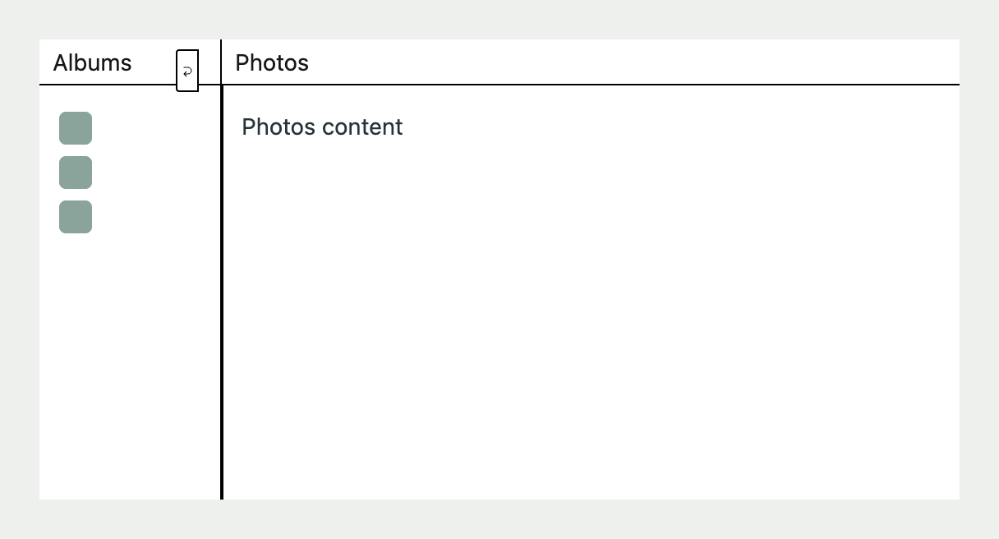
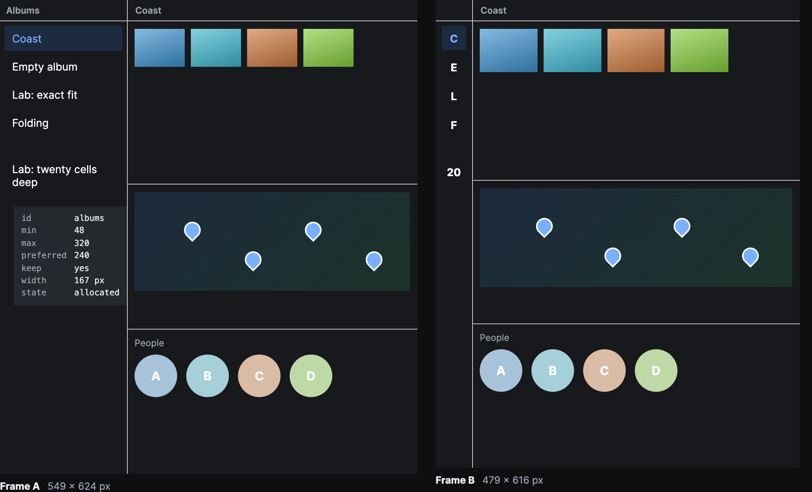
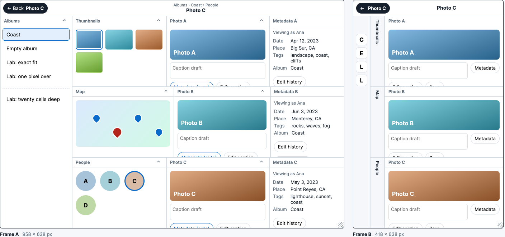

# Supermax

Framework-free cell layout and navigation primitives for workspaces that open content below and to the right.

## Install

The package is not on the npm registry. Install it from GitHub and pin a commit of `master`, for example the 2.0.0 merge:

```bash
corepack pnpm add github:laicluse/supermax#beaf89b
```

Any package manager that installs from a git reference works the same way.

## Upgrading from v1

Read [Migrating from v1 to v2](docs/migrating-to-v2.md) before accepting a major dependency update. It covers retained primitives, removed contracts, changed behavior, the optional Workspace adoption, and verification. The [changelog](CHANGELOG.md) identifies the upgrade entry point. Upgrading the package does not require replacing an existing allocator or strip with a Workspace.

## For coding agents

Start with the README and migration guide shipped in the target package, inventory the application's existing uses, and follow the lane that matches them. These documents work without an agent plugin. This repository also offers the optional `supermax` plugin for Claude Code and Codex, with the interaction contract and guidance on which feature fits which need:

```bash
claude plugins marketplace add laicluse/supermax
claude plugins install supermax@supermax
codex plugin marketplace add laicluse/supermax
codex plugin add supermax@supermax
```

The optional skill points at this README and the [application-shell guide](docs/application-shell.md) for the signatures; the installed package remains the version-specific reference.

The package has four parts. `CellCollection` allocates one horizontal chain of cells within a budget. `CellStrip` animates such a chain. `Navigator` models a workspace whose cells can split into independent rows, with one Show control that brings back whatever hid above the window; `validateSplit` checks a split against the declared minimum height. `Workspace` renders a navigator into the DOM with the stylesheet `@laicluse/supermax/workspace.css`; `VEIL_PRESENTATION` is its default motion and `ORIGAMI_PRESENTATION` is available for folding transitions. Hosts own their content, their data and their routing; one host store above the `content` callbacks can serve every cell. A GitHub Pages demo lives in `docs/` outside the package files.

## A single row

```js
import { Navigator, Workspace } from "@laicluse/supermax";
import "@laicluse/supermax/workspace.css";

const model = new Navigator({
  root: "inbox",
  minViewportHeight: 360,
  destinations: {
    inbox: { title: "Inbox", min: 240, max: 360, data: { kind: "list" } },
    "message:1": { title: "Weekly report", min: 320, max: "*", preferred: 420, defaultChild: "attachments:1", data: { kind: "message" } },
    "attachments:1": { title: "Attachments", min: 200, max: 320, data: { kind: "attachments" } },
  },
});

const workspace = new Workspace(document.querySelector("#workspace"), {
  navigator: model,
  content: (occurrence, definition, workspace) => ({ element: renderFor(definition.data, occurrence, workspace) }),
});

workspace.navigate("message:1", { from: "inbox" });
```

One row is a chain: the inbox stays on the left, the message opens beside it, and its attachments open automatically when the row has room. When the row runs out of room the inbox leaves the window on the left, and Show brings it back by closing cells at the trailing end until it fits. One declaration changes that: `overflow: { mode: "keep" }` holds a cell in view at its declared minimum, so give it a minimum at which its own content remains usable, or a smaller form with [`variants`](#responsive-variants). Below a kept cell nothing can leave on the left, so a cell that gives way there folds: it shows none of its content and leaves only a handle over the gutter. Clicking the handle unfolds the cell the way Show would, taking its room from the trailing end of the row, where cells close until it fits. Dragging the handle follows the pointer; releasing beyond 61.8% of the unfolding distance opens the fold, while a shorter drag returns to the starting state with nothing closed. Touch handles have a centered hit area of at least 44 × 44 CSS pixels. Rows do the same vertically, except that the rows after an opened row fold, as a split's rows never close. Adjacent folds share one handle, which opens the nearest of them and every fold behind it that the freed room holds; the next one back that found no room then takes the handle. An open cell or row after the active surface always remains reachable: it is full, has a fold handle, or extends the scrollable workspace. Show reaches earlier surfaces that left the window. The divider between full cells lets the user resize for the session.

[Folding](docs/folding.md) names the states and shows the horizontal and vertical layout at different viewport sizes. Choose **Folding: cells and rows** in the [interactive demo](docs/index.html) to open folds in both directions and compare the Motion styles.

Opening a row leaves the widths of the chain around its split as they were; width-only changes keep a surviving card's stationary leading edge anchored.

## Allocating one chain

```js
import { CellCollection } from "@laicluse/supermax";

const cells = new CellCollection([
  { id: "world", title: "Board", min: 8, max: 64, zoomable: true },
  { id: "idea", title: "Idea", min: 8, max: 64 },
]);

const layout = cells.distribute(16);
```

`distribute(budget, anchorId)` resets every cell to its minimum, hides cells from the left until the rest fits at its minimums and then on until the rest fits at what each cell asks for (its `preferred`, or its minimum without one, or `ask` when the caller supplies the sum a split's widest row asks); when the cells that cannot hide ask more than there is, that second pass is undone and only the minimums decide. Pass `"min"` as the third constructor argument to stop at the minimums, as split rows do. The remaining budget goes out along a curve, from every minimum up to each maximum: a preference decides which cells show, never where they stand. The curve maps a position along the chain, 0 to 1, to the share of the room given out up to there, and a cell's share is the curve's rise over its own stretch of the chain laid out at its minimums, so both its width and its place count. The default `DEFAULT_CURVE` is `linearCurve(1)`, whose first pixel gets nothing and whose last pixel gets twice an even share, so of three equal cells the last takes five ninths of the room; `linearCurve(steepness)` takes -1 to 1, 0 sharing by width alone and a negative value favouring the start. Pass another curve as the second constructor argument. A cell that would pass its maximum stops there and the others take what it left. When every visible cell reaches its `max` and budget remains, the newest visible cell marked `elastic: true` takes the rest; without one the rest stays unallocated. The unit is whatever the caller measures in: columns or pixels. The last cell survives a shortage. `anchorId` names a `zoomable` cell that hides everything to its left. The module has no global side effects.

## Navigating branching rows

```js
import { Navigator, Workspace } from "@laicluse/supermax";
import "@laicluse/supermax/workspace.css";

const model = new Navigator({
  root: "albums",
  minViewportHeight: 360,
  destinations: {
    albums: { title: "Albums", min: 200, max: 320, data: { kind: "albums" } },
    "album:coast": {
      title: "Coast", min: 320, max: "*", preferred: 1600,
      rows: [
        { destination: "thumbnails", minHeight: 180, maxHeight: "*", preferredHeight: 240 },
        { destination: "map", minHeight: 180, maxHeight: 520 },
      ],
    },
    thumbnails: { title: "Thumbnails", min: 200, max: 360, defaultChild: "photo:a", data: { kind: "selector" } },
    map: { title: "Map", min: 220, max: 480, data: { kind: "selector" } },
    "photo:a": { title: "Photo A", min: 240, max: "*", preferred: 360, defaultChild: "metadata:a", data: { kind: "photo" } },
    "metadata:a": { title: "Metadata A", min: 200, max: 320, data: { kind: "metadata" } },
  },
});

const workspace = new Workspace(element, {
  navigator: model,
  content: (occurrence, definition, workspace) => ({ element: renderFor(definition.data, occurrence, workspace) }),
});

workspace.navigate("album:coast", { from: "albums" });
workspace.requestUp();
```

Every open cell has a route in `navigator.layout().access`: allocated content, a fold handle, Back/Show, or the exit from zoom. The allocator will not return a layout that strands an occurrence. Back preserves content that was hidden before the action instead of closing it as collateral. The [reachability invariant](docs/reachability.md) describes the allocation rules and executable route checks. When zooming out cannot immediately reveal an ancestor, the control uses `strings.zoomOut()` (default `"Zoom out"`) for its accessible name.

A destination is a cell definition: a title, `min` and `max` width in pixels, optionally a `defaultChild` that opens automatically when the row has room, `placement: "beside-split"` for a cell that needs the full height and therefore stands beside the split when a cell in a row opens it, `header: "title"` for the few cells whose content a viewer cannot place without a name, `back: true` for a cell chosen from the cell before it, such as a message from its inbox, so it can step back while that cell stands beside it ([`requestBack`](#workspace-reference)), or `aspectRatio` for content that scales with its width, so the split row holding it asks no more height than that content shows ([Aspect ratio](#aspect-ratio)); every other cell draws no title bar. A cell inside a split row that declares `header: "title"` draws its bar inside the row, below the split's own bar when the split declares one; the row's heights include it. The cell's title remains its accessible name and is available to Show and `locationInfo`. A split is a destination with a title and `rows` and no width of its own: its width follows its widest row, the cells that are open in it, so a row that opens a cell asks the chain for more room. A row is as wide as its split: when the cells of a narrower row reach their maxima before the row's edge, the newest of them takes the rest, unless the user sized it or its split. Each row runs its own horizontal chain starting from the row's destination. `data` is the host's own payload and comes back untouched in the `content` callback. An opened destination is an occurrence whose id is the path of destination ids from the root, so the same photo opened from two rows is two occurrences with their own state.

`minViewportHeight` is the height at which the application guarantees that every declared split can show one row at its minimum. Smaller viewports can still fit through folding; `layout.overflow` reports whether the current layout actually needs more height. The navigator checks every split against the guaranteed height when it is created and throws a `SupermaxConfigurationError` for one that cannot fit; `validateDestinations` runs that check on its own, and a split that arrives later is checked before it opens. The destination set includes an elastic cell: a destination declares `max: "*"` with a `preferred` width, and every split has exactly one row with `maxHeight: "*"` and a `preferredHeight`. An elastic cell or row shares space like the others, with its preference as its max, and takes whatever is left once the others in view have reached their `max`; when several elastic cells are in view, the newest one does. `validateDestinations` and `register()` refuse a configuration without an elastic destination, a split without exactly one elastic row, and an elastic cell or row without its preference. When no elastic cell is in view, `spareSpace` places the canvas that shows: `"start"` (the default), `"center"` or `"end"` align the cells that way. The optional `curve` option replaces `DEFAULT_CURVE` for every chain and split; `setCurve(curve)` changes it later, and the next render uses it. The optional `chrome` option names the sizes that validation counts with: `header` (default 28, the title bar a cell or split declares with `header: "title"`) and `maxRows` per split (default 4). The workspace draws no bar of its own above the cells: the Show control lives in the first cell in view, in the leading part of its title bar, at its top left corner when it has no bar, and the title bar itself is the application's to style. Colours come from `--supermax-default-ink`, `--supermax-default-muted`, `--supermax-default-navigation-divider`, `--supermax-default-surface`, `--supermax-default-muted-surface`, `--supermax-default-canvas` and `--supermax-default-load-error`, each with a fallback. Supermax writes as few words as it can, most of them only in accessible names, and they are English by default. A host that wants them in another language passes `strings` to the workspace with only the entries it replaces, each a function so every language picks its own word order. `DEFAULT_STRINGS` lists every key; an unknown key or a value that is not a function throws, so a typo never falls back to English silently.

After opening a split and before constructing its workspace, `navigator.startRows(splitOccurrence, rowOccurrence)` chooses which row keeps its working height when the viewport is short. Pass the split occurrence id and one of its direct row-root occurrence ids; the other rows stay open and fold when they must yield height. Without this choice, the last row starts the window. The method sets the initial row window without rendering or changing navigation history; subsequent navigation, Show and fold-cue clicks can move it.

```js
new Workspace(element, {
  navigator,
  content,
  strings: {
    up: (title) => `Toon ${title}`,
    loadFailed: (title) => `${title} kon niet laden.`,
  },
});
```

The workspace element needs a height of its own; the workspace fills it, observes its size, computes the layout, and renders cells through the `content` callback. The callback returns `{ element, header?, update?, transition?, leave?, dispose? }`, or a promise of it for content that loads: the workspace mounts the element once, calls `update(occurrence, workspace)` after every render, `leave()` the moment the occurrence closes, while its cell still folds away beside the cell that replaces it, and `dispose()` once it has gone; a modal's content follows the same order, `leave()` when it starts to close and `dispose()` once the dialog has gone. A cell that comes back before it has gone keeps its content, which hears `update` again. `header` is an element with the content's own controls, such as search or zoom: the workspace places it in the trailing part of the cell's title bar, after the title, which is cut short with an ellipsis before the controls are, or in a modal's header before its close control, and removes it with its content; a cell without a title bar keeps such controls in its content. A split that declares `header: "title"` is asked too and returns only `{ header }`, since its rows fill its body: its controls stand in its bar the way a cell's do. A split without a bar is never asked. Hidden content stays mounted, so drafts and scroll positions survive while a cell is out of view.

#### Host rendering

Pass a `renderer` map to replace the appearance of cells, headers, native controls, loading and error states, notices, modals, veil and frustum. Supermax retains structure, layout, navigation, gestures and every transition timeline. Missing overrides use `DEFAULT_RENDERER`; invalid implementations raise `SupermaxRendererError`.

[Host rendering](docs/rendering.md) documents the complete part catalog, action bindings, lifecycle and paint geometry. [Compare two renderers](docs/renderers.html) in the same working shell. The built-in style uses `--supermax-default-*` paint tokens; custom parts choose their own styling and do not depend on internal shell selectors. Title-bar height comes from `navigator.chrome.header`, which Workspace applies to the real title bars.

#### Placement

Omit `placement` to open a cell in its source's chain. `placement: "beside-split"` opens content from a split row beside the entire split, at the split's height. The split and its rows remain open. Navigation ancestry stays with the source: closing or replacing it closes this cell. A split has one such breakout at a time; children of the breakout continue to its right. In the root chain this declaration opens an ordinary full-height cell. Splits and row roots cannot declare this placement.

#### Overflow policy

Cells and split rows declare at most one `overflow` policy, and `{ mode: "keep" }` is the only choice it offers. Kept content stays in view at its minimum in ordinary allocation; if the remaining minima cannot fit, the workspace scrolls. A keep may hold only from a workspace width up: `overflow: { mode: "keep", when: { minWorkspaceWidth: 720 } }` keeps a menu in view on a tablet or desktop and lets it give way like any other cell on a phone, where Show brings it back. The width is that of the workspace element, not of the browser window. A cell never asks more width than the workspace has: on a screen narrower than its `min` it takes the workspace and its content scrolls inside it, so one declaration serves a desktop and a phone. Kept content can leave view with its container or through explicit zoom. What happens to everything else follows from where it stands. Below a kept cell or row, content that gives way folds: it shows nothing and leaves only a recovery handle. Where nothing above it is kept, it leaves the visible window and Show is its recovery route.

A host that draws a fold of its own may give a fold room for that drawing with `{ mode: "fold", size }`; [Drawing your own fold](docs/rendering.md#drawing-your-own-fold) describes it. A split derives its width from its rows and cannot itself fold; it may declare `keep`. The same policy is used by embedded declarations and server layout headers.

#### Responsive variants

Use `variants` when a cell changes its appearance under pressure and its smaller form can give useful space back to its neighbours. Declare the forms in preference order; each has an `id`, optional width overrides, and a `when` admission condition. Use at least two forms, with unique lowercase IDs matching `^[a-z][a-z0-9-]*$`. The last form is an unconditional fallback.

```js
albums: {
  title: "Albums", min: 48, preferred: 240, max: 320, overflow: { mode: "keep" },
  variants: [
    { id: "labels", when: { minWidth: 161 } },
    { id: "icons", min: 48, preferred: 48, max: 160 },
  ],
}
```

The label form uses the ordinary 48/240/320 space request, but is admitted only when its calculated width is at least 161px. Otherwise the icon form takes the 48px it prefers and other cells receive the released width. Its `max` of 160px reaches the label form's threshold: allocation never gives a smaller form with a finite `max` more than it prefers, and the room above that is the user's to drag into with the divider. A smaller form with `max: "*"` stays elastic and takes what is left.



**Between two forms:** the divider left Albums at 110px. It stays in its icon form until the label form fits at 161px. Together the forms must admit every size from the smallest `min` to the largest `max`. A declaration that leaves sizes between two forms that neither admits is refused with `variant-gap`, because a divider dragged through them would make the cell jump. Style the chosen form through `.supermax-cell[data-variant="icons"]`; the allocator owns the choice, including at the exact breakpoint. A cell that folds keeps the `data-variant` it was last shown with, so it never changes form while out of view.

`when` accepts positive finite `minWidth` and/or `minHeight`, both inclusive and both required when present. Conditions refer to the allocated cell rectangle, not the browser viewport. Variants inherit omitted bounds from their owner. Split rows may declare their own `variants`, using `minHeight`, `preferredHeight`, and `maxHeight` overrides; their choice is available as `data-row-variant` on each cell in that row and `variant` on the layout row. Row conditions use the whole allocated row rectangle, including when its first cell is horizontally folded or hidden. A row variant retains the row's elastic status, and its fallback must fit the declared supported height. An admission threshold beyond the form's own finite maximum is invalid. Cell and row forms may trade width against height through their conditions; both axes are checked together. A split itself has no variants: its width derives from its rows.

The same space-saving pattern works vertically, especially on mobile screens with little height: a large context block can become a small summary strip while the work below receives the released height. Declare the forms on the context **row**, not just on its cell; changing a cell's appearance alone does not reduce the row's height request. For example, these rows belong to a split whose `context` and `work` destinations are declared separately:

```js
rows: [
  {
    destination: "context", minHeight: 48, preferredHeight: 240, maxHeight: 320,
    variants: [
      { id: "expanded", when: { minHeight: 180 } },
      { id: "summary", minHeight: 48, preferredHeight: 48, maxHeight: 179 },
    ],
  },
  { destination: "work", minHeight: 160, preferredHeight: 400, maxHeight: "*" },
]
```

Style `.supermax-cell[data-row-variant="summary"]` as a compact strip that preserves the current selection, meaningful status and essential actions. At sufficient allocated height the context shows its expanded form; under height pressure it requests exactly 48px, leaving the elastic work row more room. These numbers illustrate content-derived bounds, not a mobile breakpoint or a required touch-target size. Choose usable bounds from the actual content and controls, and use `overflow: { mode: "keep" }` on the row only when its summary must stay visible. The compact strip is still allocated content; folding is a separate recovery mechanism when the rows cannot fit. Test short as well as narrow viewports, including an on-screen keyboard, with the same open hierarchy. Vertical form changes use the same presentation and shared content-animation hook described below.

Every occurrence selects independently. Supermax evaluates finite variant combinations through the ordinary fold/window allocator, rejects forms whose conditions fail, and picks one canonical result: avoid overflow first, retain full surfaces in reverse hierarchy order next, then prefer earlier forms in depth-first hierarchy order (row-height choices at their split, before visiting its row cells). Folded and hidden content do not have to satisfy a full-content admission condition. `overflow.mode: "keep"`, unfolded cells, Show and session divider sizes retain their existing rules. Released space never triggers another selection pass. With identical declarations, hierarchy, viewport and explicit user state, the result is identical regardless of earlier renders or resize direction. Arbitrary two-axis trade-offs can change which form wins as dimensions change; they cannot alternate at a fixed input.

The layout cell exposes `variant`, `rowVariant`, `width` and `height`. For a content-driven change, compute another finite declaration list and call `workspace.setVariants(destination, variants, { row = null, animate = true })`; name a split row's destination in `row`, or pass `null` as the variants list to remove it. `navigator.setVariants(destination, variants, { row = null })` changes the declaration without rendering. Invalid updates leave it intact. Compute declarations from explicit content inputs, such as item count or text measurements at a known font, rather than from the currently allocated rectangle. Selection conditions are data, never callbacks.

Supermax never measures content, so a height or width that should follow the content is the host's to compute. Take a context row that gains a warning line: its full form needs more height. Derive that height from the content inputs (the number of lines times the line height at a known font, plus the fixed parts) and declare it as the full form's bounds and admission condition, with the compact form as the fallback. When the warning appears or goes, call `setVariants` with the new list; the allocator then decides deterministically which form fits. Do not copy pixel sizes from a render into fixed forms, and do not declare several forms that differ only in height as steps: one content-derived form and one compact form cover it. A row without a compact form whose height should follow content that does not scale with its width, such as a number of lines, takes the computed height through `setSize(row, height, "height")`, the same session size a divider writes; content that scales with its width declares an [aspect ratio](#aspect-ratio) instead. Changing those bounds themselves has no route without a second form, because `variants` needs at least two.

Rooms place their gutters and clip their projected content within independent paint boundaries while they move; at rest a cell's renderer may paint the gutters around it. The strip arranges those rooms in 2D. During motion, gutter presence follows the neighbours still drawn on screen, and shared geometry stays on the CSS-pixel grid.

Variant geometry uses the selected presentation and the existing interruption and completion rules. Viewport resizing is immediate within a form and animates a form change; divider dragging remains immediate. Content stays at the target width during an animated form change. A subsequent viewport update retargets an unfinished form transition from its drawn state. Reduced motion applies the result directly. Content can join the same animation commit with `transition({ from, to })`, called before old geometry is cancelled. It captures the current drawn content and returns `{ prepare?, animate? }`: `prepare()` applies the persistent final content state (including final CSS values), while `animate({ animate })` registers effects with `animate(element, keyframes)`. Supermax supplies timing and owns those animations together with geometry, including cancellation, retargeting, interactive fold seeking and settling. Capture only in `transition`; apply persistent state in `prepare`, and allocate transient animation resources only inside `animate`. The animation returned by the supplied function exposes `finished`; register cleanup for both resolution and cancellation. Do not start a separate scheduler or wait asynchronously in these hooks.

```js
transition({ to }) {
  const opacity = Number(getComputedStyle(element).opacity);
  return {
    prepare() {
      element.textContent = to.variant === "icons" ? "A" : "Albums";
      element.style.opacity = "1";
    },
    animate({ animate }) {
      animate(element, [{ opacity }, { opacity: 1 }]);
    },
  };
}
```

`from` and `to` contain `{ variant, rowVariant, width, height }`; `from` is the preceding committed target, so capture actual visual values when retargeting an interrupted transition. `prepare` also runs for immediate commits; `animate` runs only for animated full content. A newly mounted cell uses its normal content lifecycle. Without a host animation, Supermax fades in the new content while its backing surface stays opaque and fills the moving room. Divider dragging uses the bounds across all forms, so a fixed-width compact form can be expanded back into a richer form.

See the [allocation guide](docs/application-shell.md#responsive-forms-save-space) and the [album demo](docs/index.html).



[Watch the shared transition at normal speed](docs/assets/captures/responsive-variants.mp4). The [capture measurements](docs/assets/captures/responsive-variants.json) include the actual allocations and displayed frame timing.

#### Aspect ratio

Content that scales with its width, such as a chart or a diagram drawn to fit, needs less height as its cell narrows. Declare `aspectRatio` (width divided by height) on its destination, and the split row that holds it asks no more height than the content shows at the width its cell gets:

```js
rows: [
  { destination: "chart", minHeight: 160, preferredHeight: 300, maxHeight: 420 },
  { destination: "table", minHeight: 200, preferredHeight: 400, maxHeight: "*" },
],
// …
chart: { title: "Chart", min: 380, preferred: 620, max: 1200, header: "title", aspectRatio: 3.4, aspectInset: { width: 16, height: 40 } },
```

For every render the row computes, for each visible and unfolded cell with a ratio, `title bar + aspectInset.height + max(0, width − aspectInset.width) / aspectRatio`, rounded up. The title bar counts when the cell declares `header: "title"`. `aspectInset` holds the parts of the content that do not scale, such as a toolbar above a chart or padding around it; `width` and `height` are each optional and zero or more pixels. The row takes the tallest of these values as its `fitHeight`, which the layout row reports (`null` without a ratio) and which can lie below `minHeight`. Hidden and folded cells and cells without a ratio do not count, so a cell opened beside the chart narrows it and the row gives its height to the row below while the split keeps its width.

The row takes at most `min(maxHeight, max(minHeight, fitHeight))`, and its `preferredHeight` stays within that: the ratio is a second ceiling beside `maxHeight`, and `minHeight` stays the floor. Between `minHeight` and `fitHeight` the content draws smaller, and under `minHeight` the row folds or leaves the window like any row. The divider travels through every form of the row up to the same ceiling; a height dragged above it stays stored and returns when the cell widens again. Height variants choose their form within the ceiling, so an expanded form whose admission threshold lies above it leaves the compact form; derive that threshold from the same inset plus the smallest drawing that is still useful. The released height goes to the elastic row, so an `aspectRatio` on the destination of an elastic row is refused with `aspect-ratio-on-elastic-row`. Outside a split row the ratio has no effect.

When the content changes form, for example a chart with another drawing and a toolbar of its own, call `workspace.setAspectRatio(destination, aspectRatio, { inset, animate = true })` with both new values, or `null` to remove the ratio and its inset; it renders once. `navigator.setAspectRatio(destination, aspectRatio, { inset })` changes the declaration without rendering. A refused update leaves the declaration intact, and a server that declares the destination again afterwards is compared with its own declaration, not with the runtime value. A ratio that is not a positive finite number, a ratio on a split, or an inset without a ratio is refused with `invalid-aspect-ratio`; an inset with other fields or a negative side with `invalid-aspect-inset`. All values are CSS pixels: browser zoom changes the width and height the workspace gets, which the allocator follows, while text-only zoom that makes a toolbar taller does not change a declared inset.

#### Growth on focus

A cell whose content benefits from room, such as a chart or a form, can grow toward its preference while DOM focus is inside it. The destination opts in, and the host decides, usually from a user preference, whether growth is on:

```js
chart: { title: "Chart", min: 380, preferred: 620, max: 1200, aspectRatio: 3.4, growOnFocus: true },
// …
const workspace = new Workspace(element, { navigator, content, growOnFocus: user.growCellsOnFocus });
preferences.addEventListener("change", () => workspace.setGrowOnFocus(user.growCellsOnFocus));
```

While growth is on and focus is inside such a cell, it asks its `preferred`; in a split row its split's width and its row's `preferredHeight` follow, within the row's aspect-ratio ceiling. The cells around it give way for that, as they do for a narrow window: first down to their minima, then the cells before it from the leading end, hiding or folding by their overflow mode, then the cells after it from the trailing end, which fold, and the other rows of its split, which fold. A kept cell or row stays, and a neighbour with [responsive variants](#responsive-variants) keeps the form it shows while it stands. Growth closes nothing: the cell never ends smaller than without growth, no cell appears or unfolds for it, and when focus leaves, the ordinary layout returns with every cell's content intact. Opening a fold that only growth made ends the growth instead of navigating. A divider size on the same axis wins, zoom suspends growth, and focus in a modal or outside the workspace ends it. A width in pixels in place of `true`, such as `growOnFocus: 620`, is the target instead of `preferred`, for a host that holds a preference low on purpose, for example in a compact layout where a higher preference would hide other cells. `growOnFocus` must be a boolean or a width at or above `min` on a cell (`invalid-grow-on-focus`), and a split refuses it as `split-with-width`. It travels with the layout declaration. The [shell guide](docs/application-shell.md#growth-on-focus) describes the behaviour.

## Workspace reference

`new Workspace(element, options)` takes `navigator` and `content` (required), `renderer` (partial map of part factories), `onIntent(action, workspace)`, `presentation` (default `VEIL_PRESENTATION`), `strings`, `overlayRoot` (default `document.body`), `noticePlacement` (`"source"` or `"top"`), `time` (a shared `TimeScale`), and `growOnFocus` (default `false`, see [Growth on focus](#growth-on-focus)). Unknown options are rejected. The [renderer reference](docs/rendering.md) names each factory and its lifecycle; every workspace method below names all its options.

- `navigate(destination, { from, origin })` asks to open `destination` to the right of the occurrence `from`. `origin` is the element the user clicked; the workspace remembers it with the opened cell, and a cell that is replaced later folds towards the side the new click lies on. Pass `origin: null` when no element started the navigation. Without `onIntent` the workspace applies the intent itself and returns the result; with `onIntent` your layer decides and calls `apply` on every workspace that should follow.
- `apply(action, { animate })` applies an action, `{ type: "open", destination, from, origin }` or `{ type: "close" }`, brings what opened into view, renders once (animated unless `animate` is false) and returns the navigator's result.
- `sync(destinations, { animate, origin, ifRoom, zoom })` brings the open chain to `destinations`, the ids from the root to the tip, the occurrence's own path, for a host that knows the whole chain from its URL. After a split the next id names one of its rows and the chain continues inside that row; an id that is not a row refuses the sync as `not-a-row`, and a full-height id after a row cell opens beside the split. A manual cell the path does not name closes: the cell after the tip, and the cell beside a split the path ends at or goes into; the rows of a split the path ends at stay as they are. A path into a row opens the split on the way and steps into the row, in the same sync. It keeps what the open chain shares, replaces or closes the rest, promotes an automatic cell it names (never a row), reports what it opened as `opened` and renders once. `ifRoom` is an ordered chain of optional destinations after the tip: the longest beginning of it that shows without hiding a cell that is in view now opens, as automatic cells that a later sync or click naming them promotes; a later sync that no longer offers them closes them; a resize opens nothing. A resize that makes an automatic cell hide a cell beside it closes that automatic cell again, so optional content is never traded for the work. A nested list in it, such as `ifRoom: [["metadata:1", "messages:1"]]`, opens whole or not at all, for cells that only make sense together; a split in it opens with its rows, and the list may go on into a row the way a sync does, `[["conversation:1", "metadata:1", "messages:1"]]`, so a conversation offers itself with its messages or not at all. The root chain runs past a split to the full-height cell beside it, so a sync whose chain ends at the split closes that cell. `zoom` names the destination in `destinations` that is zoomed after the sync, or `null` to zoom out, so a chain that replaces a zoomed cell opens zoomed in the same render; without it the zoom stays as it is, and a destination that is not zoomable refuses the sync as `not-zoomable`. When any destination, required or optional, is unknown or refused, nothing changes and the result is `{ ok: false, reason, destination }` with a `rejected` event. A sync that changes something closes an open modal.
- `depart(occurrence, { after, origin })` lets `occurrence` and everything opened from it fold away inside their rooms after `after` milliseconds (`TIMING.depart`), while the layout of what replaces them is still loading; the rooms stay. The next render keeps or replaces them in one transition, and the returned handle's `cancel()` folds them back.
- `requestUp()` is the Show control: it navigates toward earlier hidden or folded context. In a chain it closes trailing cells as needed to show the target at working width; in a split it moves the row window upward. Subsequent clicks continue toward earlier context, never toward a fold to the right or below. A cancelable `show` event (`{ shown, closing, retry }`) precedes the action; then it emits `up` (`{ shown, closed }`, with destinations). A host that refuses, for example to ask whether a draft may go, calls `retry()` once the user agrees: it repeats the same request for the same target, which asks through `show` again. A retry whose target came into view meanwhile returns `{ ok: false, reason: "stale" }`, and one after `destroy()` returns `{ ok: false, reason: "destroyed" }`; neither changes anything. A fold handle does the same for the surface it names: it asks through `show`, reports closed cells through `up`, and then emits `unfold` (`{ occurrence, axis, closed }`).
- `requestBack(occurrence)` is the step back of a cell whose destination declares `back: true`: it closes that cell, so the cell it was opened from becomes the tip and takes the room. Only the trailing cell of its chain offers it, the one with nothing open after it, so a chain of open cells shows one arrow; it is offered only while that cell and its parent stand in full view, or while the parent gave way only to [growth on focus](#growth-on-focus), so focusing the step back never takes it away; once the parent hid or folded otherwise, Show or its fold handle is the way back instead, and a cell that holds the Show control shows Show. `back` is `true` or `false`, the default. It uses the Show control's own button in the cell's leading part, so a `header` or `navigation` renderer draws it unchanged: `state.navigationText` is empty, because the parent stands beside it, and the accessible name is `strings.backTo(parentTitle)`. It asks through the same cancelable `show` (`shown` is the parent) and then emits `up`, so a host's draft guard and history cover it without new listeners. A row cannot close on its own, so a row destination that declares `back` is refused as `back-on-row`; a cell that opened by itself steps back the same way, and room alone never opens it again. It returns `{ ok: false, reason: "no-step-back" }` when the step back is not offered.
- `zoom(occurrence, { animate })` zooms a cell whose destination declares `zoomable: true`, hiding the cells before it; `zoom(null)` zooms out, the inverse, back to exactly what was in view before. While a cell is zoomed, the Show control zooms out and names the hidden parent that zooming out brings back; when zooming out brings none back, the control still exits zoom and has the accessible name `strings.zoomOut`. Every change of the zoom emits `zoom` with the zoomed occurrence or `null`, also when a `restore` changes it or the zoom ends because its cell closes.
- `goTo(occurrence)` brings an open occurrence into view.
- `setTitle(occurrence, title)` renames an open cell in its header, accessible name, Back group, `locationInfo` and snapshots.
- `setVariants(destination, variants, { row = null, animate = true })` replaces responsive forms for a destination or named split row and renders once; see Responsive variants above.
- `setAspectRatio(destination, aspectRatio, { inset = null, animate = true })` replaces the [aspect ratio](#aspect-ratio) of a destination and the inset its content does not scale, or removes both with `null`, and renders once.
- `setGrowOnFocus(enabled)` switches [growth on focus](#growth-on-focus) for the whole workspace and renders animated when the cell that has focus changes size.
- `setSize(occurrence, size, axis)` sets a cell's width or a row's height (`axis` `"width"` or `"height"`), `null` back to the preference; it emits `size`. `setSizes(sizes, axis, { animate = false })` takes a `Map` of occurrence to size or `null`, renders once and emits `size` for each; a divider drag sets only the cell before it, or the row above it. Pass `animate: true` to animate the change, as the divider reset control does.
- `openModal(definition, { from })` opens the one modal: `definition` is `{ title, content, min, max, preferred, minHeight, maxHeight, preferredHeight }`, `from` the occurrence it comes from, `from: null` for a modal that belongs to no cell. `closeModal(reason)` closes it; `modal` is the open one.
- `notify({ id, scope, source, sourceTitle, kind, message, action, persistent, busy, duration })` shows a notice, the shell's toast or flash message, and returns its id (`scope` `"cell"` or `"workspace"`; `kind` `"success"`, `"error"` or `"action"`; `action` `{ label, run(workspace, id), progress? }`). Optional `progress` is a fraction from 0 to 1 that fills the action button; omit it or use `null` for an ordinary button. The host supplies progress and the label describing its meaning. Temporary notices last 7 seconds by default; `persistent: true` disables expiry. Success is temporary by default, while error and action notices remain until dismissed. `updateNotice(id, { message?, kind?, action?, busy? })` updates the same notice; an action that returns a Promise shows its busy spinner until it settles. `dismiss(id, state)` and `dismissAll(state)` remove notices, including when the host resolves the underlying condition. The default notice has a 1px canvas-coloured outline and the fold handle’s 2px corner radius.
- `reload(predicate)` runs the `content` callback again for every open cell the predicate accepts, and for the open modal.
- `replay(actions)` rebuilds the workspace from a list of actions, `{ type: "open", destination, from }`, `{ type: "close" }` or `{ type: "sync", destinations, ifRoom, zoom }`, and renders once without motion; `restore(snapshot, { animate })` puts back a `navigator.snapshot()` and returns false when it names destinations that no longer exist. Stale zoom, fold and window selections are discarded before allocation.
- `setPresentation(presentation)` replaces motion and surface; it emits `presentation`.
- `timeScale` and `setTimeScale(value)` read and set the shared `TimeScale`.
- `findCell(occurrence)`, `findChain(root)` and `findRow(root)` read the last computed layout. `layout.chains.get(root).spare` is the width a chain leaves unused, for a host that fills free space with something other than a cell.
- `render({ animate })` renders the current model; hosts rarely need it, and never from a `render` or `zoom` handler.
- `destroy()` removes the shell, its listeners and its properties.

The host element carries its workspace as `element.supermaxWorkspace` until `destroy()`, for tools that drive the page from outside, such as a recorder; application code keeps its own reference.

The workspace emits `rejected` when the model refused an action, `change` after every action, `render` with the computed layout, `focus` after a render that moved the focus, and `show`, `up`, `unfold`, `zoom`, `size`, `content`, `modal`, `notice` and `presentation` for the features of the same names. `workspace.navigator.focus()` answers where the user navigated last: `{ occurrence, destinations, title, menu }`, the root before any navigation; `destinations` is the occurrence's path of destination ids from the root. `open`, `navigate` and `sync` take the focus, also when they find their target already open, and a sync's focus is its tip. Defaults, `ifRoom` cells, folds, zoom and resizes leave it alone. When the focused cell closes, through Back, Show or a replacement, the nearest cell on its path that is still open takes over. Snapshots carry it. The `focus` event carries the same object after the render that moved it, or at once when a sync moves only the focus; read the start with `focus()`, because the first render runs in the constructor. `menu` names the menu item to mark, or `null`. A destination with a menu item declares `menu: true` when the item stays active for everything opened under it, or `menu: "exact"` when it is active only while the focus is on the destination itself, as for an agenda that opens records. Supermax walks `destinations` from the root and names the first one whose rule matches; the host only draws the mark. `workspace.navigator.child(occurrence)` answers what a cell opened, to its right or, for a full-height cell opened from a row, beside the split; `next(occurrence)` what follows a cell in its own chain, beside a split its breakout; `isAuto(occurrence)` whether it opened by itself. A host that leaves out what this contract asks, an `origin` for a replacement or a departure, a `from` for a modal, or renders from a render handler, gets one console warning per kind.

A destination may also declare `overflow: { mode: "keep" }` (the cell stays visible at its declared `min`, so its content must work at that width), and `preferred` (the room at which its content comes into its own; a chain gives way from the left until every cell left can have what it asks, so the preference decides which cells show while the curve decides where they stand; dividers between cells let the user set a size for the session). A cell or row that gives way below a kept one folds and shows none of its content; where nothing above it is kept, it leaves the window instead. Clicking a fold handle opens its cell or row the way Show does: a cell takes its room from the trailing end of its chain, where cells close, and a row makes the rows after it fold. The default handle shows the existing occurrence title in uppercase Tiny5 Regular, horizontally on row gutters and bottom-to-top on cell gutters. A missing or blank title keeps the three diagonal hatch strokes. The handle remains 14px thick with default padding, caps its length at 96px or the available seam length, and truncates with an ellipsis; its tooltip and accessible name keep the full title. `setTitle()` updates the label. Ink and outline use the canvas colour on the host surface. The handle sits entirely on the side toward which the fold unfolds, with its straight side on the gutter and only its two outward corners rounded. The same shape applies at viewport edges; the gutter stays visible. Only the handle opens the fold; the bare gutter is not clickable. `data-direction` identifies the adjacent full surface in all four directions. Hosts replace the cue through `renderer.fold`; the built-in cue uses its own canvas and surface paint tokens. The handle has a 1px canvas-coloured outline. `--supermax-gutter` defaults to 1px and accepts 0px. `--supermax-default-fold-padding` (3px) and `--supermax-default-fold-radius` (2px) set the padded marker shape. A destination id never contains `/`, because an occurrence id is the path of destination ids joined by slashes; `register` refuses one as `invalid-id`, so encode a parameter in it, for example with `encodeURIComponent`. A destination that is not embedded in the page opens once its layout declaration is registered with `navigator.register(set)`; `readLayout(response)` reads one from a `Supermax-Layout` header. A promise from the `content` callback gives a cell that loads, with built-in loading and error states and a Retry control.

The workspace also opens a modal that knows its source cell (`openModal`), shows feedback with a scope (`notify`), reloads content (`reload`), and takes a `presentation` that replaces motion and surface while behaviour and accessibility stay. The navigation contract (the window and Show, groups, auto-opening, validation, deep links, kept cells, sizes, loading, modals, notices, presentation) is written down in the [application-shell guide](docs/application-shell.md).

## Demo

The demo in `docs/` shows two freely resizable frames side by side. Every click reaches both; each frame computes its own layout and auto-opening from its own size, and keeps its own window. Its controls switch network delay, failures and viewer for the loading cells, and the presentation between origami, veil and fold.




Regenerate the captures with `node scripts/capture-demo.mjs`.

## Animated presentation

The Veil motion declares `concealContent: true`; the foreground and renderer cover share its timeline independently of its presentation name.

```js
import { CellStrip } from "@laicluse/supermax";

const strip = new CellStrip(viewport);
await strip.update([
  { id: "board", element: boardElement, width: 320, visible: false },
  { id: "idea", element: ideaElement, width: 320, visible: true },
]);
```

Supply pixel widths from the allocator, using each hidden cell's minimum width rather than zero. The viewport clips one continuous horizontal strip. Ancestors slide left as children open; closing children reverses that movement. Without `motion` a strip moves cells by width and position only, entering cells sliding in from the right; with `motion` (`{ open, close }`, the poses a presentation supplies) it folds cells open and away as the application-shell guide describes, and a pose may carry its own `duration`, `easing` and `delay`. Width changes and strip movement share a 200ms `cubic-bezier(0.25, 0.1, 0.25, 1)` timeline; override `duration` and `easing` in the constructor when needed. With `motion`, the room of a folding cell follows the cell's projection in every frame, so it never overlaps its neighbours, unless the motion says `follow: false`, and then rooms move on their own timeline, whose duration `motion.travel(pixels)` may derive from the largest distance a transition moves; pass `horizon: () => ({ x, y })`, the vanishing point in viewport coordinates, when the rooms should share one.

The first update and reduced-motion updates paint immediately; `update(entries, { arrive: true })` lets a first update fold its cells open, for a chain that appears inside a cell that is opening itself. `update(entries, { interactive: true })` keeps the transition available under reduced motion for direct pointer scrubbing; the caller must pause and drive it, and settle immediately on release. Workspace handles this for fold drags. Later updates never restart what runs: widths and position continue from their drawn value, and each cell keeps its own motion unless its role changes. Call `update(entries, { animate: false })` for an immediate layout, which also ends every running motion. Its returned promise, also available as `strip.finished`, resolves when that update's motion has finished or a later update superseded it.

`update(entries, { participants = [] })` also accepts synchronous content participants `{ prepare, animate? }`. `prepare()` runs after capturing drawn geometry and before applying the target. On an animated commit, `animate(register)` can add effects with `register(element, keyframes)`; the strip supplies its room timing, tracks cancellation and includes them in `finished`. Immediate updates run only `prepare`. Workspace uses this contract for variant changes; a custom presentation strip must honour it as well. Application content uses the higher-level `transition` hook above.

Every duration comes from `TIMING`, and `new CellStrip(viewport, { time })` takes the `TimeScale` that multiplies them; a workspace passes its own. An animated update from rest moves rooms only after `settle` milliseconds (`STRIP_TIMING.settle` by default; `STRIP_TIMING` and `STILL` come from `@laicluse/supermax/cell-strip`), so updates that follow each other closely move each room once, by the net change; a target that moves less than `STILL` pixels is taken without motion. `strip.depart(ids, { after, toward })` folds those cells away inside their rooms after `after` milliseconds while the rooms stay, `strip.stay(ids)` folds them back, and the next `update` keeps or replaces whatever departed.

Keep cell IDs stable when replacing content. Removed cells become inert immediately but remain mounted through their exit, marked with `data-supermax-exiting`; do not remove them before calling `update`. Hidden ancestors likewise become inert immediately and become visually hidden only after their transition. Hidden entries between visible entries occupy zero width in the settled strip; leading hidden ancestors retain their widths for the strip offset. Existing `display: contents` wrappers inside the public `strip.strip` element are preserved. Headers and bodies can share the same cell element to move together. Call `destroy()` when disposing the host; it removes the strip and restores the viewport's previous overflow style.

## Development

Supermax is package-manager agnostic. The package is developed with pnpm as the primary lockfile owner; the model tests also run under Bun, and the browser scenarios use Playwright with Chrome (`pnpm exec playwright install chrome` if Chrome is missing):

```sh
corepack pnpm run serve
corepack pnpm run build:docs
corepack pnpm run check
corepack pnpm run test:browser:fold
corepack pnpm run test:browser:veil
corepack pnpm run bench:transitions -- --runs 5 --trees ../supermax-base,.
```

`bench:transitions` measures how much rendering the demo's transitions cost: it plays back, open, replace and close in a 1440px frame at a 4x CPU throttle, traces each step, and reports the median time the renderer's main thread spends on style, layout, prepaint, paint and layerize, with the frames that took more than 25ms. With `--trees` it measures several checkouts in alternating order, so a change is judged against its base on the same machine at the same moment, and `--content heavy` fills every cell with a long styled list, closer to what a real app paints than the demo's light content.

`serve` builds the docs and serves the demo at `http://127.0.0.1:8260` (`PORT` overrides it) with `Cache-Control: no-store` and every build's modules under a path of their own (`/__build/<revision>/assets/`), so a reload always runs the current build, also in a browser that cached modules from an earlier server; a plain static server lets the browser keep the previous modules. The `test:browser:fold` and `test:browser:veil` lines run the browser suite under those presentations; `check` runs it under the default presentation only.

## Bundled font

Tiny5 Regular is included under the SIL Open Font License 1.1, with its copyright notice and [license text](src/fonts/OFL.txt). Supermax remains MIT-licensed. Only the static Regular weight is shipped, preserving the original character coverage. `python3 scripts/build-fold-font.py` rebuilds it from the pinned source recorded in [the font source register](docs/research/fold-label-fonts/sources.json); FontTools is required only for this build step.
