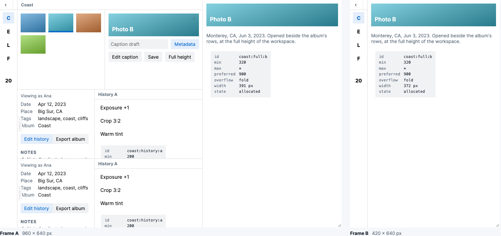
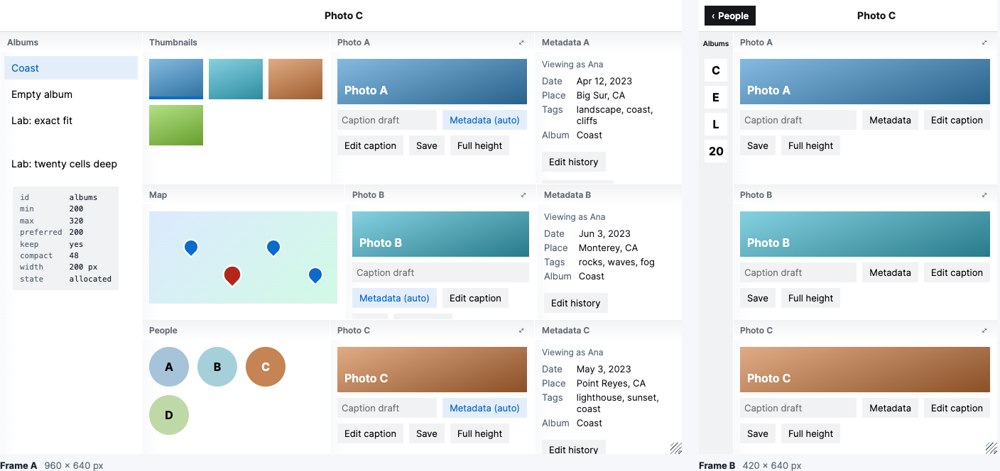

# Supermax

Framework-free cell layout and navigation primitives for workspaces that open content below and to the right.

## Upgrading from v1

Read [Migrating from v1 to v2](docs/migrating-to-v2.md) before accepting a major dependency update. It covers retained primitives, removed contracts, changed behavior, the optional Workspace adoption, and verification. The [changelog](CHANGELOG.md) identifies the upgrade entry point. Upgrading the package does not require replacing an existing allocator or strip with a Workspace.

## For coding agents

Start with the README and migration guide shipped in the target package, inventory the application's existing uses, and follow the lane that matches them. These documents work without an agent plugin. This repository also offers the optional `supermax` plugin for Claude Code and Codex, with the interaction contract and guidance on which feature fits which need:

```bash
claude plugins marketplace add laicluse/supermax
claude plugins install supermax@supermax
codex plugin marketplace add laicluse/supermax
codex plugin add supermax@supermax
```

The optional skill points at this README and the [application-shell guide](docs/application-shell.md) for the signatures; the installed package remains the version-specific reference.

The package has four parts. `CellCollection` allocates one horizontal chain of cells within a budget. `CellStrip` animates such a chain. `Navigator` models a workspace whose cells can split into independent rows, with one Show control that brings back whatever hid above the window; `validateSplit` checks a split against the declared minimum height. `Workspace` renders a navigator into the DOM with the stylesheet `@laicluse/supermax/workspace.css`; `VEIL_PRESENTATION` is its default motion and `ORIGAMI_PRESENTATION` is available for folding transitions. Hosts own their content and their routing. A GitHub Pages demo lives in `docs/` outside the package files.

## A single row

```js
import { Navigator, Workspace } from "@laicluse/supermax";
import "@laicluse/supermax/workspace.css";

const model = new Navigator({
  root: "inbox",
  minViewportHeight: 360,
  destinations: {
    inbox: { title: "Inbox", min: 240, max: 360, data: { kind: "list" } },
    "message:1": { title: "Weekly report", min: 320, max: "*", preferred: 420, defaultChild: "attachments:1", data: { kind: "message" } },
    "attachments:1": { title: "Attachments", min: 200, max: 320, data: { kind: "attachments" } },
  },
});

const workspace = new Workspace(document.querySelector("#workspace"), {
  navigator: model,
  content: (occurrence, definition, workspace) => ({ element: renderFor(definition.data, occurrence, workspace) }),
});

workspace.navigate("message:1", { from: "inbox" });
```

One row is a chain: the inbox stays on the left, the message opens beside it, its attachments open automatically when the row has room, and when the row runs out of room the inbox folds to a handle over the gutter without reserving space; clicking it unfolds the inbox and folds neighbours that need to yield space. Dragging the handle follows the pointer; releasing beyond 61.8% of the unfolding distance completes the trade, while a shorter drag returns to the starting state. Touch handles have a centered hit area of at least 44 × 44 CSS pixels. Rows do the same vertically. Mark a mode switcher `keep: true` with a minimum at which its own content remains usable; it stays visible at that width. Declare `fold: false` on an important ordinary cell or row that must not fold; `fold: { size: 16 }` reserves that much fold space. The divider between full cells lets the user resize for the session.

[Folding](docs/folding.md) names the states and shows the horizontal and vertical layout at different viewport sizes. Choose **Folding: cells and rows** in the [interactive demo](docs/index.html) to trade space in both directions and compare the Motion styles.

## Allocating one chain

```js
import { CellCollection } from "@laicluse/supermax";

const cells = new CellCollection([
  { id: "world", title: "Board", min: 8, max: 64, zoomable: true },
  { id: "idea", title: "Idea", min: 8, max: 64 },
]);

const layout = cells.distribute(16);
```

`distribute(budget, anchorId)` resets every cell to its minimum, hides cells from the left until the chain fits, and shares the remaining budget by `preferred` size when cells declare one, otherwise by `max` weight. When every visible cell reaches its `max` and budget remains, the newest visible cell marked `elastic: true` takes the rest; without one the rest stays unallocated. The unit is whatever the caller measures in: columns or pixels. The last cell survives a shortage. `anchorId` names a `zoomable` cell that hides everything to its left. The module has no global side effects.

## Navigating branching rows

```js
import { Navigator, Workspace } from "@laicluse/supermax";
import "@laicluse/supermax/workspace.css";

const model = new Navigator({
  root: "albums",
  minViewportHeight: 360,
  destinations: {
    albums: { title: "Albums", min: 200, max: 320, data: { kind: "albums" } },
    "album:coast": {
      title: "Coast", min: 320, max: "*", preferred: 1600,
      rows: [
        { destination: "thumbnails", minHeight: 180, maxHeight: "*", preferredHeight: 240 },
        { destination: "map", minHeight: 180, maxHeight: 520 },
      ],
    },
    thumbnails: { title: "Thumbnails", min: 200, max: 360, defaultChild: "photo:a", data: { kind: "selector" } },
    map: { title: "Map", min: 220, max: 480, data: { kind: "selector" } },
    "photo:a": { title: "Photo A", min: 240, max: "*", preferred: 360, defaultChild: "metadata:a", data: { kind: "photo" } },
    "metadata:a": { title: "Metadata A", min: 200, max: 320, data: { kind: "metadata" } },
  },
});

const workspace = new Workspace(element, {
  navigator: model,
  content: (occurrence, definition, workspace) => ({ element: renderFor(definition.data, occurrence, workspace) }),
});

workspace.navigate("album:coast", { from: "albums" });
workspace.requestUp();
```

A destination is a cell definition: a title, `min` and `max` width in pixels, optionally a `defaultChild` that opens automatically when the row has room, `height: "full"` for a cell that needs the full height and therefore stands beside the split when a cell in a row opens it, or `header: "title"` for the few cells whose content a viewer cannot place without a name; every other cell draws no title bar. A cell inside a split row never draws its own title bar, even if it declares `header: "title"`; the split owns the bar above its rows. The cell's title remains its accessible name and is available to Show and `locationInfo`. A split is a destination with a title and `rows` and no width of its own: its width follows its widest row, the cells that are open in it, so a row that opens a cell asks the chain for more room. Each row runs its own horizontal chain starting from the row's destination. `data` is the host's own payload and comes back untouched in the `content` callback. An opened destination is an occurrence whose id is the path of destination ids from the root, so the same photo opened from two rows is two occurrences with their own state.

`minViewportHeight` is the smallest window height the application supports. The navigator checks every split against it when it is created and throws a `SupermaxConfigurationError` for one that cannot fit; `validateDestinations` runs that check on its own, and a split that arrives later is checked before it opens. Every layout has an elastic cell: a destination declares `max: "*"` with a `preferred` width, and every split has exactly one row with `maxHeight: "*"` and a `preferredHeight`. An elastic cell or row shares space like the others, with its preference as its max, and takes whatever is left once the others in view have reached their `max`; when several elastic cells are in view, the newest one does. `validateDestinations` and `register()` refuse a configuration without an elastic destination, a split without exactly one elastic row, and an elastic cell or row without its preference. When no elastic cell is in view, `spareSpace` places the canvas that shows: `"start"` (the default), `"center"` or `"end"` align the cells that way. The optional `chrome` option names the sizes that validation counts with: `header` (default 28, the title bar a cell or split declares with `header: "title"`) and `maxRows` per split (default 4). The workspace draws no bar of its own above the cells: the Show control lives in the first cell in view, in the leading part of its title bar, at its top left corner when it has no bar, and the title bar itself is the application's to style. Colours come from `--supermax-ink`, `--supermax-muted`, `--supermax-line`, `--supermax-surface`, `--supermax-muted-surface`, `--supermax-canvas`, `--supermax-accent` and `--supermax-warn`, each with a fallback. Supermax writes as few words as it can, most of them only in accessible names, and they are English by default. A host that wants them in another language passes `strings` to the workspace with only the entries it replaces, each a function so every language picks its own word order. `DEFAULT_STRINGS` lists every key; an unknown key or a value that is not a function throws, so a typo never falls back to English silently.

```js
new Workspace(element, {
  navigator,
  content,
  strings: {
    up: (title) => `Toon ${title}`,
    loadFailed: (title) => `${title} kon niet laden.`,
  },
});
```

The workspace element needs a height of its own; the workspace fills it, observes its size, computes the layout, and renders cells through the `content` callback. The callback returns `{ element, header?, update?, leave?, dispose? }`, or a promise of it for content that loads: the workspace mounts the element once, calls `update(occurrence, workspace)` after every render, `leave()` the moment the occurrence closes, while its cell still folds away beside the cell that replaces it, and `dispose()` once it has gone; a modal's content follows the same order, `leave()` when it starts to close and `dispose()` once the dialog has gone. A cell that comes back before it has gone keeps its content, which hears `update` again. `header` is an element with the content's own controls, such as search or zoom: the workspace places it in the trailing part of the cell's title bar, after the title, which is cut short with an ellipsis before the controls are, or in a modal's header before its close control, and removes it with its content; a cell without a title bar keeps such controls in its content. Hidden content stays mounted, so drafts and scroll positions survive while a cell is out of view.

### Workspace reference

`new Workspace(element, options)` takes `navigator` and `content` (required), `onIntent(action, workspace)`, `presentation` (default `VEIL_PRESENTATION`), `strings`, `origin` (the function that draws links, default `frustumOrigin`, `null` for none), `overlayRoot` (default `document.body`), `noticePlacement` (`"source"` or `"top"`), `noticeIcon`, `time` (a `TimeScale`, shared to slow several workspaces together), `foldContent(occurrence, axis, workspace)` (the element shown inside a folded seam; `axis` is `"horizontal"` or `"vertical"`). Every method below names all its options.

- `navigate(destination, { from, origin })` asks to open `destination` to the right of the occurrence `from`. `origin` is the element the user clicked; the workspace remembers it with the opened cell, and a cell that is replaced later folds towards the side the new click lies on. Pass `origin: null` when no element started the navigation. Without `onIntent` the workspace applies the intent itself and returns the result; with `onIntent` your layer decides and calls `apply` on every workspace that should follow.
- `apply(action, { animate })` applies an action, `{ type: "open", destination, from, origin }` or `{ type: "close" }`, brings what opened into view, renders once (animated unless `animate` is false) and returns the navigator's result.
- `sync(destinations, { animate, origin, ifRoom, zoom })` brings the open chain to `destinations`, the ids from the root to the tip, the occurrence's own path, for a host that knows the whole chain from its URL. After a split the next id names one of its rows and the chain continues inside that row; an id that is not a row refuses the sync as `not-a-row`, and a full-height id after a row cell opens beside the split. A manual cell the path does not name closes: the cell after the tip, and the cell beside a split the path ends at or goes into; the rows of a split the path ends at stay as they are. A path into a row opens the split on the way and steps into the row, in the same sync. It keeps what the open chain shares, replaces or closes the rest, promotes an automatic cell it names (never a row), reports what it opened as `opened` and renders once. `ifRoom` is an ordered chain of optional destinations after the tip: the longest beginning of it that shows without hiding a cell that is in view now opens, as automatic cells that a later sync or click naming them promotes; a later sync that no longer offers them closes them; a resize opens nothing. A nested list in it, such as `ifRoom: [["metadata:1", "messages:1"]]`, opens whole or not at all, for cells that only make sense together; a split in it opens with its rows, and the list may go on into a row the way a sync does, `[["conversation:1", "metadata:1", "messages:1"]]`, so a conversation offers itself with its messages or not at all. The root chain runs past a split to the full-height cell beside it, so a sync whose chain ends at the split closes that cell. `zoom` names the destination in `destinations` that is zoomed after the sync, or `null` to zoom out, so a chain that replaces a zoomed cell opens zoomed in the same render; without it the zoom stays as it is, and a destination that is not zoomable refuses the sync as `not-zoomable`. When any destination, required or optional, is unknown or refused, nothing changes and the result is `{ ok: false, reason, destination }` with a `rejected` event. A sync that changes something closes an open modal.
- `depart(occurrence, { after, origin })` lets `occurrence` and everything opened from it fold away inside their rooms after `after` milliseconds (`TIMING.depart`), while the layout of what replaces them is still loading; the rooms stay. The next render keeps or replaces them in one transition, and the returned handle's `cancel()` folds them back.
- `requestUp()` is the Show control: it navigates toward earlier hidden or folded context. In a chain it closes trailing cells as needed to show the target at working width; in a split it moves the row window upward. Subsequent clicks continue toward earlier context, never toward a fold to the right or below. A cancelable `show` event (`{ shown, closing }`) precedes the action; then it emits `up` (`{ shown, closed }`, with destinations). A fold-cue click instead exchanges space without closing content.
- `zoom(occurrence, { animate })` zooms a cell whose destination declares `zoomable: true`, hiding the cells before it; `zoom(null)` zooms out, the inverse, back to exactly what was in view before. While a cell is zoomed, the Show control zooms out and names the hidden parent that zooming out brings back; when zooming out brings none back, it is absent and the content's own zoom toggle zooms out. Every change of the zoom emits `zoom` with the zoomed occurrence or `null`, also when a `restore` changes it or the zoom ends because its cell closes.
- `goTo(occurrence)` brings an open occurrence into view.
- `setTitle(occurrence, title)` renames an open cell in its header, accessible name, Back group, `locationInfo` and snapshots.
- `setSize(occurrence, size, axis)` sets a cell's width or a row's height (`axis` `"width"` or `"height"`), `null` back to the preference; it emits `size`. `setSizes(sizes, axis, { animate = false })` takes a `Map` of occurrence to size or `null`, renders once and emits `size` for each; a divider drag uses it for every cell it moves. Pass `animate: true` to animate the change, as the divider reset control does.
- `openModal(definition, { from })` opens the one modal: `definition` is `{ title, content, min, max, preferred, minHeight, maxHeight, preferredHeight }`, `from` the occurrence it comes from, `from: null` for a modal that belongs to no cell. `closeModal(reason)` closes it; `modal` is the open one.
- `notify({ id, scope, source, sourceTitle, kind, message, action, duration })` shows a notice (`scope` `"cell"` or `"workspace"`, `kind` `"success"`, `"error"` or `"action"`, `action` `{ label, run(workspace) }`, `duration` in milliseconds, default `TIMING.noticeLife` for success) and returns its id; `dismiss(id, state)` and `dismissAll(state)` remove notices.
- `reload(predicate)` runs the `content` callback again for every open cell the predicate accepts, and for the open modal.
- `replay(actions)` rebuilds the workspace from a list of actions, `{ type: "open", destination, from }`, `{ type: "close" }` or `{ type: "sync", destinations, ifRoom, zoom }`, and renders once without motion; `restore(snapshot, { animate })` puts back a `navigator.snapshot()` and returns false when it names destinations that no longer exist.
- `setPresentation(presentation)` replaces motion and surface; it emits `presentation`.
- `timeScale` and `setTimeScale(value)` read and set the shared `TimeScale`.
- `findCell(occurrence)`, `findChain(root)` and `findRow(root)` read the last computed layout. `layout.chains.get(root).spare` is the width a chain leaves unused, for a host that fills free space with something other than a cell.
- `render({ animate })` renders the current model; hosts rarely need it, and never from a `render` or `zoom` handler.
- `destroy()` removes the shell, its listeners and its properties.

The workspace emits `rejected` when the model refused an action, `change` after every action, `render` with the computed layout, and `show`, `up`, `zoom`, `size`, `content`, `modal`, `notice` and `presentation` for the features of the same names. `workspace.navigator.child(occurrence)` answers what a cell opened, to its right or, for a full-height cell opened from a row, beside the split; `next(occurrence)` what follows a cell in its own chain, beside a split its breakout; `isAuto(occurrence)` whether it opened by itself. A host that leaves out what this contract asks, an `origin` for a replacement or a departure, a `from` for a modal, or renders from a render handler, gets one console warning per kind.

A destination may also declare `keep: true` (the cell stays visible at its declared `min`, so its content must work at that width), `fold: false` (never turn this cell into a fold cue), `fold: { size }` (optionally reserve fold space; default 0px), and `preferred` (its share when the chain has room beyond every minimum; dividers between cells let the user override it for the session). Ordinary cells and split rows are foldable by default; a row may also declare `fold: false` or `fold: { size }`. Clicking a folded seam focuses its cell or row; neighbours fold as needed, and clicking another seam trades the space back without closing either destination. The default cue places three diagonal hatch strokes on the adjacent cell gutter. The hatching always uses the canvas colour on a padded host-background rectangle. The handle sits entirely on the side toward which the fold unfolds, with its straight side on the gutter and only its two outward corners rounded. The same shape applies at viewport edges; the gutter stays visible. Only the hatch handle opens the fold; the bare gutter is not clickable. Its layout reservation defaults to 0px; `data-direction` identifies the adjacent full surface in all four directions. Hosts can replace the cue through `foldContent`; the default cue follows `--supermax-canvas` and `--supermax-surface` directly. The handle has a 1px canvas-coloured outline. `--supermax-gutter` defaults to 1px and accepts 0px independently of fold reservation. `--supermax-fold-padding` (3px) and `--supermax-fold-radius` (2px) set the padded marker shape. A destination id never contains `/`, because an occurrence id is the path of destination ids joined by slashes; `register` refuses one as `invalid-id`, so encode a parameter in it, for example with `encodeURIComponent`. A destination that is not embedded in the page opens once its layout declaration is registered with `navigator.register(set)`; `readLayout(response)` reads one from a `Supermax-Layout` header. A promise from the `content` callback gives a cell that loads, with built-in loading and error states and a Retry control.

The workspace also opens a modal that knows its source cell (`openModal`), shows feedback with a scope (`notify`), reloads content (`reload`), and takes a `presentation` that replaces motion and surface while behaviour and accessibility stay. The navigation contract (the window and Show, groups, auto-opening, validation, deep links, kept cells, sizes, loading, modals, notices, presentation) is written down in the [application-shell guide](docs/application-shell.md).

## Demo

The demo in `docs/` shows two freely resizable frames side by side. Every click reaches both; each frame computes its own layout and auto-opening from its own size, and keeps its own window. Its controls switch network delay, failures and viewer for the loading cells, and the presentation between origami, veil and fold.






Regenerate the captures with `node scripts/capture-demo.mjs`.

## Animated presentation

```js
import { CellStrip } from "@laicluse/supermax";

const strip = new CellStrip(viewport);
await strip.update([
  { id: "board", element: boardElement, width: 320, visible: false },
  { id: "idea", element: ideaElement, width: 320, visible: true },
]);
```

Supply pixel widths from the allocator, using each hidden cell's minimum width rather than zero. The viewport clips one continuous horizontal strip. Ancestors slide left as children open; closing children reverses that movement. Without `motion` a strip moves cells by width and position only, entering cells sliding in from the right; with `motion` (`{ open, close }`, the poses a presentation supplies) it folds cells open and away as the application-shell guide describes, and a pose may carry its own `duration`, `easing` and `delay`. Width changes and strip movement share a 200ms `cubic-bezier(0.25, 0.1, 0.25, 1)` timeline; override `duration` and `easing` in the constructor when needed. With `motion`, the room of a folding cell follows the cell's projection in every frame, so it never overlaps its neighbours, unless the motion says `follow: false`, and then rooms move on their own timeline, whose duration `motion.travel(pixels)` may derive from the largest distance a transition moves; pass `horizon: () => ({ x, y })`, the vanishing point in viewport coordinates, when the rooms should share one.

The first update and reduced-motion updates paint immediately; `update(entries, { arrive: true })` lets a first update fold its cells open, for a chain that appears inside a cell that is opening itself. `update(entries, { interactive: true })` keeps the transition available under reduced motion for direct pointer scrubbing; the caller must pause and drive it, and settle immediately on release. Workspace handles this for fold drags. Later updates never restart what runs: widths and position continue from their drawn value, and each cell keeps its own motion unless its role changes. Call `update(entries, { animate: false })` for an immediate layout, which also ends every running motion. Its returned promise, also available as `strip.finished`, resolves when that update's motion has finished or a later update superseded it.

Every duration comes from `TIMING`, and `new CellStrip(viewport, { time })` takes the `TimeScale` that multiplies them; a workspace passes its own. An animated update from rest moves rooms only after `settle` milliseconds (`STRIP_TIMING.settle` by default), so updates that follow each other closely move each room once, by the net change; a target that moves less than `STILL` pixels is taken without motion. `strip.depart(ids, { after, toward })` folds those cells away inside their rooms after `after` milliseconds while the rooms stay, `strip.stay(ids)` folds them back, and the next `update` keeps or replaces whatever departed.

Keep cell IDs stable when replacing content. Removed cells become inert immediately but remain mounted through their exit, marked with `data-supermax-exiting`; do not remove them before calling `update`. Hidden ancestors likewise become inert immediately and become visually hidden only after their transition. Hidden entries between visible entries occupy zero width in the settled strip; leading hidden ancestors retain their widths for the strip offset. Existing `display: contents` wrappers inside the public `strip.strip` element are preserved. Headers and bodies can share the same cell element to move together. Call `destroy()` when disposing the host; it removes the strip and restores the viewport's previous overflow style.

## Development

Supermax is package-manager agnostic. The package is developed with pnpm as the primary lockfile owner; the model tests also run under Bun, and the browser scenarios use Playwright with Chrome (`pnpm exec playwright install chrome` if Chrome is missing):

```sh
corepack pnpm run serve
corepack pnpm run build:docs
corepack pnpm run check
corepack pnpm run test:browser:fold
corepack pnpm run test:browser:veil
corepack pnpm run bench:transitions -- --runs 5 --trees ../supermax-base,.
```

`bench:transitions` measures how much rendering the demo's transitions cost: it plays back, open, replace and close in a 1440px frame at a 4x CPU throttle, traces each step, and reports the median time the renderer's main thread spends on style, layout, prepaint, paint and layerize, with the frames that took more than 25ms. With `--trees` it measures several checkouts in alternating order, so a change is judged against its base on the same machine at the same moment, and `--content heavy` fills every cell with a long styled list, closer to what a real app paints than the demo's light content.

`serve` builds the docs and serves the demo at `http://127.0.0.1:8260` (`PORT` overrides it) with `Cache-Control: no-store` and every build's modules under a path of their own (`/__build/<revision>/assets/`), so a reload always runs the current build, also in a browser that cached modules from an earlier server; a plain static server lets the browser keep the previous modules. The `test:browser:fold` and `test:browser:veil` lines run the browser suite under those presentations; `check` runs it under the default presentation only.
