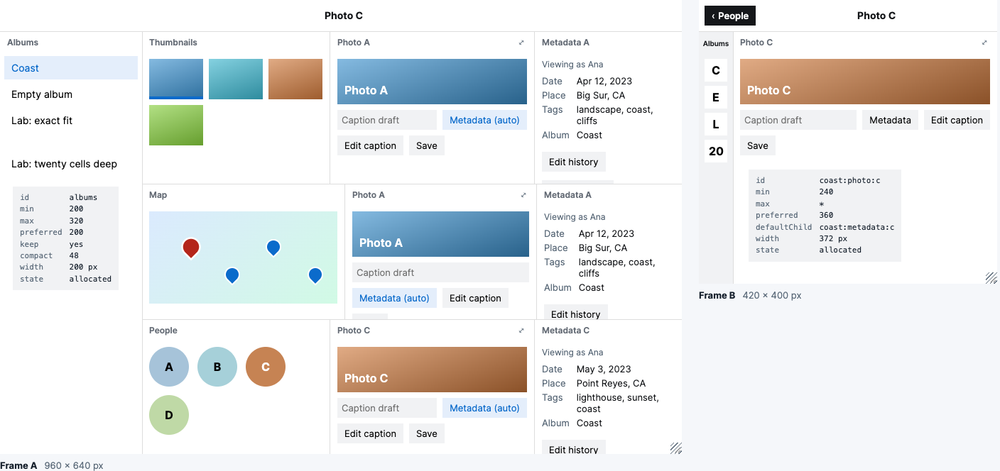

# Supermax

Framework-free cell layout and navigation primitives for workspaces that open content below and to the right.

The package has four parts. `CellCollection` allocates one horizontal chain of cells within a budget. `CellStrip` animates such a chain. `Navigator` models a workspace whose cells can split into independent rows, with one Back history across all rows; `validateSplit` checks a split against the declared minimum height. `Workspace` renders a navigator into the DOM with the stylesheet `@laicluse/supermax/workspace.css`. Hosts own their content and their routing. A GitHub Pages demo lives in `docs/` outside the package files.

## Allocating one chain

```js
import { CellCollection } from "@laicluse/supermax";

const cells = new CellCollection([
  { id: "world", title: "Board", min: 8, max: 64, zoomable: true },
  { id: "idea", title: "Idea", min: 8, max: 64 },
]);

const layout = cells.distribute(16);
```

`distribute(budget, anchorId, { pinnedId })` resets every cell to its minimum, hides cells from the left until the chain fits, and water-fills the remaining budget by `max` weight. The unit is whatever the caller measures in: V1 hosts pass columns, the workspace passes pixels. The last cell survives a shortage; `pinnedId` protects a different cell instead, which is how the vertical row allocation keeps the focused row open. `anchorId` names a `zoomable` cell that hides everything to its left, the V1 zoom anchor. The package also assigns `globalThis.Supermax` for hosts that bundle the module into a browser artifact and still need a global compatibility surface.

## Navigating branching rows

```js
import { Navigator, Workspace } from "@laicluse/supermax";
import "@laicluse/supermax/workspace.css";

const model = new Navigator({
  root: "albums",
  minViewportHeight: 360,
  destinations: {
    albums: { title: "Albums", min: 200, max: 320, data: { kind: "albums" } },
    "album:coast": {
      title: "Coast", min: 320, max: 1600,
      rows: [
        { destination: "thumbnails", minHeight: 180, maxHeight: 520 },
        { destination: "map", minHeight: 180, maxHeight: 520 },
      ],
    },
    thumbnails: { title: "Thumbnails", min: 200, max: 360, defaultChild: "photo:a", data: { kind: "selector" } },
    map: { title: "Map", min: 220, max: 480, data: { kind: "selector" } },
    "photo:a": { title: "Photo A", min: 240, max: 520, defaultChild: "metadata:a", data: { kind: "photo" } },
    "metadata:a": { title: "Metadata A", min: 200, max: 320, data: { kind: "metadata" } },
  },
});

const workspace = new Workspace(element, {
  navigator: model,
  content: (occurrence, definition, workspace) => ({ element: renderFor(definition.data, occurrence, workspace) }),
});

workspace.navigate("album:coast", { from: "albums" });
workspace.requestBack();
```

A destination is a cell definition: a title, `min` and `max` width in pixels, optionally a `defaultChild` that opens automatically when the row has room, or `rows` that split the cell into vertically stacked rows. Each row runs its own horizontal chain starting from the row's destination. `data` is the host's own payload and comes back untouched in the `content` callback. An opened destination is an occurrence whose id is the path of destination ids from the root, so the same photo opened from two rows is two occurrences with their own state.

`minViewportHeight` is the smallest window height the application supports; every split is validated against it before it opens. The optional `chrome` option names the sizes that validation counts with: `navbar` (default 44), `rowTab` (the collapsed row, default 32) and `maxRows` per split (default 4). The workspace writes `navbar` and `rowTab` onto its element as `--supermax-navbar` and `--supermax-row-tab`, so the stylesheet draws what the model computed. Colours come from `--supermax-ink`, `--supermax-muted`, `--supermax-line`, `--supermax-surface`, `--supermax-muted-surface`, `--supermax-canvas`, `--supermax-accent` and `--supermax-warn`, each with a fallback. The navigation bar's own strings (Back, its accessible labels, the reveal and row tab labels) are English in this version.

The workspace element needs a height of its own; the workspace fills it, observes its size, computes the layout, and renders cells through the `content` callback. The callback returns `{ element, update?, dispose? }`: the workspace mounts the element once, calls `update(occurrence, workspace)` after every render, and `dispose()` when the occurrence closes. `workspace.navigator.child(occurrence)` answers what is open to the right of a cell, `isAuto(occurrence)` whether it opened by itself. Hidden content stays mounted, so drafts and scroll positions survive a collapse.

`navigate(destination, { from })` and `requestBack()` are intents. Without `onIntent` the workspace applies them itself, moves keyboard focus to the opened content or to the selector a Back returned to, and returns the result. With `onIntent(action, workspace)` your layer decides what happens: call `apply(action, { focus })` on every workspace that should follow, with `focus: true` on the one that received the click. That is how the demo drives two workspaces from one click. `replay(actions)` rebuilds a workspace from a list of actions and renders once; `restore(snapshot)` puts back a `navigator.snapshot()` and returns false when the snapshot names destinations that no longer exist. The workspace emits `rejected` when the model refused an action, `change` after every action, and `render` with the computed layout.

The navigation contract (groups, Back, auto-opening, validation, deep links) is written down in the [application-shell guide](docs/application-shell.md).

## Demo

The demo in `docs/` shows two freely resizable frames side by side. Every click and Back reaches both; each frame computes its own layout, auto-opening and Back history from its own size.




Regenerate the captures with `node scripts/capture-demo.mjs`.

## Animated presentation

```js
import { CellStrip } from "@laicluse/supermax";

const strip = new CellStrip(viewport);
await strip.update([
  { id: "board", element: boardElement, width: 320, visible: false },
  { id: "idea", element: ideaElement, width: 320, visible: true },
]);
```

Supply pixel widths from the allocator, using each hidden cell's minimum width rather than zero. The viewport clips one continuous horizontal strip. Ancestors slide left as children enter from the right; removing children reverses that movement. Width changes and strip movement share a 200ms `cubic-bezier(0.25, 0.1, 0.25, 1)` timeline. Override `duration` and `easing` in the constructor when needed.

The first update and reduced-motion updates paint immediately. Subsequent updates continue from the current rendered position, including interrupted transitions and viewport resizing. Call `update(entries, { animate: false })` for an immediate layout. Its returned promise, also available as `strip.finished`, resolves when that update finishes or is superseded.

Keep cell IDs stable when replacing content. Removed cells become inert immediately but remain mounted through their exit, marked with `data-supermax-exiting`; do not remove them before calling `update`. Hidden ancestors likewise become inert immediately and become visually hidden only after their transition. Existing `display: contents` wrappers inside the public `strip.strip` element are preserved. Headers and bodies can share the same cell element to move together. Call `destroy()` when disposing the host; it removes the strip and restores the viewport's previous overflow style.

## Development

Supermax is package-manager agnostic. The package is developed with pnpm as the primary lockfile owner; the model tests also run under Bun, and the browser scenarios use Playwright with Chrome (`pnpm exec playwright install chrome` if Chrome is missing):

```sh
corepack pnpm run build:docs
corepack pnpm run check
```
