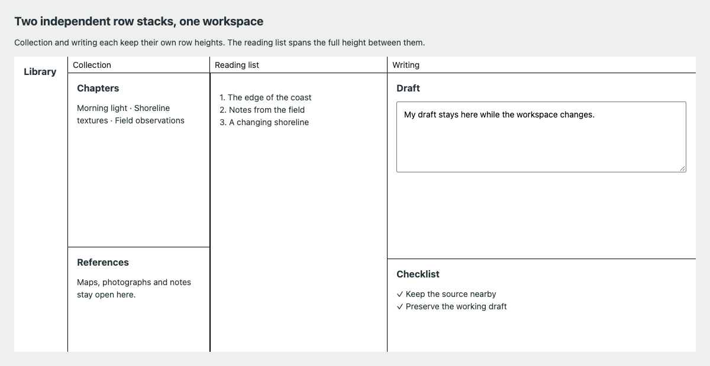
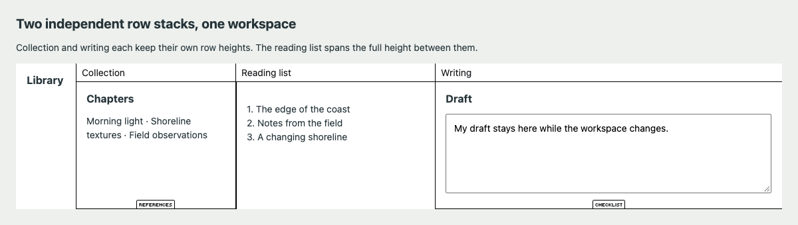
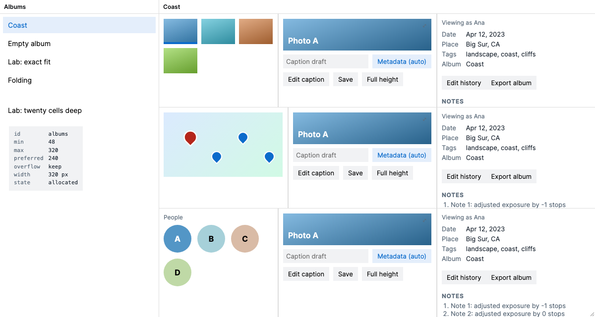
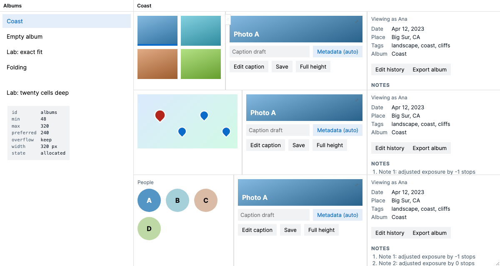
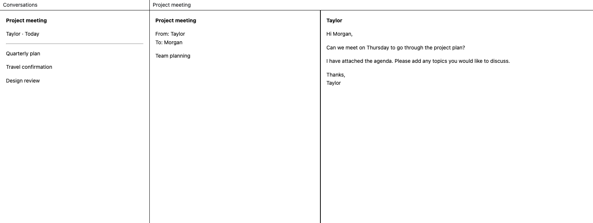
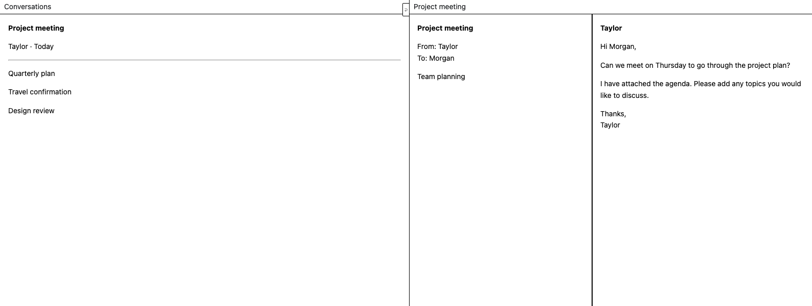
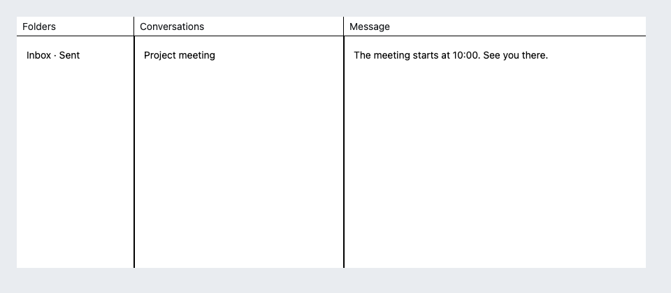
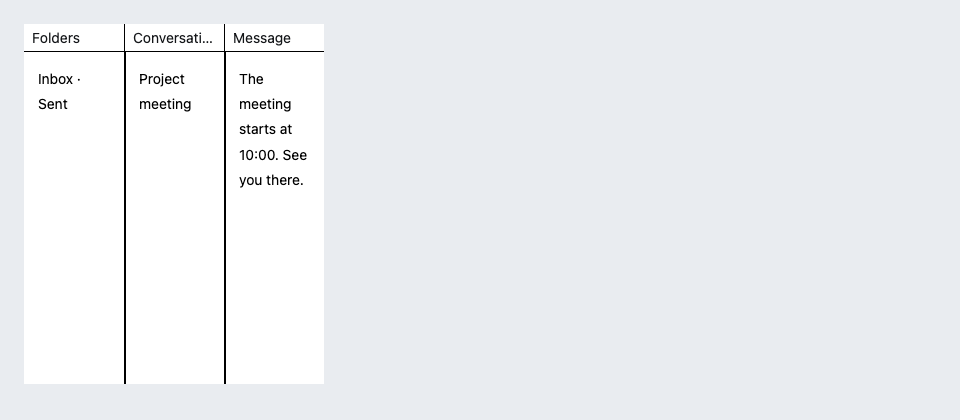

# Supermax application shell

Supermax is an application shell, not merely a responsive column allocator. New content opens below and then to the right, like reading a book: a cell can split into rows, every row runs its own left-to-right chain, and the screen is a window on that reading order that one Show control moves toward its beginning. The allocator decides which cells fit and how wide they become; the navigator decides what is open; the host owns content and should follow this contract so that navigation, controls, and content remain predictable across applications.

## Vocabulary

- **Destination:** a cell definition the host registers: title, `min` and `max` width in pixels, optionally a default child, and host data; a split declares title and rows instead of a width.
- **Occurrence:** one opened destination at one place, identified by the path of destination ids from the root.
- **Chain:** a row of cells from a root cell to the right; the workspace root is a chain and every row is a chain.
- **Split:** a cell whose rows are chains stacked below each other.
- **Breakout:** a full-height cell (`placement: "beside-split"`) opened from a cell in a row; it stands beside the split instead of inside the row.
- **Group:** a manual opening together with every default it brought along, named after its root cell; `navigator.closeNewestGroup()` closes the newest one.
- **Default:** a cell that opened by itself because its parent names it as `defaultChild` and the row had room; a click on it promotes it into a group of its own.
- **Kept cell:** a destination or row the host marks `overflow: { mode: "keep" }`; it stays in view while the cells or rows around it hide, at its declared minimum width; the host adapts its content to that width.
- **Layout declaration:** what a server says about a destination before its content exists: title, bounds, rows and default child, with the whole chain of defaults it brings along.
- **Window:** the part of the reading order that is in view. It ends at the newest content until Show, or a click on content that is already open, moves its start.
- **Notice:** temporary feedback at the top of the viewport, linked to the cell it came from when that cell is in view.
- **Presentation:** the motion and surface treatment of cells, replaceable without changing behaviour.

## Start with the cell path

Write the complete product hierarchy before writing layout code, for example:

```text
workspace -> collection -> item -> task -> subdetail
```

Each level is one cell with one data owner and one responsibility. Opening a child adds information to the right while preserving its ancestors on the left for as long as they fit. A modal, drawer, accordion, or page redirect that holds what reads as a cell is a sign that a true child has not been modeled as a cell; a modal stays right for a short task about one cell, as "A modal with an origin" describes.

A cell whose children are independent of each other splits into rows instead of a chain:

```text
albums -> album
            |- thumbnails -> photo -> metadata
            |- map        -> photo -> metadata
            `- people     -> photo -> metadata
```

Each row keeps its own selection and its own left-to-right chain. The same photo opened from two rows is two occurrences with separate local state. The hierarchy says where a cell belongs; the order of openings says what Back closes.

The ordered list of manual openings is the source of truth for what is open. A deep link replays that list, browser back returns to the previous list, and the viewport decides only how much of it is visible and which defaults opened automatically. The allocator may hide ancestors; it does not close them. Each layout carries an access route for every open occurrence, and the shell renders its fold handles and Back target from that same plan. See the [reachability invariant](reachability.md).

## Cell anatomy

A cell is its body: one scroll owner, with the content at the top. Three regions can join it, in a stable order:

```text
┌ title bar, only when declared: title | cell-scoped controls ┐
│ body: the cell's single scroll owner                        │
├ optional contextual or batch bar                            ┤
└ optional task toolbar                                       ┘
```

- **Title bar:** the exception. A cell has none; its title is its accessible name and the name Show and `locationInfo` use. The workspace draws no bar of its own: the Show control lives in the first cell of the root chain in view, in the leading part of its title bar or at its top left corner when it has no bar. The bar has three parts in a fixed order, each present even when empty: `.supermax-cell-title-leading` for the Show control, `.supermax-cell-title-text` for the title, and `.supermax-cell-title-trailing` for the content's own controls (`header` in the content handle), such as zoom or search. A title bar and its body leave one gutter-width transparent gap, so the canvas underneath makes the seam. Neighbouring bars line up on that same gap; hosts set `--supermax-gutter` for its width and `--supermax-default-canvas` for the canvas it reveals. The Show control spells out what it brings back only when that adds something: a title of at most 20 characters that differs from the title of the bar it stands in; otherwise it says Back (`strings.back`), while its accessible name names the cell it shows. Zoom always keeps an exit: when zooming out reveals no named ancestor, its accessible name is `strings.zoomOut` (default “Zoom out”). When the bar lacks room, its parts give way by presence: the title first, down to nothing, then the trailing controls, then the name in the Show control, which keeps its arrow and its accessible name. The bar is the application's to style: the stylesheet gives it its height, that row of three parts and that order, nothing more, since every application wants its own, centred title included. A bar costs a line of height and a glance in every cell that has one, so a cell gets one only when it declares `header: "title"`, and it declares that only when a viewer cannot place the content without a name: a list of edit names or a cell that holds one control. A strip of thumbnails, a map, a photo that carries its name, a list of dates and places beside its photo need none. With the bar the shell draws the title and the content's own controls (`header` in the content handle); without it those controls live in the content, where the viewer's eye already is. A split may declare `header: "title"` the same way, one bar above all its rows; the `content` callback then gives that split only `{ header }`, its bar's controls, because its rows fill its body. A cell inside a row declares it the same way and draws its bar inside the row, whose `minHeight` must leave room for it. Name a thing once: a split bar that names the album makes a row cell bar or a heading in the content that repeats the name redundant.

  In a headless cell the floating Show control sizes to its content with a 28px minimum height, independently of the cell height. [Headless navigation at 390 × 900px](assets/captures/headless-navigation.png) shows its position above the host action.
- **Body:** content and selection. A collection row that opens a detail has one primary interaction: select it. Keep simple contextual actions directly available when they need no separate task space; duplicating a detail's whole toolbar on every row makes the hierarchy ambiguous. [Controls, modals and task cells](#controls-modals-and-task-cells) distinguishes these cases.
- **Context bar:** temporary state that qualifies the body, such as a batch selection summary. It appears only while that state exists.
- **Task toolbar:** the stable action set for the current item or task. Use it for repeated decisions, commit/cancel actions, and destructive actions that operate on the body above. Its visual association must be with this cell, never with a neighboring cell or all rows at once.

Place a control by scope, not by available space:

| Control affects | Placement |
| --- | --- |
| Application or workspace | The root cell, at the top of its content |
| Entire collection | The top of the collection's content, or its title bar when it has one |
| One collection row | Keep simple contextual actions in place; select the row for a separate detail or task |
| Current item identity or lightweight utility | The top of the detail's content, or its title bar when it has one |
| Current item decision or mutation | Detail task toolbar |
| Form draft | Form toolbar or form footer |
| Temporary multi-selection | Context bar in the owning collection cell |
| Child resource | A new cell to the right |

Creation that needs its own task is navigation as well as an action: a collection-level **New** control belongs at the top of the collection and opens an editor cell to the right. A compact contextual input needs no new cell; a short bounded task can use a modal when the interruption helps. Apply [Controls, modals and task cells](#controls-modals-and-task-cells) to this choice.

## Widths express content semantics

`min` is the smallest width at which a cell remains useful. `max` is the widest width at which more space still improves that content. Neither value describes a target viewport or a page-wide container. The allocator combines the bounds; the host must not add a global maximum width around the chain. Every layout names one elastic cell for its width and, in a split, one elastic row for its height: a destination with `max: "*"` and a `preferred` width, a row with `maxHeight: "*"` and a `preferredHeight`. The elastic cell is the one that may grow without limit and decides itself what its content does with the room, which HTML handles well. It shares space like any other cell, with its preference as its max, and once every other visible cell has reached its `max` it takes whatever is left; when several elastic cells are in view, the newest one does. The lint refuses a configuration without an elastic destination, a split without exactly one elastic row, and an elastic cell or row without a preference, in `validateDestinations` and in `register()`. When no elastic cell is in view, for example while only a menu is open, the canvas shows beside the cells, and the navigator's `spareSpace` option aligns them: `"start"` (the default), `"center"` or `"end"`.

Use these as starting ranges in pixels, then verify against real content:

| Cell archetype | Typical `min` | Typical `max` | Reason |
| --- | ---: | ---: | --- |
| Mode or compact navigation | 200 | 260 | Short labels and counts |
| Collection or list | 200 | 360 | Scannable rows should stay compact |
| Editor or compact form | 320 | 520 | Labels and fields need a readable measure |
| Detail or document | 320 | 720 | Prose and metadata can use more room |
| Media or working surface | 480 | 1200 | Visual comparison benefits from width |
| Canvas or world | 480 | 1600 | May consume remaining space; often zoomable |

Height is content semantics too. A cell whose content needs the full height, such as an attachment, a document or a working surface, declares `placement: "beside-split"`; opened from a cell in a row it then stands beside the split instead of inside the row (see "Breaking out of a row"). A row's `minHeight` and `maxHeight` describe what its own content needs, never the needs of what opens from it.

Do not copy these numbers mechanically. A dense data table may need more width than a list; a short inspector may need less than a document. If every cell receives the same bounds, the information architecture has not been expressed in the layout.

## Collection and detail behavior

- Keep the collection cell as the parent while its selected item opens to the right.
- Mark the selected row, but do not make it a second action surface.
- Put item-specific actions in the detail or task cell.
- Let filters and route context inherit to the right.
- Open create and edit flows as child cells when they are part of the hierarchy.
- Use one scroll owner per cell. Headers and task toolbars remain stable while the body scrolls.

When cells no longer fit, ordinary cells fold by default, keeping a narrow clickable seam; `overflow: { mode: "hide" }` excludes a cell and `overflow: { mode: "fold", size }` changes its seam size. Clicking that seam opens the cell the way Show does: its room comes from the trailing end of the chain, where cells close until it shows in full beside the cells that showed before. A folded cell stays open meanwhile, so its draft and scroll state survive. A fold collapses onto its leading edge and opens toward the trailing side; a fold after the active surface opens toward the leading side instead. Dragging follows the pointer; release beyond 61.8% of the unfolding distance to commit, otherwise return to the starting state with nothing closed. Touch hit areas are centered on their handles and measure at least 44 × 44 CSS pixels. The cue shows the existing occurrence title in uppercase Tiny5 Regular, or three diagonal hatch strokes when no title is available. The short dimension remains 14px with default padding; the long dimension caps at 96px or the available seam length, using an ellipsis while the tooltip and accessible name retain the full title. `setTitle()` updates the label. Labels and hatching use canvas ink on the host surface. The handle sits on the unfolding side of the gutter, with a straight attached side and two rounded outward corners. This applies both between cells and at viewport edges; the gutter remains visible. Only the handle is clickable, not the bare gutter. When several folded surfaces share a gutter, each presents a handle of its own along it. Opening one moves the others aside with the cells after it. It remains distinct from a drag divider; `renderer.fold` supplies its contents, while `--supermax-default-canvas` supplies the hatch colour and `--supermax-default-surface` supplies the host-background fill. The Show control, in the bar of the first cell in view, reaches folded content as well as cells that hid entirely. Show and a fold handle bring a surface back the same way, closing trailing cells as needed. Selecting new content brings its destination into view.

## Rows

The root chain can contain several splits separated by full-height cells. Each split owns its row heights and horizontal row windows; the cell between them spans the workspace height. A split cannot open inside another split's row.

| Full-height workspace | Short workspace |
| --- | --- |
| <br>**Independent stacks.** Collection and writing own their rows; the reading list spans the height between them. | <br>**Independent row windows.** Both task rows retain their working height while their secondary rows remain reachable through fold handles. |

From a source checkout, `node scripts/capture-splits.mjs` refreshes these views and checks draft retention through short and narrow allocation and zoom recovery.

A split declares no width of its own; it asks the chain for what its widest row holds. A row needs at least its newest cell and its kept cells, prefers the sum of its cells' preferences and reaches the sum of their maxima, and the split takes the largest of those over its rows, elastic as soon as a row holds an elastic cell. Only what is open counts, never what is visible. So a cell that opens in a row widens the split on the next render. Room is given up in reading order: the cells before the split give way first, down to what they ask and then by folding or hiding from the left, then the row's own older cells, and the split itself hides last, when a newer cell beside it needs the room; a width the user dragged holds as a session size that counts for its minimum. A default in a row opens only when, with the room its chain then asks for, it shows without hiding any cell that showed before. A split spans the full width of its own cell and stacks its rows from top to bottom. Rows never share column boundaries with each other, and no cell spans more than one row. A split that declares `header: "title"` draws its title above its rows, the full width of the split, and that bar stays while the rows open cells and the split widens or narrows; `setTitle` renames it. One bar for the split is usually all its rows need. Rows are owned by their split: they open with it, close with it, and cannot be replaced or promoted on their own. A split opens from the workspace's root chain and its rows are plain cells; a split inside a row is refused. Inside a row the horizontal rules above apply unchanged: ancestors hide from the left and the newest cell survives.

Rows declare `minHeight` and `maxHeight`. When the split is too short for every row, eligible rows fold from the top by default. A folded row reserves no height unless it declares `overflow: { mode: "fold", size }`; `overflow: { mode: "hide" }` excludes it from folding. The last row starts the height window unless the host calls `navigator.startRows(splitOccurrence, rowOccurrence)` after opening the split and before constructing the workspace. This chooses the task row that keeps its working height at cold start, without closing other rows or changing navigation history. An earlier row may hide behind Show; a row at or after the active row remains visible and makes the workspace scroll when necessary. Clicking it unfolds the row and folds another row that needs to yield space, so two tall rows can trade the short viewport repeatedly. `renderer.fold` customizes that cue. There are no row tabs. Hiding, folding, resizing and moving the window preserve drafts, scroll positions and every navigation group.

### Breaking out of a row

A destination with `placement: "beside-split"` opens beside its source’s enclosing split, retaining its original navigation ancestry. Without `placement`, a destination opens in its source’s chain. Opened from the root chain it is an ordinary cell. Opened from a cell inside a row it breaks out: it stands beside the split, in the chain the split is in and as tall as the split, and its own chain continues to the right of it at that height; this is the shell's answer to a table's colspan. A mail conversation, for example, is a split with the messages above and the attachments below, and an attachment declared `placement: "beside-split"` opens beside that split when its thumbnail is clicked, not inside the attachments row. The breakout keeps the path of the cell that opened it: that cell's `child()` names it, closing or replacing that cell closes it, and Back closes it like any other group. A split holds one breakout at a time. A full-height cell opened from another row, or another one from the same cell, replaces it, and Back then closes the replacement without bringing the first one back; the same destination opened from another row is a new occurrence. A `defaultChild` with `placement: "beside-split"` opens beside the split by itself when the root chain has room and nothing stands beside the split yet; defaults never replace a breakout, so when several rows name one, the first row's default takes the place. Show frees the root chain first: when a breakout has pushed its split out of view, Show closes the breakout before it reaches the cell inside the row. When a split has pushed a cell before it out of view, Show closes the newest cell inside the split's rows first, since those come after the split in reading order, and the split itself only once its rows hold nothing but their roots. A zoom on the breakout hides the split; a zoom inside a row keeps the breakout beside it. The declaration is validated with the rest: a full-height destination cannot be a row (`beside-split-on-row`), and a split cannot declare this placement (`invalid-placement`). Opening or syncing into a split from a row is refused as `invalid-rows`, with `validation.reason: "nested-split"`. Separate splits may follow full-height cells in the root chain. `sync` names the path to the tip the way an occurrence id does: after the split comes the row, then the cells in it, and a breakout is the full-height id after its row cell, so a deep link that ends in a breakout is one `sync` with its `ifRoom` and one render, also when the split is not open yet. A manual cell the path does not name closes, so a path into a row closes the breakout beside the split; `navigator.next(split)` names the cell beside a split. An `ifRoom` list may go into a row the same way, whole or not at all. A cell a sync names inside a row is a manual cell and takes its room the way any named cell does: in reading order, the cells before the split give way first, then the row's older cells, and the split itself last.

### The window and Show

Content has one reading order: a chain from left to right, and at a split each row top to bottom, each row's chain from left to right. The screen is a window on that order, and by default it ends at the newest content.

The Show control, `requestUp()` in code, gives access to everything the window hides. Supermax only ever hides cells that lie higher in the hierarchy than what is in view: to the left in a chain, or in a row above. Show brings one of them back and names it (`‹ Thumbnails`). Which one follows the order in which content appeared, because siblings have no priority of their own. The branch the user opened last climbs first: from its deepest open cell upward, the first cell above the window is the target. When that branch has nothing hidden above the window, the branch opened before it is next, and so on. Content that opened by itself appeared top-down, so its rows climb bottom-up; a deep link replays its actions in order, so Show climbs its hierarchy in the order of the link. Opening History A in the Map row and then in the Thumbnails row hides Map and then Thumbnails; the first Show brings Thumbnails back, the second Map. A cell or row to the right or below the active surface never disappears without a route: it keeps a fold handle, remains full, or extends the scrollable workspace when folding is disabled. Folded cells and rows are also Show targets when they lie before or above the current content. Show restores their working space through the same backward navigation as entirely hidden content, which is also what their own handle does. Subsequent clicks keep moving toward earlier context. A folded surface to the right or below remains reachable through its seam, not through Show. The host can cancel Show through its usual event, which lists any trailing cells that would close. The control says what the user wants to see; Supermax works out what has to go for it. In a chain it closes cells from the end, deepest first, until the shown cell fits, and no more than that: one cell, or several small ones when the shown cell needs a lot of room. Clicking the content that opened them brings them back. Rows cannot close on their own; when an earlier row comes back, later rows fold or remain reachable through scrolling. When no earlier hidden or folded content remains, the control is not there at all. The control shows only the chevron, the familiar mark of going up a level, and the title of the cell it brings back; its accessible name is `Show <title>`, which contains the visible words as speech control needs. Supermax keeps its own chrome to that minimum and leaves the rest to the host. With a modal open, Show closes the modal before it shows, like any navigation.

The window has an anchor per chain and per split. Show, a click on content that is already open, and a notice's Show move the anchor just far enough to bring their target into view. More room shows as much as fits, toward the end first; less room hides from the end, so the anchor stays in view. Without an anchor the window ends at the newest content, and a new opening clears the anchors of every chain and split above it. The window and what the control closes are local to one workspace and stay out of a shared action log; a host that keeps a browser history records each step there, so browser back returns to the moment before, as the demo does.

### Kept cells

A host marks a destination, or a row in a split's `rows`, with `overflow: { mode: "keep" }` when it must stay in view, for example a menu that switches between modes of the application; the cells around it hide while it stays. The host chooses a `min` at which that cell remains usable and makes its own content responsive within the cell. A kept cell or row stays in every window, also when Show has moved the window to earlier content; it only leaves the view when its whole container does, for example a kept cell in a row that hid, and then Show reaches it like any other cell. Cells folded away between a kept cell and the window take no room at all. When the kept cells and the newest cell still exceed the width, the newest cell keeps its minimum and the workspace scrolls horizontally, the same emergency a row gets below the supported height.

### Responsive forms save space

When a smaller appearance has a smaller useful size, declare ordered `variants` so Supermax can give its unused room to other content. An album menu can prefer labels but take exactly its minimum once it becomes an icon rail. Use each form's own `min`, `preferred` and `max`, and a separate `when` condition for admitting it. A smaller form's `preferred` is what allocation gives it; its `max` reaches up to where the next form takes over, so a divider can stop at every size between them. Forms that leave sizes between them unserved are refused with `variant-gap`. On mobile, apply the same pattern vertically: an expanded context row can become a compact summary strip that retains selection, meaningful status and essential actions, freeing height for the work row. Put the variants on the row with `minHeight`, `preferredHeight` and `maxHeight`; a compact summary that needs no more height prefers its useful minimum, with a maximum that reaches the expanded form's threshold. A cell-only style change does not release row height. Choose `overflow.mode: "keep"` only when the summary must stay visible; compact content and folded recovery remain distinct. Verify short heights, including an on-screen keyboard, as well as narrow widths. The [README reference](../README.md#responsive-variants) gives declarations, validation, dynamic updates and the shared content-animation hook.

Supermax selects the form and emits its ID with the final rectangle. The host styles that ID; it does not choose a form from animated dimensions or feed a container query back into the allocator. Both axes, fold reservations, hidden ancestors and session sizes are evaluated in one finite, ordered selection. Equal inputs have one result, with inclusive admission thresholds and deterministic pixel rounding. Retaining full surfaces precedes form preference, so a useful compact surface can prevent a fold without closing content. Hidden and folded surfaces keep their existing recovery routes. A split recomputes its width from its rows for each candidate, including equally wide rows.

The search checks candidate combinations exactly and stops early when the first valid combination retains every full surface without overflow. Worst-case work grows with the product of variant counts, so declare meaningful forms rather than a form for every pixel. Selection is independent of animation state. A viewport change within one form follows the pointer immediately; crossing into another form can animate through the selected presentation. Host content participates in the same managed commit when it supplies `transition`, sharing timing, interruption, fold-drag seeking and reduced-motion handling.

### Preferred sizes and dividers

A cell may declare `preferred` between `min` and `max`, and a row `preferredHeight`. The preference is the room at which the cell's content comes into its own; the minimum is what the cell still supports, for a phone. The preference decides which cells show: a chain gives way, in reading order and by each cell's overflow mode, until every cell left asks no more than there is, a cell asking for its preference or else its minimum and a split for what its widest row asks. Only when the cells that cannot give way ask more than there is does the chain settle for the minimums instead. Where the cells then stand is the curve's answer: every cell stands on its minimum and the whole room above the minimums goes out along the navigator's `curve`, up to each maximum, so an earlier cell may stand under its preference while a later one stands over it. The chain is laid out at the minimums and the share of a cell is the curve's rise over its own stretch, so a wider cell and a later cell both get more. The default `linearCurve(1)` gives the first pixel nothing and the last pixel twice an even share, the way the original Stacks allocator favoured the deepest cell; a cell that would pass its maximum stops there and the others take what it left. Two cells of min 200 and max 600 with preferences 280 and 500 therefore show one cell at 600px, and split 780px as 295 and 485 and 1000px as 400 and 600. The same curve runs down a split, so later rows get more height; rows give way at their minimums only, since a split is a declared composition.

Every boundary between two full cells, and between two open rows, is a divider with an 8px hit area. Dragging defines only the width of the cell immediately before that gutter, or the height of the row immediately above it. Earlier cells or rows retain their allocation; those after the gutter share the remaining space through the normal allocator, without receiving new session sizes. The dragged cell stops at its own minimum and maximum and reserves the following cells' minimums. A stationary gutter never redirects a drag into another column or enters the active resize state. Immovable boundaries have no resize cursor or hover hit area, including when the following cells need all the remaining room. A reset that would still move the boundary remains visible as a separate button. Renderer divider state includes `resizable`. A compact form follows the divider through every size up to the next form's threshold, where the richer form takes over. Returning to the starting point restores the original session size. The reset control clears only its preceding cell's width or row's height. Width and height are independent; sizes survive content updates and are included in navigation snapshots. Requested sizes apply in reading order and are limited by the room left after earlier allocations and the following minimums. Enlarging the viewport restores the requested size when it fits again; resizing never hides a cell to honour a session size. The demo's frame handle is the browser's own resize control and never binds to cell sizes.

| Before the drag | During the drag |
| --- | --- |
|  |  |
| **Before:** the thumbnails use 240px; the photo and metadata each use 320px. | **During:** dragging the thumbnails’ right edge 20px left makes them 220px; the photo takes the remaining 340px. The Albums column, metadata and other rows stay in place. |

A split after a resized column can yield its preferred width down to the minimum needed by its open row content. That extra room goes to the resized column; the natural allocation before the gutter stays unchanged.

| List at its initial width | List dragged wider |
| --- | --- |
|  |  |
| **400px:** the list and both source columns are visible. | **800px:** the list is twice as wide; the conversation uses the remaining space and both source columns stay visible. |

| Hover with room to resize | Hover with no room to resize |
| --- | --- |
|  |  |
| **Available:** the Conversations boundary accepts hover and uses the resize cursor. | **Blocked:** all three columns use their 100px minimum; the Conversations boundary ignores hover and uses the ordinary cursor. |

### Loading layout: declarations before the first pixel

A cell opens only once its layout is known, so its room, its rows and the defaults that open with it are final from the first frame; content may load later inside that shape, layout never arrives late. The page embeds the declarations it needs to show itself, as the navigator's `destinations`. For everything else the server answers a request, usually a `HEAD` the host sends when a pointer rests on a link for about 100ms, with a `Supermax-Layout` header:

```http
Supermax-Layout: v=2; hash="sha256-…"; inline="<base64url of the canonical JSON set>"
ETag: "sha256-…"
Cache-Control: private, no-cache
```

The header carries a declaration set: `{ schemaVersion: 2, context, root, destinations }`, where `destinations` holds the root and every destination its defaults and rows reach, each as `{ title, min, max, preferred, defaultChild, overflow?, rows?, zoomable?, placement?, header?, variants?, menu? }` with `preferred` and `defaultChild` written out, also when they are `null`. A large set is served as an immutable snapshot instead, named by `url="…"` in place of `inline`. The server derives the set, the header and the content from one declaration per destination and viewer context, so they cannot disagree. `encodeLayoutHeader(set)` writes the header value, `readLayout(response)` reads a response back, fetches a snapshot when the header names one, and refuses a header without a set, with an unknown schema or with bytes that do not match the hash, as a `SupermaxLayoutError`.

`navigator.register(set)` takes that same set, `{ schemaVersion: LAYOUT_SCHEMA, context, root, destinations }`, also from a host that keeps its declarations in code; a bare map of destinations is refused as `not-a-set`. It adds the declarations and opens nothing. It refuses the whole set with a `SupermaxConfigurationError` before anything is registered when a declaration is malformed or carries other fields than layout, when a split declares a width, a default child of its own (`split-with-width`), when a default or row names a destination the set does not carry, when defaults form a cycle, when a split cannot fit the supported height, when the set is for another `context` than the navigator's, or when a destination that is already known is declared differently. A difference between what was drawn and what the server says is therefore a configuration error in development and a refused opening in production, never a cell that moves. `open()` takes no layout of its own: an action that carries a `hint` throws a `TypeError`, and an undeclared destination is refused as `unknown-destination`.

The host opens a destination after its declaration is registered. A click that comes before the prefetch shows at once on its control that it waits, asks for the layout, and opens in one navigation and one render, with every default that fits; a click, Back or any other action in the meantime cancels that opening. When the layout cannot be had, nothing opens and no Back step appears; the failure says which destination it was and offers Retry. Deep links name only destination and source (`o:<id>@<from>`): a reload asks for every layout the link needs in one batch and renders the whole state once, without motion. Content requests name the layout they were opened with (`layoutHashOf(definition)`), so the server renders under that layout or refuses, and a viewer switch is a new context that loads the page again. Default chains stop where a destination would repeat inside its own chain.

While a layout is on its way, the content it replaces can leave without waiting for it. `workspace.depart(occurrence, { after, origin })` folds the occurrence and everything opened from it away after `after` milliseconds (`TIMING.depart`, 50ms), each cell in its own room and over the same edge a replacement from `origin` would use. The rooms stay reserved and show the canvas. The next render ends the departure. When it comes within `after`, nothing has folded yet and it is one ordinary transition; when it comes later, the new cells open in the reserved rooms once the old ones are gone. A departed cell that the render keeps folds back from where it is, and so does every departed cell when the host calls `cancel()` on the handle `depart` returns, for instance because the layout failed. A new `depart` brings back what it no longer covers. A host that already holds every declaration skips `depart` and renders at once. The demo departs the cells a click replaces while it asks for the layout, and its Delay control (`?delay=`) shows that wait.

Content loads through the same `content` callback: return a promise of `{ element, header?, update?, leave?, dispose? }` and the cell shows `Loading <title>` until it settles. A rejected promise, or a thrown callback, shows `<title> could not load.` with the error text and a Retry control that calls the callback again. Navigation never waits for content: a failed cell is still an open cell, and choosing another branch closes it. Every mount has a generation, so an answer for an unmounted or remounted cell is discarded and its handle disposed. `workspace.reload(predicate)` runs the callback again for every open cell the predicate accepts, and for the open modal.

The demo answers layout and content from the album catalog inside the page, with real `Response` objects and headers, a viewer, a delay and a failure switch as controls, so it also runs as a static site.

### Controls, modals and task cells

Give an interaction the space its task needs. Decide from task length, frequency, consequences, recoverability and the need to consult surrounding content, not from an HTML form, a field count or the application's previous presentation.

- A direct action or compact contextual input stays where its task happens. Show pending and result feedback in proportion to the change. Ask for confirmation only when the risk warrants interruption, such as a serious consequence that cannot easily be undone; a readily reversible toggle needs no confirmation.
- A modal holds a short, bounded, infrequent task whose completion or deliberate choice benefits from blocking the surrounding view. Open it with `from` set to its source cell. Frequently repeated actions belong on the main surface rather than behind repeated interruptions.
- A substantial edit, multi-step process, draft, detail or comparison gets its own cell. Work that needs to consult the background must not block that background in a modal. Content that needs the full height, such as an attachment opened from a strip of thumbnails in a row, is a cell declared `placement: "beside-split"`, which stands beside the split rather than a modal or a cell squeezed into the row.
- Disclosure reveals additional reading information without changing the cell's task. It does not unfold a new editor between reading content; that is a different boundary from a compact control already present where its task happens.

Moving an action between these forms preserves its choices, defaults, pending/result feedback, errors, recovery and focus. The host moves focus into a task, returns it on dismissal and handles modal focus containment; Supermax does not do that itself.

Sources: [NN/g on modal and nonmodal dialogs](https://www.nngroup.com/articles/modal-nonmodal-dialog/), [Carbon's modal guidelines](https://www.carbondesignsystem.com/building-blocks/core/components/modal/guidelines) and [GOV.UK's button guidance](https://design-system.service.gov.uk/components/button/).

### A modal with an origin

`workspace.openModal({ title, content }, { from })` opens one dialog front and centre in the viewport, above a backdrop. The header carries the title and moves the dialog by pointer; the frustum shows where the modal comes from, and the dialog describes its source to assistive technology as `From <source title>` (`aria-description`, `strings.modalFrom`); the corner grip resizes it. The definition bounds it with the names cells and rows use: `min`, `max` and `preferred` for its width (defaults 280, 720 and 440 pixels), `minHeight`, `maxHeight` and `preferredHeight` for its height (defaults 160, the viewport, and the height of its content); moving and resizing never take it past the viewport inset. Without `preferredHeight` a modal whose content loads late opens at its minimum height and grows when the content arrives; a host that knows how tall that content will be declares it, as a destination declares its layout, so the modal opens at its final size. `content(modal, workspace)` follows the cell contract, including a promise with the loading and error states, so delayed modal content shows a centered loading ring with the accessible name `Loading <title>`, and failed content offers Retry. The cells behind the modal are inert, and the close control, the backdrop and `workspace.closeModal(reason)` close it. A second `openModal` replaces the open modal; there are no nested modals. A modal writes no history and is local to one workspace.

When the source closes while the modal is open (a group closed from another workspace, for example) its frustum disappears, the dialog describes itself as `Its source has closed` (`strings.modalSourceClosed`), and the modal stays until the user closes it. The `modal` event reports `open` and `closed` with the reason and the source.

### Notices with a scope

Notices are the shell's toasts or flash messages, so a host needs no toast library of its own. `workspace.notify({ id?, scope, source?, sourceTitle?, kind, message, action?, persistent?, busy?, duration? })` shows feedback and carries its source on `data-source`. A notice whose source cell is in view appears as a bubble inside that cell, centred under its title with an arrow pointing at it, so it needs no name; several bubbles for one cell stack under the first. A notice whose source is out of view, hidden behind a modal, or absent goes to the stack at the top of the viewport, centred, sliding in from the top edge and leaving the same way; there it is prefixed with the source title, and while the source is open a `Show <source>` control brings it into view. A notice whose source is not open says so and offers no way back, because a closed cell is never reopened by a late response; `sourceTitle` lets the host name a source the workspace never had. `workspace.dismissAll()` clears all notices when a host resets or replays a workspace.

`kind` sets the tone: `error` has `role="alert"`; success, error and action have their own tint and icon. Success is temporary by default, with a 7-second timeout (or `duration` ms), paused while hovered or busy. Error and action notices are persistent by default. `persistent: true` disables expiry for any kind; `persistent: false` gives any kind the temporary timeout. `action: { label, run(workspace, id) }` supplies a button. A returned Promise shows the spinner and pauses a temporary notice's timeout; on success a temporary notice closes, while a persistent notice waits for the host to dismiss it. On failure the spinner stops and the action becomes available again. `workspace.updateNotice(id, { message?, kind?, action?, busy? })` changes content or busy state without replacing the notice. A synchronous event-driven action can set `busy: true` through `updateNotice` and later clear it or dismiss the notice. The host calls `workspace.dismiss(id, "resolved")` when the underlying condition clears, including after a one-shot persistent action. The action keeps keyboard focus and cannot run again while busy. An active `id` is shown only once, and can be reused after dismissal for a later incident. Notices use a 1px canvas-coloured outline and the same small corner radius as the fold handle by default. The notice stack is `aria-live="polite"`. A cell whose content failed to load shows its own Retry and raises no notice; that is the host's call. The `notice` event reports `shown`, `updated`, `dismissed`, `expired`, `acted` and host-provided resolution states.

The main demo's “Notices: persistent recovery” scenario shows the same notice [before the action](assets/captures/notice-persistent.png) and [while it is busy](assets/captures/notice-busy.png). Its host callback removes the notice after the simulated recovery finishes.

### Overlays and their origin

Notices and modals use the browser viewport by default. `overlayRoot` names a different containing element; give it `contain: layout` or a transform so fixed positioning resolves inside it. Default-renderer workspaces share a notice stack per overlay root; a custom renderer has an independent stack. `--supermax-overlay-inset` and `--supermax-notice-width` determine placement. Dialog bounds come from `openModal`.

Supermax computes the frustum linking a visible source to its modal or notice. The shell owns source/target tracking, polygon geometry, growth, reduced motion and the entrance/exit timeline. `renderer.frustum` paints stable SVG faces with fills, strokes, gradients or patterns; its optional paint hook receives current geometry without owning an animation clock. A notice in the shared stack has no source link. `renderer.noticeBackdrop` paints the stack veil and `renderer.backdrop` paints the modal scrim.

A modal grows out of its source in one 200ms ease-out stroke and closes in the reverse ease-in stroke. The workspace takes input as closing starts; the leaving dialog stays inert until disposal. A renderer changes the appearance of these surfaces and native controls, not their lifecycle. See [Host rendering](rendering.md) for all render points and action bindings.

### Words are the host's to replace

Supermax writes as few words as it can: the control's chevron and title, Retry after a loading error, the source line of a modal and a notice, and accessible names such as the loading status. Every one of them comes from `strings`, English by default. A host passes `new Workspace(element, { strings })` with only the entries it replaces, each a function of the title or message it needs, so a language can choose its own word order; `DEFAULT_STRINGS` lists the keys. An unknown key or a value that is not a function throws when the workspace is created. Messages from a `SupermaxConfigurationError` are for developers and stay English.

### The default look

`DEFAULT_RENDERER` draws flat surfaces, narrow title bars, canvas-coloured recovery controls and semantic notice tints. Its `--supermax-default-*` paint tokens belong to this particular style. Hosts can use it, override selected parts or replace the complete visual treatment through the same renderer interface.

The shell owns transparent gutters (`--supermax-gutter`, 1px by default), room clipping, title seams and recovery hit areas. Renderers fill the provided paint regions without covering those gaps. Cell material remains under the foreground, and a split's own material is restricted to its title region so row gaps remain canvas. Shadows outside a room can be clipped.

Loading and error regions retain shell-managed roles and lifecycle while their contents are renderer-defined. A title bar consumes `navigator.chrome.header` including its separator; the actual container derives its height from that one declaration. Supermax does not move keyboard focus. See [Host rendering](rendering.md) for composition, geometry and the [working comparison](renderers.html).

### Presentation is one override point

The workspace moves cells with one presentation, and the default `VEIL_PRESENTATION` reveals them quietly; `ORIGAMI_PRESENTATION` folds them. One click gives every cell it touches one transition. Opening takes one 200ms stroke with ease-out: the cell folds out from the edge it shares with its parent (its left edge in a chain, its top edge as the first cell of a row), and every default that opens with it folds out at the same moment. Closing without a replacement is that stroke played backwards: the cell folds back onto the edge it opened from, its ease-out running as an ease-in, while its neighbours move back the way they came; clicking back and forth reverses the same motion from wherever it is. A replacement from rest takes two strokes: the old cells, its defaults included, fold away in place while their room stays, then the room takes its new size and the new cells fold open in it. The old cells fold away towards the click that replaced them: compared with the element the user clicked to open them, a click lower down folds them over their top edge, a click higher up over their bottom edge, and when both clicks lie at the same height or either is unknown they fold on their far edge. Supermax only knows a click when the host passes it, so a host gives the clicked element as `origin` to every `navigate`, `apply`, `sync` and `depart` that comes from a click, and `origin: null` when nothing was clicked; a replacement without one folds on its far edge and the console warns once. Every cell is a finished card: while it opens, closes, replaces another or only changes size, it keeps the larger of its old and new size, and only its room in the chain opens, closes or changes; once everything is still it takes its new size. Its content therefore lays out once, never while it moves. A card that stays but changes size moves as a whole with its edge: its own edge sits on its room's edge in every frame, so it is never cut off there, and what leaves its room disappears under its neighbour; a row that changes height does the same with its bottom edge. Neighbours that move together share that edge: the room of a folding cell is as wide as the cell's projection in every frame, and a row whose first cell folds is as tall as that projection, so papers stay joined at their edges across and down, never overlap and never leave canvas between them; a split that opens or closes is as wide as its rows. A paper that stays and only changes size moves its edge on the same 200ms timeline. Each card folds inside a room of its own (`.supermax-room`), which clips it to its rectangle, and every room gets the shared vanishing point as its own `perspective-origin`. A gutter is the left edge of a frame that does not move: a cell's room, or for the gutter beside a split, the frame of each of its rows. That edge clips whatever folds or slides inside, so the perspective never draws a card over a gutter and a row's cells never cover the split's gutter while they slide. A cell that hides or comes back for lack of room only moves. The cell stays opaque while it folds and shades as one towards the canvas colour (`--supermax-default-canvas`, through the opacity of a layer over the whole cell, which the compositor animates without touching the cell's content), so it matches the canvas exactly while it stands on edge and overlapping cells cover each other instead of showing through; content that arrives later swaps in without a fade of its own. A split does not fold itself open or closed; the cells in its rows fold in the same stroke. A split that another cell replaces leaves as one card, with the presentation's exit, instead of vanishing. Nothing moves on load: the first render, a reload, a deep link and a replay show their state at once, while `restore(snapshot, { animate: true })`, which the demo uses for browser back and forward, moves like any other transition, and so do a resize, a dragged divider, a presentation switch and reduced motion, which also end every motion that runs.

A transition can be interrupted at any moment, and every cell continues from where it is instead of restarting. A cell that is still folding open when a replacement takes its place tears off: from its current pose it flies to the folded pose on its far edge while it shades into the canvas. A cell that is folding away when it is wanted again, after Back or a click on it, folds back open from its current pose, as the same element with its drafts. A new cell on a place that is already in motion folds open at once while the earlier layers tear off, so clicking faster than a stroke shows each superseded cell leaving on its own path; there is no limit to how many layers a place holds. Widths, the strip's offset and row heights always move from their drawn value to the newest target.

Rooms move once the renders have settled. An animated render sets every target at once, but rooms, the strip's offset and row heights start to move only when no further render follows within the settle window (`STRIP_TIMING.settle`, 20ms). A render inside the window moves the targets, and every room then goes in one motion from its drawn size to the newest target: only the net change moves, never a shrink followed by a growth. A close that the next render takes back moves nothing, and a close followed by an opening at the same place is one replacement. A target that moves less than `STILL` (2px) is taken without motion. The window holds only from rest; a place that is already in motion follows a new target at once. Content does not wait for rooms: a replaced cell folds away at once inside its room, and a new cell opens when its room starts to move. Load, reduced motion and the immediate updates (a resize, a dragged divider, a presentation switch) have no window. Measured on the demo and on a mail client built on Supermax, every click, Back, Show and zoom renders once, so the window has nothing to merge there; it lasts a little over one frame, to catch renders of one input that land in the next frame. The smallest target changes a redistribution of spare space makes are 0.9 to 1.6px, the next ones 3px and more, hence `STILL`. `TIMING.depart` lies above the time most layouts take: in that mail client the render after a layout request falls 12 to 46ms after the click, and its server answers 90% of layout requests within 41ms.

Every duration Supermax keeps lives in `TIMING` (`@laicluse/supermax`), in milliseconds: the stroke, the settle window, a departure's wait, a notice's entrance, exit and life, the frustum's growth, the loading mark and fold-handle motion. One `TimeScale` multiplies all of them, for Web Animations, timers and the stylesheet alike: the workspace writes every scaled duration and easing onto its element and its notice layer as custom properties (`--supermax-time-stroke`, `--supermax-ease-appear`, …), which `workspace.css` reads. `new Workspace(element, { time })` takes a shared `TimeScale`, so several workspaces slow down together, and `workspace.setTimeScale(n)` or `time.set(n)` changes it for every motion and wait that starts afterwards. A host scales its own waits with `time.ms(milliseconds)`, and `time.paint(element, { times, easings, prefix })` writes its own durations as custom properties the same way. The demo's Speed control sets one scale for both frames, its network delay, its hover prefetch and its waiting pulse.

Every chain viewport shares one vanishing point per overlay root, centred horizontally and at the golden section of its height from the top (`HORIZON`, 0.382); `--supermax-perspective` sets the depth. Modals and notices carry their own small entrance; loading cells show a mark. `new Workspace(element, { presentation })` or `workspace.setPresentation(presentation)` replaces the treatment with `{ name, motion?, createStrip? }`. `motion` is `{ open(element, { axis }), close(element, { axis }) }`, each returning the folded pose `{ origin, transform, shade? }` a cell opens from or closes to, `shade` being how far it is shaded towards the canvas in that pose (1 by default), with `axis` `"row"` for the first cell of a row and `"chain"` otherwise; the strip builds every stroke, tear and return from those two poses, with its own timing. The second argument also names the cell's `width`, its `order` among the cells that open in the same transition (reading order: along the chain, plus the index of its row in a split) and whether it `replaces` another cell. A pose may carry its own `duration`, `easing` and `delay` in milliseconds at time scale 1; a closing stroke takes the close pose's duration, a tear or return ignores the delay. `motion.follow: false` lets rooms move on their own timeline instead of following the cell's projection, and a closing cell then stays mounted until its room has closed; `motion.travel(pixels)` gives that timeline one duration per transition from the largest distance a room or the strip moves. A presentation without `motion` moves cells by width and position only. A presentation that needs more supplies `createStrip(viewport, workspace)` returning an object with the `CellStrip` contract: `update(entries, { animate, arrive })` places the entries, keeps a departing entry mounted and marked with `data-supermax-exiting` until it has gone, makes hidden entries inert, and `destroy()` removes it. It may also offer `depart(ids, { after, toward })` and `stay(ids)`; without them `workspace.depart` leaves the content where it is. The workspace carries `supermax-presentation-<name>` on its element so a stylesheet can restyle surfaces and modals for that presentation. Switching rebuilds the strips without animation and changes no state, no groups and no geometry; the `presentation` event names the new presentation.

Behaviour stays with the workspace, not with the presentation: an override cannot change what opens or closes, and reduced motion still paints every update immediately. The demo also offers `fold`, which supplies `motion` only: a shallower rotation on its left edge for both poses, with cell surfaces and the modal restyled through that class.

### Veil is the calm presentation

`VEIL_PRESENTATION` is for workspaces whose cells are large, where a fold moves a whole screen of content through space. A cell in veil never rotates, never travels and never takes the canvas colour: the shell conceals and reveals the foreground above its persistent material while driving a renderer-owned veil, while the rooms open, close and resize on their own timeline. A cell that opens gets its room first; its veil lifts 60ms later in 160ms for a narrow cell up to 240ms for a cell of 1040px or wider, decelerating (`cubic-bezier(0, 0, 0.2, 1)`). A replacement is a fade through: the old content's veil falls in 100ms, accelerating (`cubic-bezier(0.4, 0, 1, 1)`), and only then does the new content lift, without the 60ms, so the two never show at once and the surface never empties to canvas. A cell that closes loses its content in those 100ms while its room closes. Cells that open in one transition lift 30ms apart in reading order, along the chain and down the rows of a split, at most 90ms in all; exits never stagger. Rooms and the strip take `140 + 30·√(px/100)` ms for the largest distance a transition moves, at most 260ms. Nothing inside a cell moves on its own, text and images alike. Interruption, reduced motion and the behaviour of the workspace are those of every presentation. The sources behind each number are in [Cell transitions](research/cell-transitions.md).

### Minimum height is validated up front

The application declares the smallest viewport height it supports. Every split must fit inside it: its own title bar when it declares one and each row's own `minHeight`, which already holds the bar of a cell inside it, with at most the maximum number of rows. An exact fit passes; one pixel over fails; an empty split, a split with more rows than allowed, a row that is itself a split, two rows with the same destination, and a row or cell whose minimum exceeds its maximum fail.

An impossible split is a mistake in the application's configuration, never something to show its users. The `Navigator` therefore checks every split it is given when it is created and throws a `SupermaxConfigurationError` that names the split, the row, the problems and the heights, so the mistake surfaces on the first run in development or in a test. `validateDestinations(destinations, { minViewportHeight, chrome })` runs the same check without creating a navigator, for a test suite or a build step. Declarations registered later through `navigator.register()` get the same check, and a refused set registers nothing.

Below the supported height the shell keeps the first row of the window at its minimum and lets the workspace scroll. That is the emergency behaviour for a window the application never promised to support, distinct from an invalid configuration inside the supported range.

## Navigation groups

A manual opening forms a navigation group. Every default that this opening triggers while the row has room belongs to the same group, across any number of levels: opening an album that auto-opens a photo that auto-opens its metadata is one group. `navigator.closeNewestGroup()` closes the newest group, all of it, in reverse order of opening across all rows: after opening photos A, B and C in three rows it closes C, then B, then A; after A, C, B it closes B, then C, then A. The selectors remain, and groups opened earlier are untouched. In the interface content closes when the user chooses another branch, or when the Show control needs room for a parent.

A default opens only when the row has room: the sum of the minimum widths of the row's cells plus the candidate must fit the row's width at the moment of opening. Otherwise the default stays visible as a manual choice, and opening it later forms its own group. A wide and a narrow viewport therefore reach the same content through a different number of groups, and the groups record what actually happened in that viewport.

Two rules cover the cases the three-row example leaves open:

- **Replacing content on the same slot.** Opening Photo B where Photo A was open closes Photo A and everything under it; its group disappears. Closing Photo B's group returns to the selector. Supermax does not restore the replaced content; that would be an undo system.
- **An explicit click on content that is already open automatically.** The occurrence and the defaults under it move into a new group with that occurrence as root, so closing the newest group closes exactly what the user just chose. The defaults that moved along stay automatic, so a later click on one of them promotes it in turn. Without this rule, closing after clicking visible metadata would close the whole album, which contradicts what the user did last. Clicking content that was already opened manually changes nothing.

Hiding, resizing and moving the window never create or rewrite groups. The title says what is in view: the root of the newest group that is in view. It names no trail of where that came from; the Show control and Back give the way back. A click in a cell or a resize leaves it where it is; after the Show control closed Depth 20 to show Depth 15, the title reads Depth 19, the deepest cell still open, and never names a cell that has gone.

### Deep links and browser history

The library ships no router: the host owns the log of actions and how it travels. The demo shows one shape. Its URL carries the ordered log of applied manual actions; an action every frame refused stays out, and Show, which is local to its frame, never enters it. A fresh navigation to such a link replays the log from the start, and every viewport computes its own defaults while replaying, so the result depends on the size each viewport has at that moment, because room is decided when something opens and a resize never rewrites what is open. Within a session each action pushes a history entry that also stores a snapshot of what every frame has open, so browser back, forward and reload restore that earlier state instead of replaying; content that stayed open through such a step keeps its drafts, content that closed was disposed and comes back fresh. The snapshot holds what is open, the groups and the windows as they were when the action was taken; a window change on its own writes no history entry. A click in one viewport reaches the other as the same new click: the other viewport opens whatever on the clicked path it lacks, for example cells its own up control closed, and when the click opened something new where the other viewport still had it open with deeper cells, that viewport opens it anew too. Each viewport then opens its own defaults for its own size. The up control is the exception and stays in its own viewport, because what it shows and closes depends on the size.

A host that keeps the chain itself still gets the active state for its menu from the shell: `navigator.focus()` and the workspace's `focus` event name where the user navigated last, with its path of destination ids; when that cell closes, the nearest open cell on its path takes over. Its `menu` field names the item to mark. A destination with a menu item declares `menu: true` to stay active for everything opened under it, or `menu: "exact"` to be active only while the focus is on that destination, like an agenda that opens records. Supermax takes the first destination on the path, from the root, whose rule matches; a host draws the mark and keeps no matching rules of its own.

## Cold start

A Supermax application should open into useful work, not a landing page that duplicates the first collection.

1. Restore a valid explicit selection from the route or durable session state.
2. Otherwise select the first item from the product's meaningful ordering, such as the most recent active item.
3. Open its stable default task when that relationship is unambiguous.
4. Stop at the first task that needs human judgment.
5. Preserve the collection cell between the workspace and selected item, even when selection was automatic.

A manual opening is offered to every viewport. Automatic defaults depend on room, so a narrow viewport may stop one level earlier and offer that default as a manual choice, and a viewport where the source of a later opening never appeared rejects that opening.

## Adaptation checklist

Before implementing a Supermax adaptation:

1. Draw every reachable route as a cell tree, including create, edit, empty, error, and external-leaf states, and mark which cells open inside a row and which break out beside the split.
2. Inventory every existing control and assign its scope: application, collection, selection, item, task, form, or child resource.
3. Classify each cell by content and set independent `min` and `max` bounds; give each row `minHeight` and `maxHeight`, and declare `placement: "beside-split"` on every cell whose content needs the full height wherever it opens.
4. Specify each cell's header controls, scroll owner, context bar, and task toolbar.
5. Define the cold-start selection and the defaults that may open automatically when there is room.
6. Declare the minimum supported viewport height and check every split against it.
7. Define narrow behavior: which cells or rows the host keeps, and what Show brings back first.
8. Import the workspace stylesheet and give the workspace element a height; theme it through the `--supermax-*` custom properties.
9. Only then wire the navigator and render the cells.

Verify the result with real content at narrow and wide sizes, preferably side by side. Test deep links, reload, browser back, Show across cells and rows, selected-row continuity, hidden rows, drafts surviving while their cell is hidden, create/edit child cells, and every control's scope. A green allocator test does not verify the application shell.

## Common failures

- Treating Supermax as a set of responsive cards inside a centered page container.
- Designing desktop and phone page variants instead of one route-driven cell stack.
- Navigating from collection to detail as separate pages and losing sibling context.
- Hiding collections or help text inside accordions instead of modeling hierarchy and disclosure deliberately.
- Putting **New**, search, or sort below a collection when they govern the whole collection.
- Putting item mutations on every row instead of in the selected item's child cell.
- Mixing identity, explanation, and repeated task actions in one verbose body block.
- Mounting one component in two cells, so the same record may load twice and two key handlers listen; keep one host store above the cells and let each cell render its own part of it.
- Copying pixel sizes from a render into fixed forms instead of computing a form's size from its content and updating it with `setVariants`.
- Choosing cell widths to fill one screenshot rather than to suit the information carrier.
- Opening full-height content, such as an attachment or a document, inside the row that lists it, or in a modal, instead of declaring `placement: "beside-split"` so it stands beside the split.
