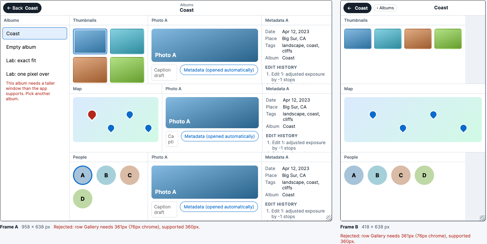

# Supermax application shell

Supermax is an application shell, not merely a responsive column allocator. New content opens below and then to the right, like reading a book: a cell can split into rows, every row runs its own left-to-right chain, and one Back closes what was opened last. The allocator decides which cells fit and how wide they become; the navigator decides what is open and what Back closes; the host owns content and should follow this contract so that navigation, controls, and content remain predictable across applications.

## Vocabulary

- **Destination:** a cell definition the host registers: title, `min` and `max` width in pixels, optionally a default child or rows, and host data.
- **Occurrence:** one opened destination at one place, identified by the path of destination ids from the root.
- **Chain:** a row of cells from a root cell to the right; the workspace root is a chain and every row is a chain.
- **Split:** a cell whose rows are chains stacked below each other.
- **Row tab:** the compact form of a collapsed row: its title on one line, which opens the row again.
- **Reveal:** showing a hidden ancestor of a chain without opening or closing anything.
- **Navigation group:** one manual opening plus everything it opened by itself.
- **Back:** closes the newest navigation group across all rows.
- **Room:** whether the minimum widths of a chain plus a candidate fit the row width.
- **Strip:** the animated track `CellStrip` moves a chain on; nothing else is called a strip.

## Start with the cell path

Write the complete product hierarchy before writing layout code, for example:

```text
workspace -> collection -> item -> task -> subdetail
```

Each level is one cell with one data owner and one responsibility. Opening a child adds information to the right while preserving its ancestors on the left for as long as they fit. A modal, drawer, accordion, or page redirect is usually a sign that a true child has not been modeled as a cell.

A cell whose children are independent of each other splits into rows instead of a chain:

```text
albums -> album
            |- thumbnails -> photo -> metadata
            |- map        -> photo -> metadata
            `- people     -> photo -> metadata
```

Each row keeps its own selection and its own left-to-right chain. The same photo opened from two rows is two occurrences with separate local state. The hierarchy says where a cell belongs; the order of openings says what Back closes.

The ordered list of manual openings is the source of truth for what is open. A deep link replays that list, browser back returns to the previous list, and the viewport decides only how much of it is visible and which defaults opened automatically. The allocator may hide ancestors; it does not close them.

## Cell anatomy

A cell has three regions. Only the body is required, but their order is stable:

```text
┌ header: back | identity | cell-scoped controls ┐
│ body: the cell's single scroll owner            │
├ optional contextual or batch bar                ┤
└ optional task toolbar                           ┘
```

- **Header/navigation bar:** orientation and controls that affect the entire cell. Put collection creation, search, sort, filter, view, and cell zoom here. In the V2 workspace the shell draws the cell header (title and reveal control) and the Back control lives in the workspace navigation bar; host content starts below the header.
- **Body:** content and selection. A collection row has one primary interaction: select it. Row-level button farms duplicate the detail cell and make the hierarchy ambiguous.
- **Context bar:** temporary state that qualifies the body, such as a batch selection summary. It appears only while that state exists.
- **Task toolbar:** the stable action set for the current item or task. Use it for repeated decisions, commit/cancel actions, and destructive actions that operate on the body above. Its visual association must be with this cell, never with a neighboring cell or all rows at once.

Place a control by scope, not by available space:

| Control affects | Placement |
| --- | --- |
| Application or workspace | Root cell header |
| Entire collection | Collection header |
| One collection row | Select the row; expose actions in its child detail cell |
| Current item identity or lightweight utility | Detail header |
| Current item decision or mutation | Detail task toolbar |
| Form draft | Form toolbar or form footer |
| Temporary multi-selection | Context bar in the owning collection cell |
| Child resource | A new cell to the right |

Creation is navigation as well as an action: a collection-level **New** control belongs in the collection header and opens an editor cell to the right. It does not replace the collection, open an unrelated page, or appear as another list row.

## Widths express content semantics

`min` is the smallest width at which a cell remains useful. `max` is the widest width at which more space still improves that content. Neither value describes a target viewport or a page-wide container. The allocator combines the bounds; the host must not add a global maximum width around the chain. The allocator itself is unit-free: V1 hosts measured in 64px columns, the V2 workspace measures in pixels.

Use these as starting ranges in pixels, then verify against real content:

| Cell archetype | Typical `min` | Typical `max` | Reason |
| --- | ---: | ---: | --- |
| Mode or compact navigation | 200 | 260 | Short labels and counts |
| Collection or list | 200 | 360 | Scannable rows should stay compact |
| Editor or compact form | 320 | 520 | Labels and fields need a readable measure |
| Detail or document | 320 | 720 | Prose and metadata can use more room |
| Media or working surface | 480 | 1200 | Visual comparison benefits from width |
| Canvas or world | 480 | 1600 | May consume remaining space; often zoomable |

Do not copy these numbers mechanically. A dense data table may need more width than a list; a short inspector may need less than a document. If every cell receives the same bounds, the information architecture has not been expressed in the layout.

## Collection and detail behavior

- Keep the collection cell as the parent while its selected item opens to the right.
- Mark the selected row, but do not make it a second action surface.
- Put item-specific actions in the detail or task cell.
- Let filters and route context inherit to the right.
- Open create and edit flows as child cells when they are part of the hierarchy.
- Use one scroll owner per cell. Headers and task toolbars remain stable while the body scrolls.

When cells no longer fit, hide ancestors from the left. Do not squeeze them into narrow columns and do not add horizontal page scrolling. The first visible header provides a reveal control for the rightmost hidden ancestor; revealing changes what is visible, never what is open. When the first visible cell of a chain is a split, which has no header of its own, that control sits in the navigation bar next to Back. Selecting new content returns focus to the rightmost active cells.

## Rows

A split spans the full width of its own cell and stacks its rows from top to bottom. Rows never share column boundaries with each other, and no cell spans more than one row. Rows are owned by their split: they open with it, close with it, and cannot be replaced or promoted on their own. Inside a row the horizontal rules above apply unchanged: ancestors hide from the left, the newest cell survives, and the first visible cell's header carries a reveal control for the rightmost hidden ancestor. Revealing is a view change, not navigation: it never opens, closes, or regroups anything, and the next opening in that row or above it resets the view to its newest cells.

Rows declare `minHeight` and `maxHeight`. When the split is too short for every row, rows give way from the top: they shrink to their minimum first and then collapse to a row tab, while the focused row (the row holding the focused occurrence, or the last row) always stays open, at its minimum height if need be. A row tab is compact presentation, not a closed row; activating it focuses that row and lets rows above or below it collapse instead. Keyboard focus follows the same rule: focusing content in a row makes that row the protected one, and when a cell slides out of view the focus moves to the visible cell of the same row. Collapse, resize, focus, and reveal preserve drafts, scroll positions, and every navigation group.

### Minimum height is validated up front

The application declares the smallest viewport height it supports. Before a split opens, every row is checked: the navigation bar, one row tab per other row of this split and of every split above it (the ancestor chrome budget, bounded by the maximum number of rows per split), and the row's own `minHeight` must fit inside that height. An exact fit passes; one pixel over fails; an empty split, a split with more rows than allowed, two rows with the same destination, and a row or cell whose minimum exceeds its maximum fail. The check runs for a split the user opens and for a split that would open as a default; a default that fails stays closed and becomes a manual choice that reports the same verdict. The result names the row, the required height, the chrome budget, and the supported height, and a refused open touches nothing already open. Those numbers are for the developer; the content that offered the link shows an understandable message and a way on.



Below the supported height the shell keeps the focused row at its minimum and lets the workspace scroll. That is the emergency behaviour for a window the application never promised to support, distinct from an invalid configuration inside the supported range.

## Navigation groups and Back

A manual opening forms a navigation group. Every default that this opening triggers while the row has room belongs to the same group, across any number of levels: opening an album that auto-opens a photo that auto-opens its metadata is one group, and one Back closes all of it. Groups close in reverse order of opening across all rows: after opening photos A, B and C in three rows, Back closes C, then B, then A; after A, C, B it closes B, then C, then A. The selectors remain, and groups opened earlier are untouched.

A default opens only when the row has room: the sum of the minimum widths of the row's cells plus the candidate must fit the row's width at the moment of opening. Otherwise the default stays visible as a manual choice, and opening it later forms its own group. A wide and a narrow viewport therefore reach the same content through a different number of groups, and the Back history records what actually happened in that viewport.

Two rules cover the cases the three-row example leaves open:

- **Replacing content on the same slot.** Opening Photo B where Photo A was open closes Photo A and everything under it; its group disappears. Back on Photo B returns to the selector. Supermax does not restore the replaced content; that would be an undo system.
- **An explicit click on content that is already open automatically.** The occurrence and the defaults under it move into a new group with that occurrence as root, so the next Back closes exactly what the user just chose. The defaults that moved along stay automatic, so a later click on one of them promotes it in turn. Without this rule, Back after clicking visible metadata would close the whole album, which contradicts what the user did last. Clicking content that was already opened manually changes nothing.

Hiding, resizing, focusing a row, and revealing an ancestor never create or rewrite groups. The Back control names the content it will close, also when that content lives in another row than the focus or is hidden; the title shows the focused content with its ancestors as context. When nothing is left to close, Back is disabled and says so.

### Deep links and browser history

The library ships no router: the host owns the log of actions and how it travels. The demo shows one shape. Its URL carries the ordered log of applied manual actions, including Backs; an action every frame refused stays out. A fresh navigation to such a link replays the log from the start, and every viewport computes its own defaults while replaying, so the result depends on the size each viewport has at that moment, because room is decided when something opens and a resize never rewrites what is open. Within a session each action pushes a history entry that also stores a snapshot of what every frame has open, so browser back, forward and reload restore that earlier state instead of replaying; content that stayed open through such a step keeps its drafts, content that closed was disposed and comes back fresh. Focus and reveal are not part of the snapshot. An action whose source is no longer open in a viewport is rejected there and reported; the demo never invents hidden steps to make the viewports match.

## Cold start

A Supermax application should open into useful work, not a landing page that duplicates the first collection.

1. Restore a valid explicit selection from the route or durable session state.
2. Otherwise select the first item from the product's meaningful ordering, such as the most recent active item.
3. Open its stable default task when that relationship is unambiguous.
4. Stop at the first task that needs human judgment.
5. Preserve the collection cell between the workspace and selected item, even when selection was automatic.

A manual opening is offered to every viewport. Automatic defaults depend on room, so a narrow viewport may stop one level earlier and offer that default as a manual choice, and a viewport where the source of a later opening never appeared rejects that opening.

## Adaptation checklist

Before implementing a Supermax adaptation:

1. Draw every reachable route as a cell tree, including create, edit, empty, error, and external-leaf states.
2. Inventory every existing control and assign its scope: application, collection, selection, item, task, form, or child resource.
3. Classify each cell by content and set independent `min` and `max` bounds; give each row `minHeight` and `maxHeight`.
4. Specify each cell's header controls, scroll owner, context bar, and task toolbar.
5. Define the cold-start selection and the defaults that may open automatically when there is room.
6. Declare the minimum supported viewport height and check every split against it.
7. Define narrow behavior: which ancestors hide, which rows collapse first, and what the Back control names.
8. Import the workspace stylesheet and give the workspace element a height; theme it through the `--supermax-*` custom properties.
9. Only then wire the navigator and render the cells.

Verify the result with real content at narrow and wide sizes, preferably side by side. Test deep links, reload, browser back, group-wise Back across rows, selected-row continuity, hidden-ancestor recovery, collapsed rows, drafts surviving a collapse, create/edit child cells, and every control's scope. A green allocator test does not verify the application shell.

## Common failures

- Treating Supermax as a set of responsive cards inside a centered page container.
- Designing desktop and phone page variants instead of one route-driven cell stack.
- Navigating from collection to detail as separate pages and losing sibling context.
- Hiding collections or help text inside accordions instead of modeling hierarchy and disclosure deliberately.
- Putting **New**, search, or sort below a collection when they govern the whole collection.
- Putting item mutations on every row instead of in the selected item's child cell.
- Mixing identity, explanation, and repeated task actions in one verbose body block.
- Choosing cell widths to fill one screenshot rather than to suit the information carrier.
