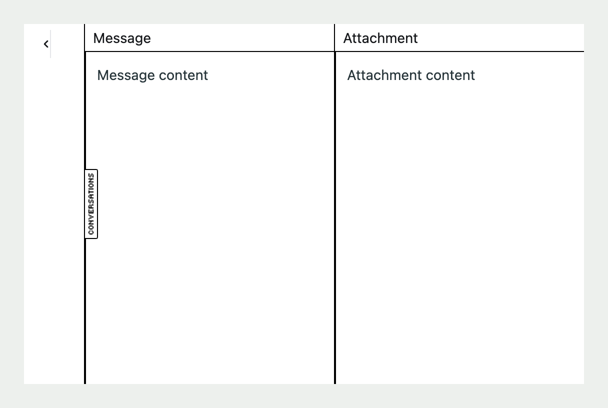
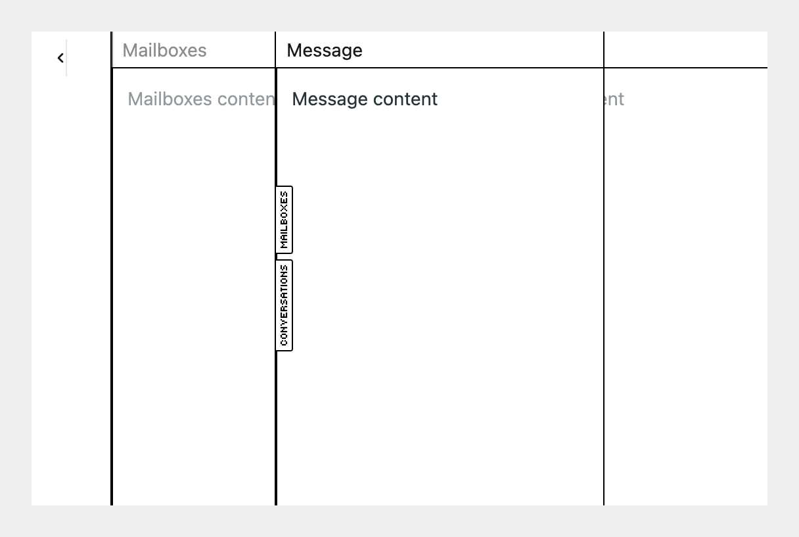
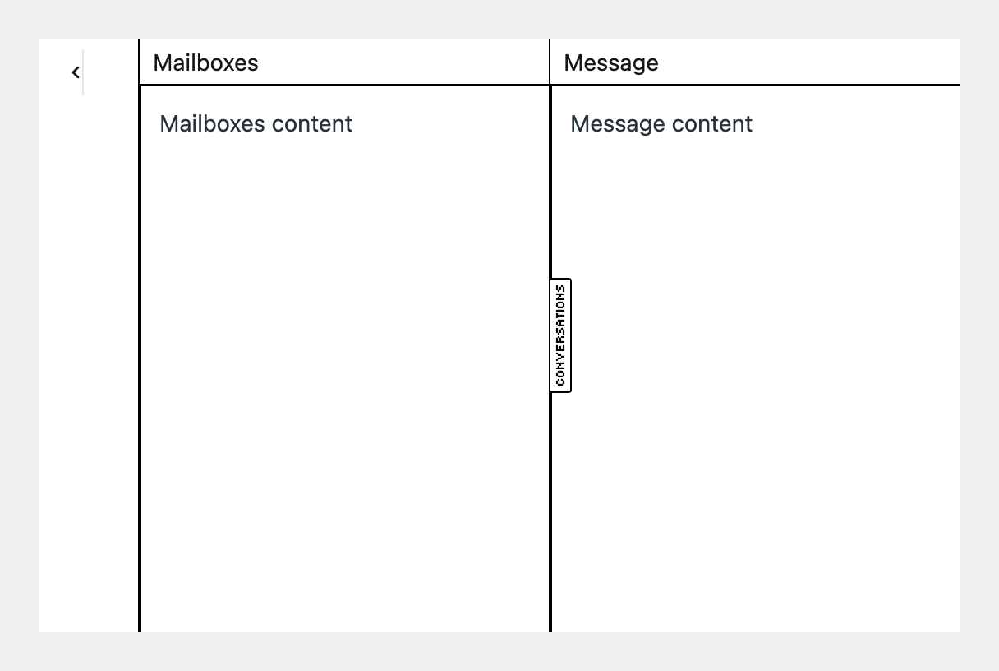

# Folding

Folding keeps a place for intermediate content below a kept cell or row, when a chain or split cannot show every full surface. A folded cell or row shows none of its content; only its handle remains. A fold cue is a narrow seam, distinct from a resize divider. Opening it does for that one surface what Show does: the room comes from the trailing end. A folded cell opens while cells close from the end of its chain, until it shows in full beside the cells that showed before. A folded row opens while the rows after it fold, because the rows of a split never close. A fold always collapses onto its leading edge. It opens toward the trailing side, so the surfaces after it move aside; only a fold that lies after the active surface, the one its chain or split is keeping, opens toward the leading side while a surface before it folds. Dragging a handle reveals its content continuously along either axis. Release beyond 61.8% of its full unfolding distance to open the fold; release at or below that threshold to return to the starting state with nothing closed. The remaining distance animates from the release position in either case, with reduced motion settling immediately. The distance is measured in the opening direction, so the threshold mirrors for left/right and up/down. Reversing the gesture before release uses the final position, not its furthest reach. Pointer cancellation and Escape return to the starting state. A folded surface stays open, so its draft, scroll position and navigation identity survive; a cell that closes to make room is closed as it is for Show. A cell the user opened from its fold is the last to fold again when room runs out, until the next navigation. Opening a row leaves the horizontal folds inside the other rows alone. Adjacent folds share one handle, which opens only the fold nearest the active surface; the folds behind it stay folded and the handle then names the next one.

The up/back (Show) control also reaches earlier folded cells and rows, so the seam is not their only entry point. Show and a fold handle bring a surface back the same way; Adjacent folds share one handle, which names the fold nearest the active surface. Once that fold has opened, the handle names the next one back. Either closes visible trailing cells as needed or moves the row window. It never discards a subtree containing content that was hidden before the action; that content keeps a fold or scroll route. Further clicks continue to earlier context, never toggling back to a fold on the right or below. Rows remain part of their split. The cancelable `show` event lists any cells that would close, for a handle as for Show, and `up` reports those actually closed. A drag asks on release. After `up`, `unfold` (`{ occurrence, axis, closed }`) follows every fold a handle opened. These rules are enforced by the [reachability invariant](reachability.md).

## Vocabulary

| Term | Meaning |
| --- | --- |
| Foldable surface | A cell or row that is not kept itself and stands below a kept cell or row. |
| Fold cue | The visible seam of a folded surface. The host can render its contents with `renderer.fold`. |
| Unfolded cell | A cell the user opened from its fold. It folds after every other cell until the next navigation. |
| Active surface | The one cell of a chain or row of a split that allocation keeps: the last one, or the one Show or a row's handle brought back. |
| Leading, trailing | The start and the end of a chain or of a split's rows: left and right for cells, up and down for rows. |

Only `overflow: { mode: "keep" }` is a choice: a kept cell or row stays in view at its declared minimum. Everything else follows from where it stands. Below a kept cell or row, a surface that gives way folds. Where nothing above it is kept, it leaves the window and Show brings it back. The host keeps kept content usable at its minimum, where needed through a [smaller form](application-shell.md#responsive-forms-save-space); a fold never shows content. A fold cue marks content that can exchange space with the current task. A surface with nothing kept above it has no fold cue: earlier than the active surface it may leave behind Show, and at or after the active surface it stays visible, extending the scrollable workspace if necessary.

## One hierarchy at four sizes

The horizontal chain is `Mode → Mailboxes → Messages`. Mode is kept at 48px. Mailboxes needs at least 180px to work; Messages needs at least 270px. The vertical split is `Summary` above `Detail`; Summary needs at least 170px, while Detail needs at least 260px. Each full cell owns its own scroll; a folded cell keeps its scroll position.

```text
Wide 620px, tall 640px          Mode 48 | Mailboxes 180+ | Messages 270+
                                Summary 170+
                                ─────────────────────────
                                Detail 260+

Narrow 390px, tall 640px        Mode 48 | Mailboxes [handle] | Messages 270+
                                Summary 170+
                                ─────────────────────────
                                Detail 260+

Wide 620px, short 350px         Mode 48 | Mailboxes 180+ | Messages 270+
                                Summary [handle]
                                ─────────────────────────
                                Detail 260+

Narrow 390px, short 350px       Mode 48 | Mailboxes [handle] | Messages 270+
                                Summary [handle]
                                ─────────────────────────
                                Detail 260+
```

In the last state, clicking Mailboxes closes Messages and leaves `Mode 48 | Mailboxes 180+`, as Show would. Clicking Summary makes `Summary 170+ / Detail [handle]`; clicking Detail folds Summary again. The host may change the cue's content and colours, or reserve space per surface with `overflow: { mode: "fold", size }`.

## Interaction and motion

The default Veil presentation moves the room boundaries and reveals content quietly. While a cell opens, it and the cells that move aside stay fitted to their moving rooms while their content keeps its full working width; the moving room clips the content instead of reflowing it. A row's content stays anchored to its shrinking or growing surface and fades while the edge moves, so it does not slide over its neighbour or expose the canvas. Origami rotates the folding content toward its edge as those boundaries move; the demo's Paper Fold presentation uses a shallower angle. Folding is a layout transition on the original cell or row, with no detached overlay, backdrop, dimming or undo control. The default cue is a thin gutter with an attached handle showing the occurrence title in uppercase Tiny5 Regular. Cell-gutter labels read bottom-to-top; row-gutter labels read left-to-right. Missing or blank titles retain the three diagonal hatch strokes. With default padding the handle stays 14px thick. Its length is capped at 96px or the available seam length, with an ellipsis for a longer title. The full title remains in its tooltip and accessible name, and `setTitle()` updates the visible label. Its line sits on the adjacent cell or row gutter and follows `--supermax-gutter` in thickness. The handle lies entirely on the unfolding side of that line. Its straight side meets the gutter; only the two outward corners are rounded. It has a surface-coloured fill, padding and a 1px canvas-coloured outline. When a row opens and the row after it folds, the handle moves across the gutter to that row and its outer corners change sides over the same 120ms transition. During a drag the grabbed handle stays on the moving gutter; if the drag commits, the handle handoff starts on pointer release while the remaining room motion settles. Releasing below the threshold returns the original handle along with the room. Reduced motion transfers the handle immediately. The same attachment applies between cells and at viewport edges, where the gutter remains visible. `--supermax-default-fold-padding` (3px) and `--supermax-default-fold-radius` (2px) customize the marker shape. Its line uses the canvas colour and its fill uses the application surface colour directly in both colour schemes: grey on white in the light demo. No muted surface or colour blend is applied. These two colour roles follow `--supermax-default-canvas` and `--supermax-default-surface` directly, including on hover. `data-direction` names the way a fold opens (`left`, `right`, `up` or `down`) for host styling; its handle, hinge and drag direction follow the gutter that moves. A fold before the active surface opens `right` or `down`. A fold after the active surface opens `left` or `up`, while a surface before it folds onto its own leading edge. Only the handle opens the fold; the bare gutter is not clickable. On touch-capable devices its invisible hit area is centered on the visible handle and measures at least 44 × 44 CSS pixels, extending only dimensions smaller than 44px. The visible handle and layout reservation do not grow. The viewport clips any portion outside its edges. Touch capture keeps a drag attached to its handle and prevents page scrolling for that gesture; normal content remains scrollable. The layout reservation defaults to 0px. The cue is keyboard operable and has an accessible name that includes the destination title. A navigation action forgets which cells the user unfolded and returns to ordinary allocation around the new destination.

`ORIGAMI_PRESENTATION` remains an alternative for normal cell transitions. A literal multi-pleat treatment for the fold seam is a separate visual experiment: it should change only the presentation of the same room exchange, and must be checked with large, complex cell content before replacing the calm default.

Opening a row changes heights only, so the widths of the chain around its split stay as they were. Opening a cell that closes others shares out the width again, as any close does. With responsive variants, the target geometry comes from canonical selection over the declared forms; motion starts at the currently drawn geometry. Width-only changes retain the nearer stationary edge while shrinking as well as growing. A card making room for a newly opening neighbour retains its shared-edge slide. The [stable-prefix investigation](research/stable-prefix-during-folds.md) records how the anchoring was chosen, with V1.1 as the rendering reference; the width retention it also describes went away with the fold focus that needed it.

Choose **Folding: cells and rows** in the [main demo](index.html) to see both axes in the narrow frame. The Motion menu switches the same interaction between Veil, Origami and Paper Fold.

The ordinary album scenarios keep their Albums menu, so everything below it folds. The [Coast album at 415 × 332px](assets/captures/coast-default-folding.png) retains fold handles for its earlier rows and the current row's selector.

[After two Show steps at 401 × 292px](assets/captures/coast-reachable-after-show.png), Thumbnails is full and the rows after it remain available through their fold handles.

When a tiny active cell would make opposite 44px hit areas overlap, the fold after it keeps its handle; the fold before it remains reachable with Back or Up. During a drag all initially visible handles stay visible until release, with only the dragged handle active.

[During a reverse drag at 329 × 323px](assets/captures/coast-fold-gutter-drag.png), the handle remains attached to the moving canvas gutter.

At 296 × 335px, [partway through opening History](assets/captures/coast-drag-title-gutter.png) and [near the end of that same drag](assets/captures/coast-drag-page-retained.png), the title keeps one gutter and the preceding page handle remains visible.


[A row opened while the row after it folded](assets/captures/folding-vertical.png)

| Two folds on one seam | Dragging the first open | Released |
| --- | --- | --- |
|  |  |  |
| **Start:** Mailboxes and Conversations are folded on the rail's trailing gutter. Their one handle names Conversations, the fold nearest Message. | **Drag:** Conversations grows from its leading edge; Message and Attachment move aside, and Attachment leaves at the trailing end. | **Released:** Attachment has closed. Mailboxes stays folded, and the handle on the rail's gutter now names it. |

[Watch up/back continue toward earlier content](assets/captures/folding-up.mp4) · [After the first back step](assets/captures/folding-up.png).

Canvas-coloured hatching on the white host background at the viewport edge: [right edge](assets/captures/folding-edge-right.png) and [bottom edge](assets/captures/folding-edge-bottom.png). The two outer corners are square against the edge; only the two inner corners are rounded.

The host controls gutter thickness with `--supermax-gutter` (1px by default, including at a folded viewport edge). Set it to `0px` for a gutterless host; the handle retains its 1px outline and hatch strokes. A host that wants a fold of its own design reads [Drawing your own fold](rendering.md#drawing-your-own-fold).

[Host with 0px gutters](assets/captures/folding-gutterless.png).

Gutters are unpainted gaps revealing the canvas, not borders painted over cell content. Every ordinary gap remains 1px by default before, during and after folding, including the split boundary and a trailing folded viewport edge. The handle is drawn above the clipped content; its inset rim follows the gutter thickness, with a 1px minimum when the host explicitly disables gutters.

[Split and viewport gutters after opening a fold](assets/captures/folding-gutters.png) · [Drag a row open, return, and complete it](assets/captures/folding-drag.mp4) · [The moving row gutter during a drag](assets/captures/folding-drag.png).
