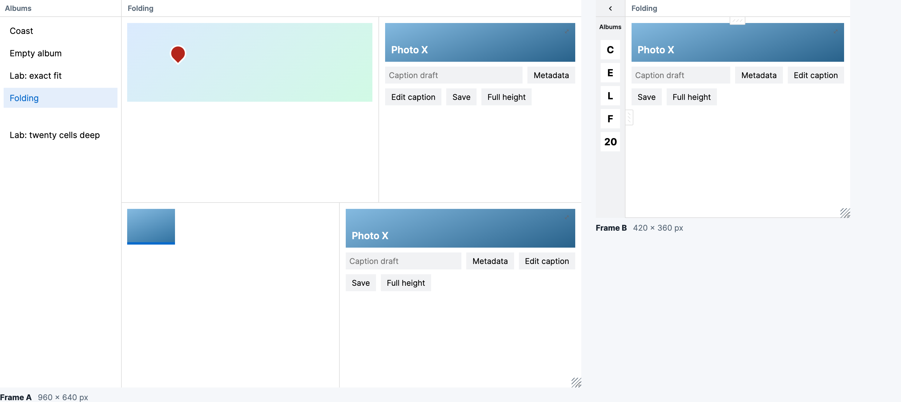

# Folding

Folding keeps a place for intermediate content when a chain or split cannot show every full surface. A fold cue is a narrow seam, distinct from a resize divider. Clicking it gives that surface room and folds the nearest neighbours that must yield space. Clicking another cue trades the space again. Dragging a handle reveals its content continuously along either axis. Release beyond 61.8% of its full unfolding distance to complete the trade; release at or below that threshold to return to the starting state. The remaining distance animates from the release position in either case, with reduced motion settling immediately. The distance is measured in the opening direction, so the threshold mirrors for left/right and up/down. Reversing the gesture before release uses the final position, not its furthest reach. Pointer cancellation and Escape return to the starting state. Every destination stays open, so its draft, scroll position and navigation identity survive. Each horizontal chain and vertical split keeps its own fold focus, so opening a row preserves the horizontal folds inside its neighbours. This is a local layout focus, not a modal or browser-history step. When several folds share one seam, only the nearest folded surface shows a handle. Opening or dragging it reveals the next handle, like turning pages; each surface remains open in the model.

The up/back (Show) control also reaches earlier folded cells and rows, so the seam is not their only entry point. Unlike a fold click, Show navigates backward: it closes visible trailing cells as needed or moves the row window upward. It never discards a subtree containing content that was hidden before the action; that content keeps a fold or scroll route. Further clicks continue to earlier context, never toggling back to a fold on the right or below. Rows remain part of their split. The existing cancelable `show` event lists any cells that would close, and `up` reports those actually closed. These rules are enforced by the [reachability invariant](reachability.md).

## Vocabulary

| Term | Meaning |
| --- | --- |
| Foldable surface | Any ordinary cell or row unless it declares `overflow: { mode: "hide" }` or `overflow: { mode: "keep" }`. |
| Fold cue | The visible seam of a folded surface. The host can render its contents with `foldContent`. |
| Fold focus | The full cell or row selected by clicking a fold cue. Neighbours fold as needed to make room. |
| Trade | Clicking another cue changes fold focus without closing either surface. |

`overflow.mode: "keep"` holds a cell or row at its declared minimum; the host keeps its content usable at that size. A fold cue marks content that can exchange space with the current task. Folding is the default for ordinary cells and rows. Declare `overflow: { mode: "hide" }` on an important surface that must never become a fold cue. Without a declaration, a fold reserves no space; `overflow: { mode: "fold", size }` optionally reserves a non-negative width or height. An excluded surface earlier than the active one may hide behind Show. At or after the active surface it stays visible, extending the scrollable workspace if necessary.

## One hierarchy at four sizes

The horizontal chain is `Mode → Mailboxes → Messages`. Mode is kept at 48px. Mailboxes needs at least 180px to work; Messages needs at least 270px. The vertical split is `Summary` above `Detail`; Summary needs at least 170px, while Detail needs at least 260px. Both fold without reserving space. Each full cell owns its own scroll; a folded cell keeps its scroll position.

```text
Wide 620px, tall 640px          Mode 48 | Mailboxes 180+ | Messages 270+
                                Summary 170+
                                ─────────────────────────
                                Detail 260+

Narrow 390px, tall 640px        Mode 48 | Mailboxes [handle] | Messages 270+
                                Summary 170+
                                ─────────────────────────
                                Detail 260+

Wide 620px, short 350px         Mode 48 | Mailboxes 180+ | Messages 270+
                                Summary [handle]
                                ─────────────────────────
                                Detail 260+

Narrow 390px, short 350px       Mode 48 | Mailboxes [handle] | Messages 270+
                                Summary [handle]
                                ─────────────────────────
                                Detail 260+
```

In the last state, clicking Mailboxes makes `Mode 48 | Mailboxes 180+ | Messages [handle]`; clicking Messages exchanges those widths again. Clicking Summary makes `Summary 170+ / Detail [handle]`; clicking Detail exchanges the heights again. The host may change the cue's content and colours, or reserve space per surface with `overflow: { mode: "fold", size }`.

## Interaction and motion

The default Veil presentation moves the room boundaries and reveals content quietly. During a horizontal trade, both cells stay fitted to their moving rooms while their content keeps its full working width; the moving room clips the content instead of reflowing it. The same room timeline runs in either direction, even when a second click reverses it. A row's content stays anchored to its shrinking or growing surface and fades while the edge moves, so it does not slide over its neighbour or expose the canvas. Origami rotates the folding content toward its edge as those boundaries move; the demo's Paper Fold presentation uses a shallower angle. Folding is a layout transition on the original cell or row, with no detached overlay, backdrop, dimming or undo control. The default cue is a thin gutter with an attached handle showing the occurrence title in uppercase Tiny5 Regular. Cell-gutter labels read bottom-to-top; row-gutter labels read left-to-right. Missing or blank titles retain the three diagonal hatch strokes. With default padding the handle stays 14px thick. Its length is capped at 96px or the available seam length, with an ellipsis for a longer title. The full title remains in its tooltip and accessible name, and `setTitle()` updates the visible label. Its line sits on the adjacent cell or row gutter and follows `--supermax-gutter` in thickness. The handle lies entirely on the unfolding side of that line. Its straight side meets the gutter; only the two outward corners are rounded. It has a surface-coloured fill, padding and a 1px canvas-coloured outline. When focus trades between folds, the handle moves across the gutter and its outer corners change sides over the same 120ms transition. During a drag the grabbed handle stays on the moving gutter; if the drag commits, the handle handoff starts on pointer release while the remaining room motion settles. Releasing below the threshold returns the original handle along with the room. Reduced motion transfers the handle immediately. The same attachment applies between cells and at viewport edges, where the gutter remains visible. `--supermax-fold-padding` (3px) and `--supermax-fold-radius` (2px) customize the marker shape. Its line uses the canvas colour and its fill uses the application surface colour directly in both colour schemes: grey on white in the light demo. No muted surface or colour blend is applied. These two colour roles follow `--supermax-canvas` and `--supermax-surface` directly, including on hover. `data-direction` names the nearby full surface (`left`, `right`, `up` or `down`) for host styling. Only the handle opens the fold; the bare gutter is not clickable. On touch-capable devices its invisible hit area is centered on the visible handle and measures at least 44 × 44 CSS pixels, extending only dimensions smaller than 44px. The visible handle and layout reservation do not grow. The viewport clips any portion outside its edges. Touch capture keeps a drag attached to its handle and prevents page scrolling for that gesture; normal content remains scrollable. The layout reservation defaults to 0px. The cue is keyboard operable and has an accessible name that includes the destination title. A navigation action leaves fold focus and returns to ordinary allocation around the new destination.

`ORIGAMI_PRESENTATION` remains an alternative for normal cell transitions. A literal multi-pleat treatment for the fold seam is a separate visual experiment: it should change only the presentation of the same room exchange, and must be checked with large, complex cell content before replacing the calm default.

When open content declares no variants, a local fold preserves the surrounding chain's existing widths when they still satisfy the current bounds, explicit session widths and viewport. With responsive variants, the target geometry comes from canonical selection over the declared forms; motion starts at the currently drawn geometry. A genuine resize, changed open structure or newly required minimum can redistribute that space. Width-only changes retain the nearer stationary edge while shrinking as well as growing. A card making room for a newly opening neighbour retains its shared-edge slide. The [stable-prefix investigation](research/stable-prefix-during-folds.md) compares the two corrections separately and together, with V1.1 as the rendering reference.

Choose **Folding: cells and rows** in the [main demo](index.html) to see both axes in the narrow frame. The Motion menu switches the same interaction between Veil, Origami and Paper Fold.

Folding is also the default in the ordinary album scenarios. The [Coast album at 415 × 332px](assets/captures/coast-default-folding.png) retains fold handles for its earlier rows and the current row's selector. A host can opt a specific surface out with `overflow: { mode: "hide" }`.

[After two Show steps at 401 × 292px](assets/captures/coast-reachable-after-show.png), Thumbnails is full and the next row remains available through one fold handle. Opening that handle presents the following row's handle.

When a tiny active cell would make opposite 44px hit areas overlap, the following page keeps its handle; the preceding page remains reachable with Back or Up. During a drag all initially visible page handles stay visible until release, with only the dragged handle active.

[During a reverse drag at 329 × 323px](assets/captures/coast-fold-gutter-drag.png), the handle remains attached to the moving canvas gutter.

At 296 × 335px, [partway through opening History](assets/captures/coast-drag-title-gutter.png) and [near the end of that same drag](assets/captures/coast-drag-page-retained.png), the title keeps one gutter and the preceding page handle remains visible.



[Horizontal space traded](assets/captures/folding-horizontal.png) · [Vertical space traded](assets/captures/folding-vertical.png)

[Watch the two horizontal trades at normal speed](assets/captures/folding-horizontal-trade.mp4).

[Watch up/back continue toward earlier content](assets/captures/folding-up.mp4) · [After the first back step](assets/captures/folding-up.png).

Canvas-coloured hatching on the white host background at the viewport edge: [right edge](assets/captures/folding-edge-right.png) and [bottom edge](assets/captures/folding-edge-bottom.png). The two outer corners are square against the edge; only the two inner corners are rounded.

The host controls gutter thickness with `--supermax-gutter` (1px by default, including at a folded viewport edge). Set it to `0px` for a gutterless host; the handle retains its 1px outline and hatch strokes. Fold reservation is independent: `overflow: { mode: "fold", size: 8 }` reserves 8px horizontally on a cell or vertically on a row. The main demo offers **Folding: 8px reserved on both axes** alongside the default unreserved scenario.

[8px reservation on both axes](assets/captures/folding-reserved.png) · [Host with 0px gutters](assets/captures/folding-gutterless.png).

Gutters are unpainted gaps revealing the canvas, not borders painted over cell content. Every ordinary gap remains 1px by default before, during and after folding, including the split boundary and a trailing folded viewport edge. The handle is drawn above the clipped content; its inset rim follows the gutter thickness, with a 1px minimum when the host explicitly disables gutters.

[Split and viewport gutters after trading the fold](assets/captures/folding-gutters.png) · [Drag, return, and complete a trade](assets/captures/folding-drag.mp4) · [The moving row gutter during a drag](assets/captures/folding-drag.png).

[Watch a left-opening fold keep its handle on the moving interior gutter](assets/captures/folding-horizontal-drag.mp4) · [Frame during the drag](assets/captures/folding-horizontal-drag.png).

[Watch the handle change sides after click and drag release](assets/captures/folding-handle-handoff.mp4) · [Frame during the handoff](assets/captures/folding-handle-handoff.png).
