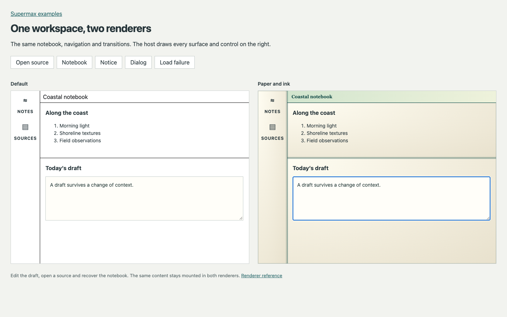
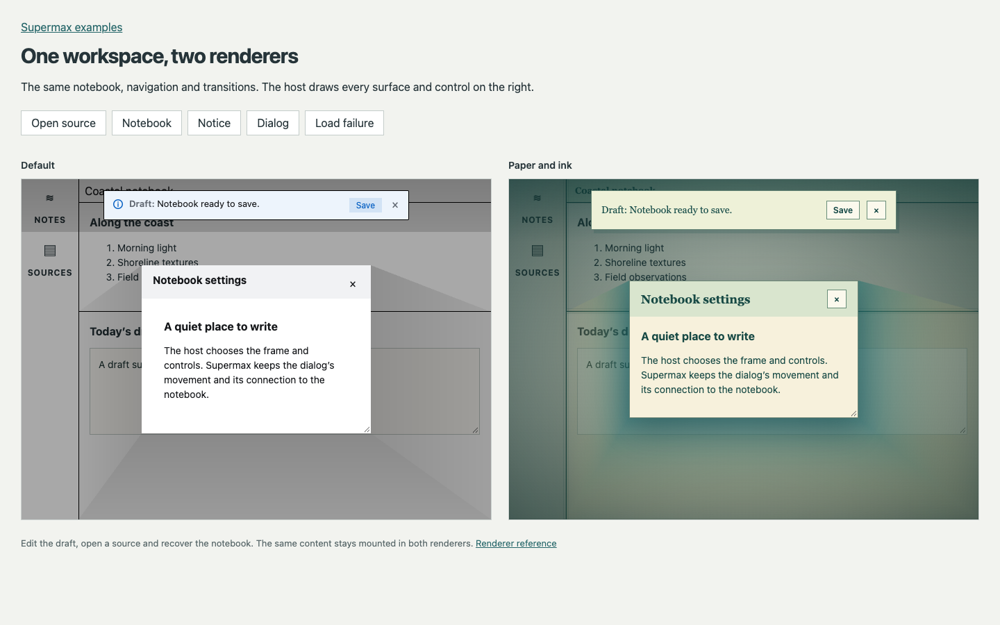

# Host rendering

Supermax owns spatial layout, navigation, folding, resizing and every shell transition. A host owns the visible treatment through a `renderer`: a map of synchronous part factories. Omitted parts use `DEFAULT_RENDERER`; an invalid override raises `SupermaxRendererError` rather than falling back to another style. Product content remains the responsibility of `content`.

Import `@laicluse/supermax/workspace.css` for structural layout and the built-in renderer. Custom parts do not need internal CSS selectors. Their supplied roots and outlets are the integration boundary.

[Compare two working renderers](renderers.html): the same notebook retains its drafts through navigation, overlays and loading failures. The comparison has no runtime dependencies beyond Supermax. From a source checkout, `node scripts/capture-renderers.mjs` verifies the example interactions and refreshes the images below.



## Mount and update

```js
new Workspace(element, {
  navigator,
  content,
  renderer: {
    header({ root, state, actions, slots, document }) {
      const title = document.createElement("strong");
      const back = document.createElement("button");
      back.textContent = "←";
      root.append(back, title, slots.utilities);
      root.classList.add("application-header");
      const detach = actions.navigation.attach(back);
      return {
        update(next) { title.textContent = next.title; },
        dispose() { detach(); },
      };
    },
  },
});
```

A factory receives `{ root, state, actions, slots, document }` plus the part-specific inputs below. It fills `root` and may return `{ update(state), dispose() }`; either method is optional. Supermax calls `update` on mount and on discrete state or allocation updates. State is a read-only snapshot. A factory must return synchronously. A framework component can mount into the root, attach its actual native buttons through component refs and unmount during `dispose`. The adapter must commit required buttons and outlets before its factory or update returns. Deferred renderer commits are not accepted; asynchronous product content still uses the ordinary content lifecycle.

Hidden or folded content stays mounted. Closing disposes its visual parts after the exit transition. A notice retains its part when it moves between its source and the shared stack. Ordinary parts do not receive animation-frame updates. `frustum` alone may return `paint(geometry)` for shell-driven geometric painting.

## Part catalog

| Part | Root and state | Additional inputs |
| --- | --- | --- |
| `canvas` | Workspace background; allocated `width`, `height` after layout | Decorative root, outside product content |
| `cell` | Persistent material; `occurrence`, `title`, `split`, `headerHeight`, allocated `width`, `height`, `variant`, `rowVariant`, `folded`, `visible`, `gutter` | `raise(on)`. A split has material only in its header region; its rows own their surfaces |
| `header` | Cell title bar; `occurrence`, `title`, `navigationText`, `gutter` | `actions.navigation`; required `slots.utilities`; `raise(on)` |
| `navigation` | Floating navigation when the cell has no title bar; the same state as `header` | `actions.navigation`; `raise(on)` |
| `fold` | Native fold button; `title`, `occurrence`, `axis`, available label extent | `axis`; `refresh()` requests repositioning when the cue's drawn size changes |
| `divider` | Resize gesture region; orientation and current size | Supermax owns pointer handling |
| `reset` | Native reset button; orientation and sizing state | Supermax owns activation and hit area |
| `loading` | Named `role=status` region; `title`, `label` | Content is still loading |
| `error` | `role=alert` region; `title`, `detail` | `actions.retry` |
| `notice` | Notice card; `id`, `kind`, `message`, `busy`, `source`, `sourceTitle`, `sourceOpen`, `sourceVisible`, `sourceLabel` | `actions.show`, `actions.action`, `actions.dismiss` |
| `modal` | Dialog; `title`, `titleId` | `actions.close`; required `slots.body` and `slots.utilities`; `dragHandle(element)` |
| `backdrop` | Modal scrim | Decorative root; no pointer interception |
| `noticeBackdrop` | Shared notice-stack veil | Decorative root |
| `veil` | Cell cover above foreground; cell state including `gutter` | Supermax drives opacity |
| `frustum` | Stable SVG polygon for one face; `kind`, `side` | `defs`, unique `id`, `side`; optional `paint` |

Dimensions can be unavailable at initial mount and arrive in allocation updates. Use CSS to fill the supplied root rather than deriving another layout from rendered measurements. Allocation sizes are target CSS-pixel sizes; Supermax retains responsibility for intermediate geometry.

The `fold` and `reset` roots are native buttons whose mechanics belong to Supermax. Their renderers draw their interiors and style their roots. Navigation, Retry, modal close and notice renderers supply their own native buttons through action bindings.

## Drawing your own fold

A cell or row that gives way below a kept one folds, and a folded cell or row shows none of its content. What marks its place is the fold cue that the `fold` part draws: by default a small handle that lies over the gutter and takes no room from its neighbours. A layout that relies on that handle declares nothing for it.

A host that wants a fold of its own design, such as a stitched seam or a concertina edge, replaces the `fold` part and may give the fold room for that drawing:

```js
albums: { title: "Albums", min: 180, max: 320, overflow: { mode: "fold", size: 16 } }
```

`size` is the width a folded cell sets aside, or the height a folded row sets aside, in CSS pixels. Nothing of the cell or row appears in it; it is the surface for the host's drawing. It is valid only with `mode: "fold"`, is a finite nonnegative length smaller than every form's minimum on that axis (`invalid-fold-size`, or `invalid-variant-fold` for a form in `variants`), and defaults to zero. It is independent of `--supermax-gutter`.

A strip that should show content, such as a rail of icons, is not a fold. Keep the cell and declare the strip as a [smaller form](application-shell.md#responsive-forms-save-space).

The [main demo](index.html) offers **Folding: 8px reserved on both axes** beside the default scenario: [8px of fold room on both axes](assets/captures/folding-reserved.png).

## Native actions and outlets

`actions.<name>.attach(button)` accepts an `HTMLButtonElement` and returns a detach function. The shell binds activation and maintains `hidden`, `disabled`, `aria-disabled`, `aria-busy` and the localized accessible name. The descriptor's current state is in `state.actions[name]`: `{ offered, enabled, busy, label }`. Missing flags mean offered and enabled, with no busy state. Busy actions use `aria-disabled` and reject activation while retaining keyboard focus; `enabled: false` disables the native button.

All supported actions must be attached, including currently unavailable ones. They may become available later without mounting a new part. When a framework replaces a button, detach the old binding and attach the replacement through its ref callback. No extra subscription or focus handoff is involved. The renderer owns glyphs, visible text and presentation; Supermax owns the action and its availability.

Required outlets and attached buttons must remain descendants of the supplied root. Frameworks should place live outlet nodes in containers whose children their reconciler does not manage. Invalid factory names and types are rejected at construction; actual bindings, handles and outlets are validated on mount and update. Construction failure removes the partial workspace. Checks establish a structural contract, not proof that host CSS leaves controls visible or usable.

## Geometry and paint

Declare title-bar height once through `Navigator({ chrome: { header } })`. That reservation includes its separator. Workspace derives the real title-bar height from the navigator and publishes the result to its containers. A renderer does not separately declare or measure header height.

Borders, inner shadows, gradients, textures and images can be drawn inside each paint root. Paint beyond the gutters around a cell is clipped; there is no extra overlay for cell shadows. A split's surface renderer cannot fill the gaps between its rows; the cells in those rows paint them. Product content keeps its own scroll region and never moves into a gutter.

```js
renderer: {
  cell({ root }) {
    root.classList.add("paper-material");
  },
  veil({ root }) {
    root.classList.add("paper-veil");
  },
}
```

```css
.paper-material {
  background: radial-gradient(ellipse at top left, #fffdf2, #e7dfca);
  background-clip: padding-box;
  box-shadow: inset 0 0 0 1px #746b53;
}
.paper-veil {
  background: repeating-linear-gradient(45deg, transparent 0 3px, #29332e22 3px 6px);
}
```

## Painting the gutters

A cell paints the gutters around it. The roots of `cell`, `veil` and `header` span the cell and the gutter on each side that has one: the gutter before the cell, the one after it, the one above its row and the one below. Each gutter is a border of the root, transparent until the renderer colours it, so the padding box is the cell itself and the border box includes its gutters.

```css
.selected-material { border-color: #2f6fed; }               /* a ring in all the cell's gutters */
.band-header { background: #20242b; background-clip: border-box; } /* a title bar that runs through its gutters */
```

`state.gutter` is `{ size, top, right, bottom, left }` in CSS pixels: `size` is the host's `--supermax-gutter`, and each side is the width the root may paint there now, 0 where the cell meets the workspace edge or the canvas. The same widths are on the root as `--supermax-gutter-top`, `-right`, `-bottom` and `-left`; a `navigation` root has no box of its own and receives only these values. The custom properties are live; `state.gutter` holds the widths at the last render or rest, and Supermax calls `update` when a chain or row settles on other widths. Style from the properties, and read the state only for decisions.

The header's bottom border is its title seam, the gap between a title bar and the content below it. The material has a slot there, so a seam shows the canvas unless the header paints it. The leading cell of a split row paints the split's own gutter with its material; its title bar stops at that gutter.

Two neighbours share the gutter between them and both may paint it. The later cell lies on top: the one to the right, or the one in the lower row. `raise(true)` puts a cell above its neighbours, which keeps a ring or a shadow whole on every side; `raise(false)` puts it back. A raised cell in a split row lifts its row, so the other cells of that row leave the gutter under them to it, and a raised cell that reaches the trailing edge of a split lifts the split over the cell beside it. Use it for a state that stands out, such as a selection or the source of a notice.

Gutter paint shows while a chain rests. While its cells or rows move, each room clips to itself as before, the outer gutters read 0, and the paint returns when the motion ends.

Cell material persists during Veil transitions. The foreground and visual cover are siblings: Supermax conceals the foreground and drives the cover on the same timeline. The default cover is transparent during Veil; the single foreground fade preserves the opaque default surface's reveal. A host may add a visible shroud. Its compositing with the foreground fade is part of its chosen appearance, while timings, interruption, reversal and drag seeking remain Supermax's.



## Frustum paint

Supermax creates and retains each face, computes polygon geometry and follows the source and target. The renderer changes fill, stroke, gradients, patterns or filters through the supplied polygon and SVG `defs`. It does not change points, transforms, clipping or positioning. A no-op `frustum` renderer leaves the faces unpainted.

```js
frustum({ root, defs, id, document }) {
  const gradient = document.createElementNS(root.namespaceURI, "linearGradient");
  gradient.id = id;
  for (const [offset, color] of [["0", "#248b8999"], ["1", "#248b8900"]]) {
    const stop = document.createElementNS(root.namespaceURI, "stop");
    stop.setAttribute("offset", offset);
    stop.setAttribute("stop-color", color);
    gradient.append(stop);
  }
  defs.append(gradient);
  root.setAttribute("fill", `url(#${id})`);
  return { dispose() { gradient.remove(); } };
}
```

A frustum handle may also supply `paint({ progress, from, to, side, kind, gradient })`. `from` and `to` are current rectangles in the SVG layer's CSS-pixel coordinate space; `gradient` contains `{ x1, y1, x2, y2 }` running from the overlay edge towards its source. Supermax invokes this hook when geometry or growth changes. Update existing attributes; do not rebuild DOM or start a clock. Shared timing, reduced motion and the geometric growth curve remain shell-owned.

## Built-in style

`DEFAULT_RENDERER` is a complete implementation of these same factories. A host can call a default part first and then add to it, the way a subclass calls its parent:

```js
import { DEFAULT_RENDERER } from "@laicluse/supermax";

renderer: {
  header(context) {
    const base = DEFAULT_RENDERER.header(context);
    context.root.classList.add("band-header");
    return base;
  },
  cell(context) {
    DEFAULT_RENDERER.cell(context);
    return {
      update(state) {
        const selected = state.occurrence === selection;
        context.root.classList.toggle("selected-material", selected);
        context.raise(selected);
      },
    };
  },
}
```

Pass the context on unchanged and forward `update` and `dispose` to the handle the default returns when you wrap it. The default part has already attached its action buttons, so reach an existing one through `actions.navigation.element` instead of attaching a second. The default surfaces fill only the cell and leave every gutter transparent, so an extension decides what its gutters show. Its stylesheet is `default-renderer.css`; its paint tokens use the `--supermax-default-` namespace. They configure that renderer's chosen design, not arbitrary custom renderers. Load host styles normally; no stylesheet installer or global renderer state is required.

Geometry variables such as `--supermax-gutter`, `--supermax-overlay-inset`, `--supermax-notice-width` and `--supermax-perspective` remain shell geometry. The derived `--supermax-cell-title` is output from `navigator.chrome.header`, not a second configuration input. Motion uses the existing presentation strategies and `TimeScale`. The Veil motion declares `concealContent: true`, so renaming a presentation does not change its concealment behavior. Host renderers do not add transitions to shell geometry or shell-controlled opacity.

Validate a custom renderer through actual navigation, short and narrow layouts, fold dragging and cancellation, resized dividers and reset, async failure and Retry, modal dragging/closing, notice busy/resolution, reduced motion, native keyboard activation and visible focus. Use the same task and open hierarchy when comparing renderers.
