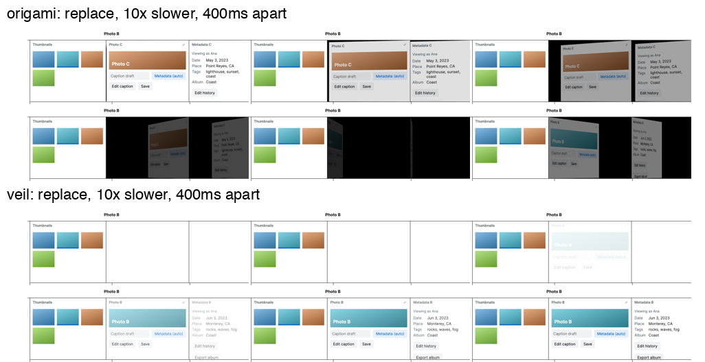

# Cell transitions: research for a calm presentation

This note collects what design systems, practitioners and perception research say about animating large panels, and turns it into the rules of a second built-in presentation next to origami. It answers one question: how should a cell of 900 by 1000 pixels open, close and give way to a sibling so that the screen stays calm? Sources were read on 2026-10-23; values from token files and reference implementations count as spec, everything else is marked as opinion or inference.

## Why origami is loud on large cells

Origami rotates a whole cell 90° around one edge and shades it towards the canvas colour, which is black in the light theme. A replacement therefore turns a white cell of a million pixels black, folds it away, leaves canvas in its room and folds a new one out. Four properties make that loud, and each grows with the cell:

- **The onset of motion captures attention, motion itself does not** (Abrams & Christ 2003, [pubmed 12930472](https://pubmed.ncbi.nlm.nih.gov/12930472/)). A large cell starts moving over the whole periphery at once, and peripheral sensitivity to motion timing is nearly equal to the fovea's ([pubmed 6695503](https://pubmed.ncbi.nlm.nih.gov/6695503/)).
- **A 2D plane rotating in 3D space is one of the motion types WebKit lists as a vestibular trigger** ([webkit.org](https://webkit.org/blog/7551/responsive-design-for-motion/)), and the perceived distance of the motion matters more than the screen size (Val Head, [A List Apart](https://alistapart.com/article/designing-safer-web-animation-for-motion-sensitivity/)).
- **The luminance swing is as large as the cell.** White to black and back is the largest contrast change the theme has.
- **Canvas shows in the room between the two strokes**, so the eye sees a hole where content was.

## What the sources agree on

**Large surfaces fade instead of travelling.** Fluent 2 says top-level navigation should use "a quick fade instead of moving or sliding large elements" ([fluent2](https://fluent2.microsoft.design/motion)). Apple's visionOS guidance fades a large object out, moves it, and fades it back in ([HIG motion](https://developer.apple.com/tutorials/data/design/human-interface-guidelines/motion.json)). Val Head suggests replacing large page transitions with a crossfade ([Smashing 2020](https://www.smashingmagazine.com/2020/09/design-reduced-motion-sensitivities/)). WCAG 2.3.3 excludes opacity and colour changes from "motion" ([W3C](https://www.w3.org/WAI/WCAG21/Understanding/animation-from-interactions)).

**Travel stays small and fixed.** Where systems slide while fading, the distance does not scale with the element: Material shared axis 30dp ([Flutter source](https://raw.githubusercontent.com/flutter/packages/main/packages/animations/lib/src/shared_axis_transition.dart)), Polaris about 4px ([tokens](https://raw.githubusercontent.com/Shopify/polaris/main/polaris-tokens/src/themes/base/motion.ts)), Fluent's Slide 0px by default ([source](https://raw.githubusercontent.com/microsoft/fluentui/master/packages/react-components/react-motion-components-preview/library/src/components/Slide/Slide.ts)). 30dp is 8% of a phone screen and 3% of a 900px cell. No study gives a pixel threshold for calm; these are conventions.

**Replacing unrelated content is a fade through, not a crossfade.** Material's fade through fades the outgoing content out in the first 30 to 35% of the run with an accelerating curve, and only then fades the incoming content in with a decelerating curve; the two never overlap ([Android](https://raw.githubusercontent.com/material-components/material-components-android/master/lib/java/com/google/android/material/transition/FadeThroughProvider.java), [Flutter](https://raw.githubusercontent.com/flutter/packages/main/packages/animations/lib/src/fade_through_transition.dart)). A simultaneous crossfade shows both texts at once: two layers at 50% cover 75% and read as a double exposure. A cut with a short breath is what film calls invisible editing; Smith & Henderson measured that a quarter to a third of continuity cuts go unnoticed when attention is on the content ([JEMR](https://bop.unibe.ch/JEMR/article/view/2264)). A productivity UI borrows the cut, not the dissolve.

**Exits are shorter than entrances.** NN/g gives 300ms in and 200 to 250ms out ([NN/g](https://www.nngroup.com/articles/animation-duration/)); Atlassian 50 to 100ms shorter ([atlassian.design](https://atlassian.design/foundations/motion/applying-motion)); Primer 300 and 200; Material's fade 150 and 75. Fluent's Slide is symmetric; it is the only dissent found. Exits accelerate (ease-in) in Material, Fluent, Carbon, Atlassian and Primer.

**Bigger changes take longer, sublinearly and capped.** Material, Fluent, Carbon and NN/g all say duration grows with distance or area; none publishes the curve. Desktop guidance sits low: Material 1 gives 150 to 200ms on desktop ([m1.material.io](https://m1.material.io/motion/duration-easing.html)), NN/g calls 400ms very slow and 500ms a drag, Carbon's productive motion (for work tools) is "significantly faster" than its expressive motion ([Carbon](https://carbondesignsystem.com/elements/motion/overview/)). A square root of the distance with a hard cap is the common practitioner convention.

**Opacity settles before movement.** M3 Expressive gives opacity springs that are critically damped and two to five times stiffer than spatial springs ([Compose tokens](https://raw.githubusercontent.com/androidx/androidx/androidx-main/compose/material3/material3/src/commonMain/kotlin/androidx/compose/material3/tokens/StandardMotionTokens.kt)); Material's container transform fades content within the first quarter of the run. Calm schemes never bounce: Apple's default spring has damping 1.0 ([SwiftUI](https://developer.apple.com/documentation/swiftui/animation/default.md)), M3 standard 0.9.

**Stagger belongs to lists, not to a few panels.** Carbon staggers table rows by 20ms and keeps the total under 500ms ([Carbon choreography](https://carbondesignsystem.com/elements/motion/choreography/)); Motion's examples use 50 to 100ms for lists ([motion.dev](https://motion.dev/docs/stagger)); Emil Kowalski uses 30 to 80ms between items. Material's current guidance treats stagger as a brand choice for playful apps. For two or three large panels each panel is its own focal point, and a gap above about 40ms reads as a sequence. Exits never stagger.

**Text does not scale.** A composited layer is rastered once; scaling it leaves text soft until the next raster, and Chrome re-rasters only for script-driven scale ([Chrome](https://developer.chrome.com/blog/re-rastering-composite)). Animated `filter: blur()` costs a GPU shader per frame proportional to area, measured at about 90ms frames ([Chrome](https://developer.chrome.com/blog/animated-blur)), so a blur that masks a crossfade on a small element is unaffordable on a large cell. Enter scales of 0.92 to 0.97 exist for menus and dialogs, never for reading surfaces.

**Images get no motion of their own.** No study supports a particular image scale range or a benefit of blur-up placeholders ([Smashing review](https://www.smashingmagazine.com/2018/02/progressive-image-loading-user-perceived-performance/)). Every element that moves on its own adds an onset, so the cell moves as one surface and its images ride along.

**Frequent actions need little motion and must be interruptible.** Apple, Rauno Freiberg and Emil Kowalski all remove motion from actions that happen hundreds of times a day, and require that motion never blocks input ([Rauno](https://rauno.me/craft/interaction-design), [Apple WWDC18](https://developer.apple.com/videos/play/wwdc2018/803/)). An interrupted motion continues from its drawn value; the strip already does this for every motion.

## Where the sources disagree

The cap on duration ranges from under 300ms (Kowalski) via 400ms (NN/g) to 600ms (Atlassian, Material full screen). Exit easing is ease-in in every design system and ease-out for Kowalski, who values responsiveness. Direction is not settled for columns: Material's shared axis brings forward content in from the right, while Apple's object permanence says content emerges from where it came, which in Supermax is the parent's edge on the left. Large surfaces that only fade sidestep the question; the room that opens already shows where the cell comes from.

## What the evidence does not cover

No controlled study gives a pixel threshold for calm travel, measures text ghosting in crossfades, fixes an image scale range or the shape of the duration curve. Those values below are conventions chosen within the range the systems use, to be judged by eye.

## The veil presentation

The second built-in presentation, `VEIL_PRESENTATION`, applies the rules above to cells. Its name describes its one device: a veil in the cell's own surface colour lies over the content and lifts or falls, while the surface itself never changes colour and never rotates.

| Moment | Veil | Rule it follows |
| --- | --- | --- |
| A cell opens | Its room widens on the room timeline and reveals a surface; the veil over the content lifts in 160 to 240ms with `cubic-bezier(0, 0, 0.2, 1)`, starting 60ms after the room so content appears as the room is mostly open. | Large surfaces fade; opacity after geometry. |
| A sibling replaces a cell | The old content's veil falls in 100ms with `cubic-bezier(0.4, 0, 1, 1)`, then the room takes its new size and the new content lifts at once, without the 60ms of an opening. Surface stays surface throughout; canvas never shows. | Fade through, exit shorter than entrance. |
| A cell closes | The veil falls in 100ms while the room closes on the room timeline. | Exits short, accelerating, never staggered. |

On Back, when a hidden parent replaces its departing child in a narrow chain, the parent takes the child's full room immediately and the child leaves as an overlay. Its veil can then fall without leaving a canvas-coloured hole while the parent appears. The [277px frame during Back](../assets/captures/narrow-back-mid.png) and [settled frame](../assets/captures/narrow-back-settled.png) show this with motion slowed ten times.
| Several cells open in one click | Each starts 30ms after the one before it, in reading order: across the chain left to right, then the rows of a split top to bottom; the total delay stops at 90ms. | Stagger under 40ms, capped. |
| Rooms and the strip move | One duration per transition from the largest distance it moves: `140 + 30·√(px/100)` ms, at most 260ms, on the room easing. | Sublinear growth, capped near the desktop range. |
| Text and images | Nothing moves inside a cell: no translation, no scale, no blur. | Fade large surfaces; no scaled text; one onset per cell. |

Origami was the default during this study and keeps its 3D fold, which reads well for small cells. Veil is now the workspace default for large and complex cells. A host chooses per workspace with `new Workspace(element, { presentation: VEIL_PRESENTATION })`; the presentation contract that makes this possible already existed and gained the timing fields veil needs.
