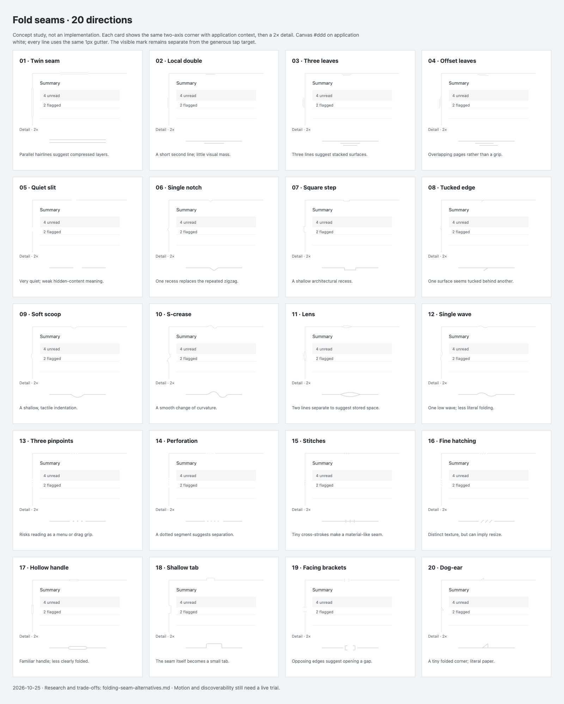

# Twenty fold seam directions

Status: option 16, Fine hatching, selected on 2026-10-25. The central zigzag trial prompted a broader exploration. Every proposal uses a canvas-coloured hairline on the application surface, matching the canvas gutter width, with a larger invisible tap target. The mark must suggest hidden content rather than navigation or resizing.

The [HTML study](folding-seam-alternatives.html) is the reproducible source. These are vector concepts in a common two-axis application context, with enlarged details, not captures of working controls. Corner junctions must remain continuous without accumulating borders.

## Published references

Research date: 2026-10-25. The alternatives are original adaptations, not twenty established standards.

- [Microsoft Excel](https://support.microsoft.com/en-us/excel/get-started/hide-or-show-rows-or-columns) explicitly uses double lines to indicate hidden rows and columns. This is the closest semantic precedent for compressed space.
- [Material bottom sheets](https://github.com/material-components/material-components-android/blob/master/docs/components/BottomSheet.md) include an optional drag handle. The handle association informs option 17 but can wrongly imply dragging here.
- [Atlassian navigation layout](https://atlassian.design/components/navigation-system/layout) distinguishes collapse toggles from panel splitters, which also support double-click collapse. Resize ambiguity deserves attention.
- [Carbon panel specifications](https://www.carbondesignsystem.com/building-blocks/core/components/ui-shell-right-panel/specifications) use layer and subtle-border tokens: a useful precedent for belonging to the host surface rather than adding an accent.
- [WAI window splitters](https://www.w3.org/WAI/ARIA/apg/patterns/windowsplitter/) describe adjustable pane boundaries. This does not make separator semantics appropriate for a click-to-unfold button.

## Alternatives

| # | Direction | Meaning and trade-off |
| --- | --- | --- |
| 1 | Twin seam | Parallel edges suggest compressed space; strongest precedent, more line work. |
| 2 | Local double | One short additional hairline; quiet and compact. |
| 3 | Three leaves | Stacked strokes; can imply several hidden items. |
| 4 | Offset leaves | Overlapping page edges; more decorative. |
| 5 | Quiet slit | Minimal interruption; could look like a rendering defect. |
| 6 | Single notch | One shallow angular recess instead of a repeated zigzag. |
| 7 | Square step | Architectural recess; possibly reads as a connector. |
| 8 | Tucked edge | One diagonal overlap suggests tucked material. |
| 9 | Soft scoop | Shallow rounded indentation; tactile and quiet. |
| 10 | S-crease | Smooth curvature change; softer but visually active. |
| 11 | Lens | Hairlines briefly separate around stored space. |
| 12 | Single wave | One low wave; hidden-content meaning must be learned. |
| 13 | Three pinpoints | Compact, but ambiguous with a menu or drag grip. |
| 14 | Perforation | Suggests separation or tearing. |
| 15 | Stitches | Tiny cross-strokes; can resemble measurement marks. |
| 16 | Fine hatching | Distinct texture; risks resembling a resize corner. |
| 17 | Hollow handle | Familiar handle, but suggests dragging. |
| 18 | Shallow tab | The seam becomes a small tab; costs more visual space. |
| 19 | Facing brackets | Opposing edges suggest opening a gap; may feel icon-like. |
| 20 | Dog-ear | Literal folded paper, better suited to Origami than neutral Veil. |

## Decision

Option 16, Fine hatching, is the accepted direction: three small diagonal strokes interrupt the hairline, with canvas ink on the application surface. Use the same gutter stroke width and rotate the motif for the other axis. Only the hatch handle opens the fold; preserve the existing fold transitions. The marker attaches to the ordinary gutter on the unfolding side, with a padded host-surface background. Its attached side is straight and its two outward corners have a 2px radius, both between cells and at viewport edges. The hatch always uses canvas colour and its rectangle uses host background, including on hover. The comparison sheet remains the accepted reference; the [live demo capture](../assets/captures/folding.png) shows the implementation. The earlier shortlist of 2, 9 and 11 was not selected.

The E motif's rotation offset and stroke mismatch are separate rendering defects. Correcting those does not establish visual acceptance. A selected replacement needs an actual-size trial in both themes, all four directions, joined corners, focus and both transition directions.

The fold reserves no space by default; `fold: { size }` opts a cell or row into a reservation. The handle has a 1px canvas-coloured outline over the host background. The canvas gutter remains visible at the viewport edge. Hosts may independently set the gutter to 0px while retaining the handle.
