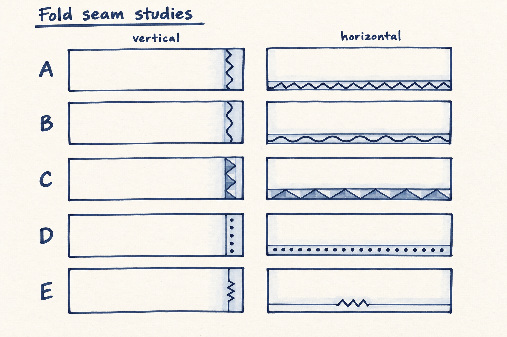

# Fold seam pattern studies

This explores a small, tappable visual seam for a folded cell or row. The sketch enlarges the seam for comparison; it is not a pixel specification. Each motif must work after rotation in both axes and remain distinct from a resize divider. Study E was trialled, then replaced by Fine hatching (option 16 in the later comparison).

| Study | Motif | Reading at a narrow size |
| --- | --- | --- |
| A | Continuous sharp zigzag | The most direct sign of alternating folds; strong even without an icon. |
| B | Continuous curve | Quiet, but less clearly folded. |
| C | Angular facets with alternating shade | Literal folded material; more visual mass than the seam can comfortably hold. |
| D | Dots | Compact, but easily mistaken for a drag grip or perforation. |
| E | Short central zigzag | Quieter than A, but its long straight sections resemble a resize divider. |

Bookbinding calls alternating opposite folds a [zigzag or concertina fold](https://blogs.brighton.ac.uk/viscommtech/bookarts/worksheets-for-bookbinders/the-zig-zag-fold/). Origami crease notation distinguishes mountain and valley folds and also uses dotted marks for cuts in some systems ([OrigamiUSA](https://origamiusa.org/thefold/article/evolution-notation-system)). These sources explain the visual associations, not measured usability in a tiny software control. Apple's [disclosure guidance](https://developer.apple.com/design/human-interface-guidelines/disclosure-controls) describes a directional symbol paired with content; the trial seam instead uses a short crease in a continuous line to signal folded space. The visual stays 12px wide or high and retains the 28px hit target.

The central zigzag trial prompted a broader [comparison of twenty directions](folding-seam-alternatives.md), with [a visual comparison sheet](folding-seam-alternatives.png). Option 16, Fine hatching, was selected on 2026-10-25.
