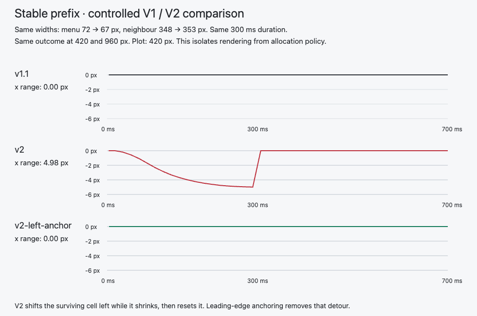
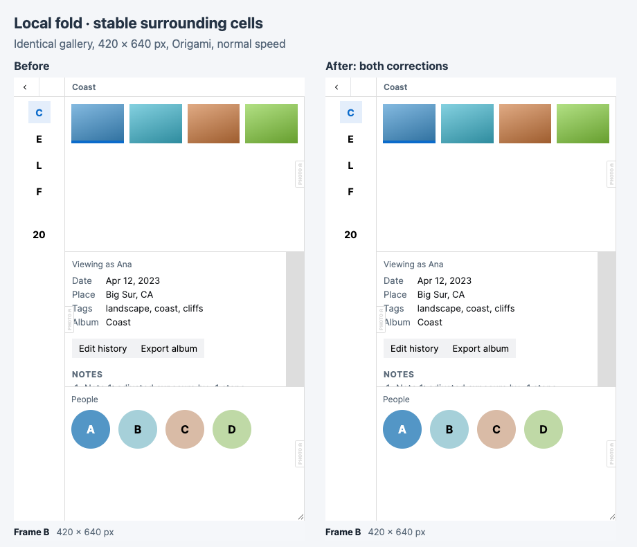

# Stable cells before a fold

Finding and correction, 2026-10-27. A fold interaction made a surviving cell before the fold move a few pixels sideways and return, even though its leading edge had no reason to move. The problem was reproducible in Supermax's renderer without a host application. The implementation now combines stable surviving-card anchoring with retention of feasible outer allocations. Neither correction requires host configuration.

The library revision under investigation is `laicluse/supermax@b20b32a`, with the Tiny5 title handles already implemented. The V1.1 comparison uses `laicluse/supermax@f2f4cc792021bac9a4f3db29d5392c29908249e6`. V1.1 has no native split-row folding; the controlled comparison therefore gives both strip implementations identical geometry changes rather than claiming their application features are equivalent.

## Observed behaviour

The native demo probe opens the Coast album and three photo branches, keeps the middle branch's metadata open, then resizes the frames. It focuses the first and last row selectors, slowly drags the last row's horizontal fold out and back, and rapidly alternates its native fold buttons. The larger case explicitly opens metadata, history and an edit to retain a horizontal fold. No host content actions are used in the rapid-button trace; the recorded events are `foldfocus` events.

The [native trace](fold-jitter.json) records these outcomes for the 420 × 640 frame:

| Presentation | Menu leading-edge range | Menu-item range | Menu target-width range |
| --- | --- | --- | --- |
| Veil | 0 px | 0 px | 0 px |
| Origami | 1.86 px | 1.86 px | 5 px |
| Paper Fold | 1.84 px | 1.84 px | 5 px |

The peak depends on when another click interrupts the movement. Slow out-and-back drags in this state did not move the menu. The selected 960 × 640 native sequence also did not change its menu target width and did not reproduce the movement. Those negative cases remain in the trace; the finding does not claim that every fold or every wide layout jitters.

## Why the movement appears

The fold changes which cell is protected in its chain. The split's width bounds use that active position, and the root chain redistributes its available width. In the reproduced narrow case the menu's target allocation changes by 5 px even though the viewport is unchanged. `keep: true` preserves visibility and minimum width; it does not freeze the menu's allocation. See [active-cell width bounds](../../src/layout.js) and [root-chain allocation](../../src/layout.js).

V2 separates the cell's working paper from the room that clips it. In [CellStrip's room animation](../../src/cell-strip.js), the `anchoredLeft` condition permits the existing-edge comparison only when `to > from`. A surviving card that shrinks therefore takes the other branch: its paper keeps the larger width while an animated `margin-left` moves it left. When the animation settles, `sync()` removes that margin and assigns the final width. That creates an extra sideways excursion followed by a return. Interrupting the animation repeats portions of this excursion, which looks like shaking.

V1.1 directly interpolates the cell element's width and applies a position correction only when its actual position changes. An unchanged leading edge stays fixed during the same small width reduction. V2's paper/room separation is useful for folding content, but the shrinking-card anchor rule also affects cells that survive before the fold.

## Controlled cause test

`node scripts/probe-prefix-motion.mjs` gives the first cell widths of 72 → 67 px and its neighbour the complementary width. The viewport stays fixed, and both versions use 300 ms. It samples painted element rectangles for 700 ms. The [measurements](fold-prefix-motion.json) show the same result at viewport widths of 420 and 960 px:

| Renderer | Leading-edge range |
| --- | --- |
| V1.1 | 0 px |
| Original V2 | 4.98 px |
| V2 with only the growth-only anchor restriction removed | 0 px |

The last variant was an in-memory module substitution in the probe. It removed only `to > from &&` from the edge-choice condition. This isolates the anchor rule from host CSS, animation duration, data loading and the width allocator. The same [temporary substitution in the native demo](fold-jitter-left-anchor.json) removed the measured menu and menu-item excursion while the 5 px target-width change remained. The controlled V1.1/V2 probe explicitly loads the original V2 renderer from `laicluse/supermax@b20b32a`, so the historical comparison remains reproducible after the correction.

## Separate and combined corrections

The native experiment runs four variants of the same gallery sequence. `node scripts/probe-fold-jitter.mjs --variant=baseline` loads the original renderer, navigator and allocator from `laicluse/supermax@b20b32a`. `--variant=anchor` substitutes only the corrected renderer; `--variant=allocation` substitutes only the corrected navigator and allocator; `--variant=combined` uses the complete implementation. The substitutions are confined to the probe's browser module responses. They add no production switches or host options.

In the 420 × 640 Origami and Paper Fold traces, the results are:

| Variant | Menu and menu-item movement | Menu target-width range |
| --- | --- | --- |
| Original V2 | 0.92 px | 5 px |
| Anchoring only | 0 px | 5 px |
| Allocation retention only | 0 px | 0 px |
| Both corrections | 0 px | 0 px |

These are fresh traces rather than a replacement of the original measurements above; interruption timing changes the observed peak. Veil at 420 px and the selected 960 px state did not reproduce the original jitter and remained stable in all variants. Slow out-and-back drags also retained stable surrounding cells. The raw traces preserve these negative cases: [baseline](fold-stability-baseline.json), [anchoring](fold-stability-anchor.json), [allocation](fold-stability-allocation.json), [combined](fold-stability-combined.json).

Both corrections are retained. Allocation retention removes unnecessary outer width changes during local folds. Anchoring independently removes the sideways excursion when width really must change, including viewport resizing and newly required minimums.

## Implemented behaviour and verification

The renderer permits the existing leading/trailing-edge comparison for a surviving visible card when its room shrinks as well as grows. A card directly making room for a newly opening neighbour retains its shared-edge slide; the existing neighbour-joining regression test checks that contract. Departing and folding cards also retain their existing treatment. The correction does not enlarge the stillness threshold or change the fold's timing, handle size or hit area.

Before a local fold command, the navigator captures the outer allocation. An internal WeakMap associates that measurement with the new focus object. It survives internal focus-array filtering and speculative fold-drag commit/cancel, without becoming an explicit session size or entering serialized snapshots. The allocator retains it only while viewport dimensions, occurrence identities, explicit width sizes, visible membership, fold state and current bounds remain compatible. Otherwise ordinary allocation runs. Layout queries do not capture or advance state. A new root-chain fold focus ends local retention.

The regression tests cover the 72 → 67 width reduction, interruption and reversal, both fold axes, centered menu content, Veil, Origami and Paper Fold, and 420 px and 960 px widths. Model cases cover minimum-pressure redistribution, actual resizing, explicit divider widths, JSON snapshot restoration, changed structure, repeated focus filtering, and speculative drag commit/cancel. A pre-existing session width resumes when a temporary active-cell minimum no longer overrides it. The retained width must satisfy the current session clamp, including surplus space an elastic cell absorbs. Existing reachability, drag, draft and gutter tests remain part of the full suite.

Final verification: `npm test` passed, including all 141 browser tests, the strip checks and the model suites. The running demo at `http://127.0.0.1:8260/` served byte-identical generated renderer, navigator and allocator assets.

[Normal-speed comparison](../assets/captures/fold-stability.mp4) · [Capture and four-variant measurements](fold-stability-verification.json). Refresh with `node scripts/capture-fold-stability.mjs` after running the four probe variants.

The comparison capture displayed approximately 60 fps in both panes, with median frame intervals of 16.7 ms and 95th-percentile intervals between 16.7 and 16.8 ms. The delivered video is H.264, `yuv420p`, 25 fps, with fast-start metadata; it preserves normal timing. The PNG shows the matching resting state, while the video and raw position traces show the transition.
